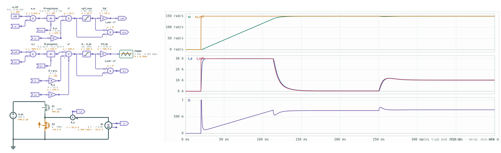

# Power Converter Lab 2

Εκπαιδευτικό εργαστήριο ηλεκτρονικών ισχύος. Σχεδιάζεις ή ανοίγεις ένα κύκλωμα, το προσομοιώνεις σε πραγματικό χρόνο και βλέπεις ρεύματα και τάσεις σε scopes ακριβώς κάτω από το κύκλωμα. Δίπλα έχεις τη θεωρία κάθε μετατροπέα, συγκριμένη με την προσομοίωση.

> **Έκδοση 3.0-alpha.2.** Σύρματα σημάτων και μπλοκ ελέγχου, και συνδέσεις χωρίς καλώδιο. Πρώτη σειρά με μπλοκ ελέγχου (μετρήσεις, πράξεις, συγκριτής, PI, z⁻¹, latch, ρολόι, φέρον). Άδεια: [PolyForm Noncommercial 1.0.0](LICENSE), δηλαδή ελεύθερη για μελέτη, διδασκαλία, έρευνα και προσωπική χρήση, όχι για εμπορική. Οι εκδόσεις 2.x μένουν με άδεια MIT.


## Γρήγορη αρχή για φοιτητές

1. Κατέβασε το zip της τελευταίας έκδοσης και στήσε το με Anaconda: δες την «Εκτέλεση με Anaconda» αμέσως παρακάτω. Είναι τέσσερις εντολές, μία φορά.
2. `python run.py` ανοίγει την εφαρμογή στον browser.
3. **Tutorials** πάνω αριστερά. Για την Άσκηση 2 της Ηλεκτρονικής Ισχύος ΙΙ:
   - **«Άσκηση 2 · Επίδραση δειγματοληψίας»** και **«Άσκηση 2 · Πολυφασική σχεδίαση»**,
   - στις επιλογές πάνω από το κύκλωμα αλλάζεις περίπτωση, τάση, έλεγχο,
   - με ▶ τρέχει η προσομοίωση, και ο πίνακας «Ζωντανές παράμετροι» (πλήκτρο P) αλλάζει τιμές χωρίς παύση.
4. Στους **«Υπολογισμούς & μαθηματικά»**, καρτέλα **«Ερωτήσεις»**:
   - απάντησε πριν δεις τη λύση,
   - σε λάθος απάντηση το εργαλείο δείχνει το πιθανό λάθος ή το βήμα όπου αποκλίνεις,
   - με «Δείξε μου τη λύση» βλέπεις τη λύση και τη σύγκριση με την προσομοίωση.
5. Η κάρτα **«Θεωρία & σύγκριση»** στο τέλος της σελίδας συγκρίνει τους τύπους με την προσομοίωση.

Τα αποτελέσματα είναι **πρόταση σχεδιασμού** για μελέτη και έλεγχο, όχι έτοιμη λύση εργασίας.

**Σχόλια και προβλήματα:** στο [GitHub Issues](https://github.com/ThanosZr/power-control-lab/issues/new/choose) (υπάρχουν έτοιμες φόρμες «Πρόβλημα» και «Σχόλιο ή πρόταση») ή στο Discord.

## Εκτέλεση με Anaconda

**1. Anaconda.** Αν δεν το έχεις, εγκατέστησε το [Anaconda](https://www.anaconda.com/download) ή το μικρότερο Miniconda.

**2. Άνοιξε τον φάκελο.** Αποσυμπίεσε το zip. Άνοιξε **Anaconda Prompt** (Windows) ή terminal (Linux/macOS) και πήγαινε στον φάκελο που έχει το `run.py`:

```bash
# Windows (Anaconda Prompt)
cd %USERPROFILE%\Downloads\Power_Converter_Lab_2_3_2
# Linux / macOS
cd ~/Downloads/Power_Converter_Lab_2_3_2
```

**3. Εγκατάσταση, μία φορά.** Φτιάχνεις περιβάλλον και περνάς τα requirements:

```bash
conda create -n pcl python=3.12 -y
conda activate pcl
pip install -r requirements.txt
```

**4. Εκτέλεση, κάθε φορά:**

```bash
conda activate pcl
python run.py
```

Ο browser ανοίγει μόνος του στο `http://127.0.0.1:8765`. Άφησε το παράθυρο του Anaconda Prompt ανοιχτό όσο δουλεύεις. Το Ctrl+C σταματά τον server.

Επιλογές:
- `python run.py --port 8800`, αν η θύρα 8765 είναι πιασμένη,
- `python run.py --no-browser`, για να μην ανοίξει αυτόματα ο browser.

Η προσομοίωση τρέχει μέσα στον browser. Η Python χρειάζεται για τη θεωρία (SymPy), για τον λύτη αναφοράς (SciPy) και για να σερβίρει τη σελίδα.

<details><summary>Χωρίς Anaconda (Python 3.10+ με venv)</summary>

```bash
# Linux / macOS
python3 -m venv .venv
source .venv/bin/activate
pip install -r requirements.txt
python run.py
```

```powershell
# Windows
py -3 -m venv .venv
.\.venv\Scripts\activate
pip install -r requirements.txt
python run.py
```

Στα Windows υπάρχουν και έτοιμα scripts: `INSTALL.ps1` μία φορά, μετά `START.ps1`.
</details>

## Τι περιέχει

| Περιοχή | Τι κάνει |
|---|---|
| **Κύκλωμα** | Βιβλιοθήκη στοιχείων: πηγές DC/AC/ρεύματος, τριφασική πηγή (Y), R, L, C, διακόπτης MOSFET ή IGBT με αντιπαράλληλη δίοδο, δίοδος, θυρίστορ, μετασχηματιστής με L_m, σκέδαση και αντιστάσεις τυλιγμάτων, φορτίο σταθερής ισχύος, PWM/έλεγχος, Sample & Hold. Ορθογώνια σύρματα με αυτόματη δρομολόγηση γύρω από τα σύμβολα. |
| **Προσομοίωση** | Τρέχει ζωντανά. Αλλάζεις τιμές ή το D την ώρα που τρέχει, από τον πίνακα **Ζωντανές παράμετροι** πάνω από το scope (κουμπί ή πλήκτρο P). Ορίζεις μέθοδο (τραπεζοειδής, Gear/BDF2, backward Euler), ταχύτητα, βήμα Δt και διάρκεια (εύρος προσομοίωσης), ή κάνεις άμεσο υπολογισμό έως το τέλος. Το μπλοκ PWM δίνει σταθερό D, πρόγραμμα D(t), PI/PID (K_d με φίλτρο), SPWM ή δύο εξόδους. |
| **Ζωντανές παράμετροι** | Πίνακας πάνω από το scope που εμφανίζεται και κρύβεται: D, αναφορά του PI, m του SPWM, γωνία α, μετατόπιση φέροντος, κανόνας δειγματοληψίας του S&H, με ζωντανές ενδείξεις. Κάθε αλλαγή κατά την προσομοίωση σημειώνεται στο scope με τον χρόνο της. Οι αλλαγές του D και της αναφοράς γίνονται με ένα κουμπί πρόγραμμα «t:τιμή», ώστε με ⟲ να ξαναπαίζεται η ίδια προσομοίωση. Από την 3.7 και οποιαδήποτε αριθμητική παράμετρος με 📌 από το πάνελ παραμέτρων. |
| **Δειγματοληψία** | Μπλοκ Sample & Hold: μετρά ρεύμα ή τάση οποιουδήποτε στοιχείου σε σημεία του φέροντος ενός PWM: στην αρχή της περιόδου (reset πριονωτού ή μέγιστο τριγώνου), στο μέσο της, ή και στα δύο. Τα δείγματα είναι συμβάντα του λύτη: παίρνονται ακριβώς στη στιγμή τους, πριν από την ενημέρωση του ελεγκτή και τις μεταγωγές της ίδιας στιγμής. Στο scope φαίνονται ως κουκκίδες, με την κρατημένη τιμή ως βαθμίδες. Το PWM δείχνει και το φέρον c(t). Ο βρόχος PI μπορεί να μετρά το δείγμα αντί για τη στιγμιαία τιμή. |
| **Μπλοκ σημάτων (3.0)** | Ομάδα «Σήματα» στη βιβλιοθήκη: βολτόμετρο, αμπερόμετρο σε σειρά, μέτρηση στοιχείου, σταθερά ή πρόγραμμα, κέρδος, άθροισμα, γινόμενο, διαίρεση, κορεσμός, συγκριτής με υστέρηση, λογικές πύλες, PI διακριτός, καθυστέρηση z⁻¹, SR latch, ρολόι, φέρον/ράμπα, ένδειξη, ετικέτες Goto/From. Από την 3.1: συνεχής ολοκληρωτής, βαθυπερατό 1ης τάξης, Clarke και Park (και αντίστροφοι), τριφασικό PLL, PI με back-calculation. Ενώνονται με σύρματα σημάτων (μωβ, με βέλος). Το PWM παίρνει το D από ακροδέκτη, ο διακόπτης την πύλη από σήμα, το Sample & Hold μετρά και σήμα. Λεπτομέρειες στις ενότητες «Μπλοκ σημάτων» και «Ηλεκτρική κίνηση». |
| **Μπλοκ κώδικα (3.3)** | Ομάδα «Κώδικας»: **μπλοκ έκφρασης** y = f(είσοδοι, σταθερές, t) με ασφαλή parser, που υπολογίζεται σε κάθε βήμα, και **μπλοκ Python** με συναρτήσεις `init(p)` και `step(t, u, s, p)`, που τρέχει στα δείγματα ενός ρολογιού, όπως ο κώδικας σε μικροελεγκτή. Είσοδοι, έξοδοι και παράμετροι με ονόματα που δίνει ο χρήστης. Επεξεργασία του κώδικα στον inspector, με μηνύματα λάθους με τη γραμμή. |
| **Μηχανή επαγωγής και τριφασικός αντιστροφέας (3.4)** | Μηχανή επαγωγής με μοντέλο ανάστροφο-Γ (R_s, R_R, L_σ, L_M, p, J, b), με σήματα ω, τ_e, |ψ_R|, θ_f (πραγματική γωνία της ροής) και θ_r. Τριφασικός διαμορφωτής (SPWM, SVPWM, τετραγωνική) με ένα duty ανά σκέλος, και εκτιμητής ροής δρομέα (μοντέλο ρεύματος). |
| **Πολυθυρικά στοιχεία, σύγχρονη μηχανή, κεραυνικό ρεύμα (3.5)** | Συζευγμένα πηνία N×N (k κοινό ή ανά ζεύγος, ή ολόκληρος πίνακας L) και πολυθυρική αντίσταση/αγωγιμότητα. Σύγχρονη μηχανή με L_d, L_q, ψ_m: SynRM (ψ_m = 0), SPMSM, IPMSM, με σήματα ω, τ_e, θ, i_d, i_q. Πηγή κεραυνικού ρεύματος Heidler (IEC 62305-1: 10/350, 1/200, 0,25/100 μs) ή με προσαρμογή σε άλλο T1/T2. Όλα και στον λύτη SciPy. |
| **SRM και κορεσμός (3.6)** | Μηχανή μαγνητικής αντίστασης με διακόπτες 6/4, 8/6, 12/8 με ψ(θ, i) από παραμέτρους ή από πίνακα (μετρήσεις ή FEM), ροπή από τη συνενέργεια, έξοδοι ω, τ_e, θ και ρεύματα φάσεων, κανάλια ψ. Κορεσμός L_d στη σύγχρονη μηχανή. Και στον λύτη SciPy. |
| **Σχεδίαση και πάνελ παραμέτρων (3.7)** | Πλευρικό πάνελ παραμέτρων που συμπτύσσεται σε λωρίδα (πλήκτρο I), με ενότητες που ανοιγοκλείνουν. 📌 σε κάθε αριθμητική παράμετρο: μπαίνει με ρυθμιστή στις ζωντανές παραμέτρους. Εργαλείο σύρματος (W) με ελεύθερα άκρα, κούμπωμα σε ακροδέκτη ή σύρμα, στοιχεία και probes τάσης και ρεύματος που κουμπώνουν πάνω στο σύρμα. Επιλογές για ασύνδετα στοιχεία και αιωρούμενα τμήματα, με διάγνωση. |
| **Οδεύοντα κύματα και κρουστικές τάσεις (3.8)** | Γραμμή μεταφοράς χωρίς απώλειες (Bergeron): Z και τ, ή μήκος και ταχύτητα, ή L′, C′. Πηγή κρουστικής τάσης 1,2/50 και 250/2500 (IEC 60060-1) ή άλλη T1/T2. Tutorial οδευόντων κυμάτων με διάγραμμα Bewley και την άσκηση 15.4.9 του βιβλίου «Υψηλές Τάσεις». Αναφορά επαλήθευσης `docs/VERIFICATION.md`. |
| **Σενάρια στην εφαρμογή, MATLAB και Octave (3.14)** | Πάνελ «Σενάρια (Python)» με Pyodide σε Worker πάνω στο κύκλωμα της οθόνης: σαρώσεις, πίνακες, γραφήματα, λήψη CSV/JSON/.mat. `pcl_run`, `pcl_sweep`, `pcl_read` για MATLAB και Octave. `/api/scenario_run` και `/api/scenario_sweep` τοπικά. |
| **Βήμα του λύτη, κονσόλα διαγνωστικών, σενάρια από κώδικα (3.13)** | Μεταβλητό βήμα με έλεγχο σφάλματος (επιλογή «σταθερό / μεταβλητό» δίπλα στο «Βήμα Δt»). Έλεγχος βήματος: σταθερές χρόνου και ταλαντώσεις του κυκλώματος, πηγές και γραμμές απέναντι στο βήμα, με το στοιχείο και την πρόταση. Κονσόλα διαγνωστικών κάτω από το scope με ομάδες, φίλτρα και φωτισμό του στοιχείου, και τα μηνύματα του server. Πακέτο Python `pcl` και γραμμή εντολών `python -m pcl`: αλλαγή παραμέτρων, προσομοιώσεις, σαρώσεις, CSV/JSON/.mat. |
| **Μετρήσεις υψηλής τάσης, στατιστική διάσπασης (3.12)** | Tutorials «Καταμεριστές» (15.1.3, 15.1.5) και «Γέφυρα Schering» (15.5.12) με φασιθέτες στην κάρτα. Templates στατιστικής διάσπασης (πολλαπλά επίπεδα, διαδοχικές εκκενώσεις, up-and-down). |
| **Γραμμή με απώλειες, τάση–χρόνος, ασκήσεις 15.3 (3.11)** | Γραμμή Bergeron με αντίσταση σειράς σε τμήματα (Dommel). Σπινθηριστής με καμπύλη τάσης–χρόνου (κριτήριο ενέργειας διάσπασης). Tutorials «Ασκήσεις 15.3», «Γραμμή με απώλειες», «Καμπύλη τάσης–χρόνου». Υπολογισμοί υψηλών τάσεων ως templates. |
| **Σπινθηριστής, Marx, αποκομμένα κύματα (3.10)** | Σπινθηριστής (τάση διάσπασης, έναυση με εντολή, σβέση στον μηδενισμό ρεύματος ή κάτω από I_ext). Tutorials γεννήτριας Marx (σχήμα 3.19 του βιβλίου) και αποκομμένης κρουστικής τάσης. Γραμμή Bergeron, αλεξικέραυνο και σπινθηριστής και στον λύτη SciPy. |
| **Αλεξικέραυνο και εγχειρίδιο θεωρίας (3.9)** | Αλεξικέραυνο MOV (i = I_ref·(v/U_ref)^α ή πίνακας ρεύματος–τάσης) με Newton σε κάθε βήμα, πηγή ράμπας, tutorial απόστασης προστασίας (άσκηση 15.5.3). Εγχειρίδιο θεωρίας `docs/THEORY.md`: εξισώσεις, παραδοχές και βιβλιογραφία για τον λύτη και κάθε μοντέλο. |
| **Μηχανή ΣΡ (3.1)** | Ομάδα «Μηχανές»: μηχανή ΣΡ ανεξάρτητης διέγερσης. Το τύμπανο (R_a, L_a) συνδέεται με γυρατή ψ στο μηχανικό μέρος, που είναι ισοδύναμο κύκλωμα: η τάση του κόμβου είναι το ω, πυκνωτής το J, αγωγιμότητα η τριβή b, πηγή ρεύματος η ροπή φορτίου (τιμή, πρόγραμμα ή σήμα). Έξοδοι σημάτων ω και τ_e. |
| **Παλμοί πύλης** | Κάθε διακόπτης και θυρίστορ δίνει στο scope τον παλμό που δέχεται (1 = ON, 0 = OFF), μετά τον νεκρό χρόνο. Στις «Ζωντανές παράμετρους» κάθε PWM έχει κουμπιά «⌁ D» και «⌁ παλμοί», και με πολλά PWM το «⌁ παλμοί όλων» φέρνει έναν παλμό ανά PWM. Όταν ένα παράθυρο του scope έχει μόνο παλμούς, ο καθένας σχεδιάζεται στη δική του λωρίδα. |
| **Διακόπτες** | MOSFET: R_on, άγει και ανάστροφα. IGBT: V_ce0 + R_on, μόνο ορθή φορά. Δίοδος σώματος με δικά της V_f, R_on. Νεκρός χρόνος στο PWM (κάθε έξοδος ανάβει t_d αργότερα). Απώλειες μεταγωγής E_on/E_off στις V_ref, I_ref, κλιμακωμένες με \|v\|·\|i\| τη στιγμή της μεταγωγής, ως σήμα p_sw (μέση ανά περίοδο). Θυρίστορ με γωνία α ως προς πηγή AC (μετατόπιση, διάρκεια παλμού) ή από PWM. Η α αλλάζει ζωντανά. |
| **Scopes** | Πολλά παράθυρα, κύλιση ή συγχρονισμός στην περίοδο, στιγμιαίες τιμές ή μέση ανά περίοδο με σκιά min–max, cursors A/B, μετρήσεις (μέση, RMS, min, max, p-p), εξαγωγή CSV. Γραμμή πλοήγησης (ανοίγει/κλείνει από τη γραμμή χειρισμού): αρχή, ◀ ▶, ζωντανά, **ακολούθηση** (η ροδέλα αλλάζει μόνο το πλάτος), εστίαση 3T, zoom, όλη η διαδρομή, αυτόματη κλίμακα. |
| **Αρμονικές και THD (3.1)** | Στο πλάι του scope: σειρά Fourier ενός σήματος πάνω σε 1–10 περιόδους της θεμελιώδους (αυτόματα από την πηγή AC, την αναφορά SPWM ή το PLL), έως την αρμονική 500. Ραβδόγραμμα σε % της θεμελιώδους, DC, πλάτος και RMS θεμελιώδους, THD ως την επιλεγμένη αρμονική και THD όλου του φάσματος από την RMS. Τα σημεία του λύτη ενώνονται με ευθείες και ολοκληρώνονται ακριβώς, χωρίς επαναδειγματοληψία. |
| **Διακλαδώσεις και Poincaré (3.2)** | Στο πλάι του scope. **Χάρτης Poincaré:** το δείγμα κάθε περιόδου (π.χ. το ρεύμα στο ρολόι) σε σχέση με το προηγούμενο, με σκάλα (cobweb) των τελευταίων περιόδων και διάγνωση 1T, 2T, 4T… ή χωρίς περίοδο. Στο current-mode buck σχεδιάζεται και ο ιδανικός χάρτης. **Διάγραμμα διακλάδωσης:** σάρωση οποιασδήποτε αριθμητικής παραμέτρου (V_o, i_c, R, L…), με μεταβατικό και καταγραφή σε περιόδους, και πίνακας με τα σημεία όπου αλλάζει η περίοδος. |
| **Εμπέδηση (EIS, 3.3.1)** | Στο πλάι του scope: σάρωση της συχνότητας μιας διαταραχής (οποιασδήποτε αριθμητικής παραμέτρου), Z = V₁/I₁ από τη σειρά Fourier της τάσης και του ρεύματος, με αφαίρεση ολίσθησης, διαγράμματα Nyquist και Bode, και πίνακας με τη θεωρητική τιμή όπου υπάρχει. |
| **Δείκτες απόκρισης** | Στο πλάι του scope: για ένα σήμα και ένα βήμα (αναφοράς, φορτίου, τάσης, D) δίνει αρχική/τελική τιμή, υπερύψωση, χρόνο ανόδου 10–90 %, χρόνο κορυφής, αποκατάσταση στη ζώνη ±2 %, σφάλμα μόνιμης κατάστασης, IAE, ISE, ITAE. Για βήμα φορτίου δίνει μέγιστη απόκλιση και χρόνο επαναφοράς. Υπολογίζονται από τις μέσες τιμές ανά περίοδο. |
| **Λύτης αναφοράς (server)** | Το ίδιο κύκλωμα λύνεται με το `solve_ivp` του SciPy: Radau, BDF, LSODA (άκαμπτα) ή RK45, RK23, DOP853, με rtol/atol και μέγιστο βήμα. Οι μεταγωγές και τα δείγματα των S&H είναι συμβάντα. Το αποτέλεσμα σχεδιάζεται διακεκομμένο πάνω στα σήματα του scope, με πίνακα διαφορών (μέση τελευταίας περιόδου, RMS, 95 %) και σύγκριση των στιγμών και τιμών των δειγμάτων. |
| **Tutorials** | Buck, Boost, Buck–boost, Ćuk, SEPIC, Flyback (και με σκέδαση + RCD clamp), full-bridge DC-DC, μονοφασικός αντιστροφέας SPWM, ανορθωτής γέφυρας που φορτίζει μπαταρία, ελεγχόμενος ανορθωτής με θυρίστορ (R ή R–L), τριφασική γέφυρα 6 παλμών (δίοδοι ή θυρίστορ), buck με βρόχο τάσης (PI ή PID, βήμα αναφοράς και φορτίου), αμφίδρομος μετατροπέας μπαταρίας (PE2, και με πραγματικούς διακόπτες), Άσκηση 2: επίδραση δειγματοληψίας και πολυφασική σχεδίαση. Από την 3.0: βρόχος ρεύματος από μπλοκ και peak current-mode με υποαρμονική. Από την 3.1: μηχανή ΣΡ με βρόχους ρεύματος και ταχύτητας. Από την 3.2: valley current-mode και διακλαδώσεις και χάος στο peak current-mode (boost). Από την 3.3: PI σε Python. Από την 3.3.1: δοκιμή κυψέλης με EIS. Από την 3.4: μηχανή επαγωγής με V/f και με διανυσματικό έλεγχο. Από την 3.5: SynRM (ευθυγράμμιση, έλεγχος dq, MTPA), PMSM/IPMSM (i_d = 0 και MTPA), κεραυνικό ρεύμα Heidler. Από την 3.6: SRM 8/6 με βρόχο ψ–i, SynRM με κορεσμό. Από την 3.8: οδεύοντα κύματα σε γραμμή Bergeron, με την άσκηση 15.4.9 του βιβλίου «Υψηλές Τάσεις». Από την 3.9: αλεξικέραυνο και απόσταση προστασίας (15.5.3). Από την 3.10: γεννήτρια Marx, αποκομμένη κρουστική τάση. Από την 3.11: οι ασκήσεις 15.3.1–15.3.7 (γεννήτριες κρουστικών), γραμμή με απώλειες, καμπύλη τάσης–χρόνου διακένου. Από την 3.12: καταμεριστές και γέφυρα Schering. |
| **Υπολογισμοί & μαθηματικά** | Κάτω από την προσομοίωση, με καρτέλες. Για Buck/Boost/Buck–boost/Flyback η τοπολογία **αναγνωρίζεται από τη συνδεσμολογία** και οι τιμές διαβάζονται από τα στοιχεία. Εμφανίζονται: μοντέλο κυκλώματος, περιοχή λειτουργίας (K, K_crit, L_crit), M(D) σε CCM, DCM και όριο BCM με αντικατάσταση και γράφημα, κυμάτωση τάσης και ρεύματος, ρεύματα/RMS, G_vd(s) με Bode, απόδειξη μοντέλου. Για την άσκηση της μπαταρίας: ερωτήματα 2–5, δοκιμές και ρυθμίσεις PLECS, έλεγχος, σύστημα. |
| **Σύγκριση** | Θεωρία και προσομοίωση δίπλα-δίπλα σε κάθε tutorial. Αν αλλάξεις στοιχεία ή συνδέσεις, η κάρτα θεωρίας το εντοπίζει και προειδοποιεί, με κουμπί επαναφοράς. |
| **Αναλυτικοί πάγκοι** | `/converter/`: ο πλήρης CCM/DCM σχεδιαστής του v1. Το «Άνοιγμα στο studio» μεταφέρει το κύκλωμα με τις τιμές του και με αρχικές συνθήκες μόνιμης κατάστασης. `/bidirectional/`: η άσκηση PE2 με τα ερωτήματα 2–5 και τον οδηγό PLECS. |

## Μπλοκ σημάτων (3.0)

Από την 3.0 ο έλεγχος σχεδιάζεται και με μπλοκ, όπως στο PLECS, εκτός από τις έτοιμες ρυθμίσεις του PWM.

- **Σύρματα σημάτων:**
  - οι ακροδέκτες σημάτων είναι μικροί μωβ κύκλοι: γεμάτος για έξοδο, άδειος για είσοδο,
  - τα σύρματα σημάτων είναι λεπτότερα, μωβ, με βέλος στην είσοδο που τροφοδοτούν,
  - ένα σύρμα σήματος **δεν ενώνεται ποτέ** με ηλεκτρικό κόμβο: το εργαλείο το απορρίπτει με εξήγηση. Για να φέρεις ένα μέγεθος του κυκλώματος σε σήμα, βάζεις βολτόμετρο, αμπερόμετρο σε σειρά ή «Μέτρηση στοιχείου».
- **Σύνδεση με το κύκλωμα:**
  - PWM με τρόπο «D από σήμα»: το D διαβάζεται από τον ακροδέκτη d στα σημεία ενημέρωσης (αρχή περιόδου, και στο ελάχιστο του τριγώνου με διπλή ενημέρωση),
  - διακόπτης με οδήγηση «Από σήμα»: εμφανίζεται ακροδέκτης πύλης g, ON όταν το σήμα είναι ≥ 0,5,
  - Sample & Hold με είσοδο «Σήμα»: δειγματοληπτεί ό,τι φτάνει στο u. Η κρατημένη τιμή βγαίνει πάντα στο y,
  - PI, z⁻¹ και Sample & Hold ενημερώνονται σε σημεία του φέροντος ενός PWM ή στις ακμές ενός μπλοκ «Ρολόι».
- **Σύνδεση χωρίς καλώδιο (3.0-alpha.2):**
  - **πεδίο «Πηγή»:** στις ρυθμίσεις κάθε μπλοκ διαλέγεις από ποια έξοδο παίρνει σήμα κάθε είσοδος, π.χ. «latch.q» για την πύλη του S1. Δίπλα στην είσοδο φαίνεται «← latch.q»,
  - **ετικέτες «προς» και «από» (Goto/From), όπως στο PLECS:** ό,τι μπαίνει στην ετικέτα «προς g_S1» βγαίνει από κάθε ετικέτα «από g_S1»,
  - και οι δύο τρόποι ισοδυναμούν με σύρμα: ίδια σειρά υπολογισμού, ίδιος έλεγχος βρόχων, ίδια συμπεριφορά στον λύτη SciPy,
  - προειδοποιήσεις για ετικέτα χωρίς ζευγάρι, για διπλό όνομα και για πηγή που δεν υπάρχει.
- **Πώς υπολογίζονται:**
  - σε κάθε στιγμή τα μπλοκ υπολογίζονται με σειρά εξάρτησης: κάθε μπλοκ μετά από όσα διαβάζει άμεσα. Η κάρτα θεωρίας δείχνει αυτή τη σειρά,
  - ένας κλειστός βρόχος χωρίς καθυστέρηση (αλγεβρικός βρόχος) αναφέρεται ως σφάλμα με τα μπλοκ του βρόχου, π.χ. «GN1 → SUM1 → GN1». Δεν λύνεται με κρυφή καθυστέρηση. Μια z⁻¹ μέσα στον βρόχο τον σπάει,
  - η στιγμή που αλλάζει ένας συγκριτής εντοπίζεται **μέσα στο βήμα** του λύτη, όπως οι μεταβάσεις των διόδων. Έτσι το peak current-mode φτιάχνεται από γενικά μπλοκ, χωρίς ειδικό κώδικα,
  - ρολόγια, ράμπες, προγράμματα και διακριτές ενημερώσεις είναι συμβάντα του λύτη,
  - ο λύτης SciPy του server υπολογίζει τα ίδια μπλοκ. Τους συγκριτές τους βρίσκει ως ρίζες του `solve_ivp`.
- **Scope και ζωντανές παράμετροι:**
  - κάθε έξοδος μπλοκ μπαίνει στο scope (δεξί κλικ → Scope),
  - οι λογικές έξοδοι (συγκριτής, latch, ρολόι, πύλες) σε ένα δικό τους παράθυρο σχεδιάζονται σε λωρίδες,
  - οι σταθερές αλλάζουν εν κινήσει από τις «Ζωντανές παραμέτρους», και οι αλλαγές γίνονται πρόγραμμα t:τιμή.

Δύο tutorials στην ομάδα **«Μπλοκ σημάτων (3.0)»**:

- **Βρόχος ρεύματος από μπλοκ.** Buck 48 V προς μπαταρία 24 V. Αναφορά → άθροισμα → PI → PWM, με το ρεύμα από αμπερόμετρο σε σειρά.
  - Επιλογές: PI από μπλοκ ή ο ενσωματωμένος, PWM με είσοδο d ή φέρον + συγκριτής, χωρίς ή με z⁻¹.
  - Ο PI από μπλοκ δίνει **ακριβώς** το D του ενσωματωμένου. Το φέρον με τον συγκριτή δίνει το ίδιο με το PWM.
  - Επειδή ο PI μετρά στο reset του πριονωτού, κρατά την κοιλάδα στην αναφορά και η μέση τιμή βγαίνει i_ref + Δi/2, όπως στην Άσκηση 2.
  - Η z⁻¹ αφαιρεί ω_c·T ≈ 18° περιθωρίου φάσης: η υπερύψωση της κοιλάδας μετά το βήμα πάει από 13 % σε 21 %.
- **Peak current-mode και υποαρμονική.** Buck 24 V προς μπαταρία, 100 kHz, χωρίς μπλοκ PWM: ρολόι → SET του latch, (i_L + ράμπα) ≥ i_c → RESET.
  - Επιλογές: D = 0,4 / 0,6 / 0,7 και ράμπα 0, m₂/2 ή m₂.
  - Η κάρτα θεωρίας δίνει m₁, m₂, m_a, τον συντελεστή λ = (m_a − m₂)/(m₁ + m_a), την ελάχιστη ράμπα, την κορυφή i_c − m_a·D·T, και το duty και την κορυφή των τελευταίων περιόδων με διάγνωση (σταθερό ή υποαρμονική).
  - Με D = 0,6 χωρίς ράμπα: λ = −1,5 και το duty αλλάζει από περίοδο σε περίοδο. Με m₂/2: σταθερό, Î = 4,136 A όπως η θεωρία. Το ίδιο βγαίνει με μικρότερο βήμα και στον λύτη SciPy.
  - Template `pcm_slope` με τέσσερις ερωτήσεις πρόβλεψης: λ, σταθερότητα, ελάχιστη ράμπα, κορυφή.


### Υποαρμονικές και χάος στο current-mode (3.2)

- **Valley current-mode** στο ίδιο tutorial (επιλογή «Έλεγχος»): το ρολόι σβήνει τον S1 και ο συγκριτής τον ανάβει όταν i_L = i_c + ράμπα. Το SET περνά από AND με το ανεστραμμένο ρολόι, ώστε το latch να βλέπει ακμή μετά από κάθε παλμό του ρολογιού.
  - λ = (m_a − m₁)/(m₂ + m_a). Χωρίς ράμπα λ = −(1 − D)/D: ασταθές για D < 0,5, το αντίστροφο του peak.
  - Η κάρτα θεωρίας δίνει λ, ελάχιστη ράμπα (m₁ − m₂)/2, κοιλάδα i_c + m_a(1 − D)T, κορυφή στο ρολόι.
- **Στο peak:** και το Q = 1/(π(m_c(1 − D) − 0,5)) του ζεύγους πόλων στο f_s/2 (Ridley).
- **Χάρτης «δείγμα στο ρολόι → επόμενο δείγμα»:** δύο ευθύγραμμα κομμάτια, με κλίση λ και 1. Με μπαταρία στην έξοδο η λειτουργία γίνεται χαοτική μόλις |λ| > 1, χωρίς τη διαδοχή 2T → 4T. Ο χάρτης Poincaré της προσομοίωσης πέφτει πάνω στον ιδανικό.
- **Tutorial «Διακλαδώσεις και χάος στο peak current-mode (boost)».** Boost 10 V με φορτίο R–C (L = 1 mH, C = 12 μF, R = 20 Ω, T = 100 μs, το παράδειγμα των Deane & Hamill), με το i_c ως παράμετρο:
  - 1T έως περίπου 1,65 A, 2T έως 2,37 A, 4T έως 2,62 A, 8T, χάος από 2,70 A,
  - ο πυκνωτής κάνει τον χάρτη δισδιάστατο, γι' αυτό ο πρώτος διπλασιασμός έρχεται στο D ≈ 0,4 αντί για 0,5,
  - η σάρωση του i_c στο «Διακλαδώσεις και Poincaré» δίνει το διάγραμμα διακλάδωσης.
- Template `pcm_slope`: και λ του valley, περιοχή αστάθειας του valley, Q του Ridley.

**Τι δεν έχουν ακόμη τα μπλοκ:** υποκυκλώματα, θύρες με μονάδες και διανύσματα, αρχείο συμβάντων, μπλοκ έκφρασης/Python.

## Μπλοκ κώδικα (3.3)

- **Μπλοκ έκφρασης:** π.χ. `clamp(u + vo/vin, 0, 0.95)` ή `v*i`.
  - Πράξεις + − * / ^ %, συγκρίσεις (δίνουν 1 ή 0), && || !, `c ? a : b`, και οι συνηθισμένες συναρτήσεις (sin, exp, sqrt, min, max, atan2, clamp, mod…).
  - Ονόματα: οι είσοδοι, οι σταθερές του μπλοκ, `t`, `pi`, `e`.
  - Υπολογίζεται σε κάθε βήμα του λύτη, χωρίς καθυστέρηση. Λάθος στην έκφραση γίνεται προειδοποίηση και η έξοδος μένει 0.
- **Μπλοκ Python:** ο χρήστης γράφει τον κώδικα, για παράδειγμα ένα PI:

  ```python
  def init(p):
      return {"xi": 0.0}

  def step(t, u, s, p):          # u: είσοδοι, s: κατάσταση, p: παράμετροι και p["Ts"]
      e = u["e"]
      s["xi"] += p["Ki"] * p["Ts"] * e
      return {"u": p["Kp"] * e + s["xi"]}
  ```

  - Καλείται στα δείγματα ενός PWM ή ενός μπλοκ «Ρολόι» (αρχή, μέσο ή και τα δύο), μία φορά ανά δείγμα. Η έξοδος μένει σταθερή ως το επόμενο.
  - Η κατάσταση μηδενίζεται με την προσομοίωση. Αν αλλάξει ο κώδικας την ώρα που τρέχει, ξεκινά από `init`.
  - Στον browser τρέχει με το **Pyodide** (Python σε WebAssembly), χωρίς εγκατάσταση. Φορτώνεται την πρώτη φορά που ένα κύκλωμα έχει μπλοκ Python, από τοπικό αντίγραφο αν υπάρχει, αλλιώς από το CDN (χρειάζεται internet). Για χρήση χωρίς internet: `python tools/get_pyodide.py` (μία φορά).
  - Στον λύτη αναφοράς του server ο ίδιος κώδικας τρέχει με την κανονική Python, μόνο όταν ο server τρέχει τοπικά (`python run.py`, 127.0.0.1).
- **Tutorial «PI σε Python και feedforward με έκφραση»** (ομάδα «Μπλοκ κώδικα (3.3)»): ο buck → μπαταρία του βρόχου από μπλοκ, με τον PI σε Python.
  - Δίνει το ίδιο D με το μπλοκ «PI διακριτός» (ίδιες πράξεις).
  - Με feedforward d = u + v_o/v_in από μπλοκ έκφρασης, το ρεύμα μένει στα 5 A από την αρχή αντί να πέσει στο 0.
- Αργότερα: MATLAB και Java με το ίδιο συμβόλαιο (`docs/ROADMAP.md` §10).

## Βήμα του λύτη και κονσόλα διαγνωστικών (3.13)

- **Σταθερό ή μεταβλητό βήμα** (δίπλα στο «Βήμα Δt», και στο πάνελ του κυκλώματος, ενότητα «Βήμα του λύτη», αποθηκεύεται με το κύκλωμα):
  - σταθερό: T/N, όπως ως τώρα,
  - μεταβλητό: σε κάθε βήμα εκτιμάται το τοπικό σφάλμα των καταστάσεων (ρεύματα πηνίων, τάσεις πυκνωτών, ροές, ρεύματα στα άκρα των γραμμών, καταστάσεις μηχανών) από διαιρεμένες διαφορές. Αν περνά την ανοχή (σχετικό σφάλμα ανά βήμα, προεπιλογή 10⁻⁵), το βήμα ξαναγίνεται μικρότερο, αλλιώς μεγαλώνει ως το μέγιστο (προεπιλογή T/50). Μετά από κάθε μεταγωγή ξεκινά μικρό. Με τον τραπεζοειδή δεν ξεπερνά το 2τ της ταχύτερης σταθεράς χρόνου του κυκλώματος, για να μην ταλαντώνεται εκεί.
  - Οι μεταγωγές, οι ακμές PWM και τα συμβάντα βρίσκονται όπως πριν. Στη γεννήτρια κρουστικών το ίδιο σφάλμα θέλει 234 βήματα αντί για 5000, στη Marx τα μισά, στο flyback με clamp το 1/5. Σε μετατροπείς με πυκνό PWM (αντιστροφείς) το σταθερό βήμα είναι συνήθως ταχύτερο.
- **Έλεγχος βήματος** (πριν από το τρέξιμο, ξανά σε κάθε αλλαγή): οι ιδιομορφές του κυκλώματος με τις τωρινές καταστάσεις των διακοπτών, απέναντι στο βήμα. Για κάθε σταθερά χρόνου ή ταλάντωση που το βήμα δεν πιάνει, μήνυμα με τα στοιχεία της, την τιμή και το βήμα που χρειάζεται (π.χ. «το βήμα 5 μs είναι 5 φορές μεγαλύτερο από τη σταθερά χρόνου 1 μs (C1)… βήμα ≤ 200 ns»). Οι σταθερές χρόνου που ορίζουν τα R_on/R_off των διακοπτών και όσες είναι πάνω από 1000 φορές μικρότερες από το βήμα μένουν πληροφορία. Ελέγχονται και οι πηγές (ημίτονο, PWM, μέτωπο κρουστικής) και οι γραμμές (βήμα ≤ τ/N).
- **Κατά την προσομοίωση:** ταλάντωση δύο βημάτων του τραπεζοειδούς, μη σύγκλιση Newton (αλεξικέραυνο, σταθερή ισχύς), συμβάντα πολύ κοντά το ένα στο άλλο, μεταβλητό βήμα στο ελάχιστο.
- **Κονσόλα διαγνωστικών** κάτω από το scope, collapsible, με μετρητές σφαλμάτων, προειδοποιήσεων και πληροφοριών. Ομάδες, φίλτρο κατά είδος, πηγή (browser ή server) και κείμενο. Κάθε μήνυμα λέει τι συνέβη, πού (στοιχείο, χρόνος) και τι να κάνεις. Κλικ στο στοιχείο: επιλέγεται και φωτίζεται στο σχέδιο. Εκεί είναι και οι προειδοποιήσεις των συνδέσεων και τα μηνύματα του λύτη SciPy (ρητή μέθοδος σε άκαμπτο κύκλωμα, αποτυχία, όριο χρόνου).

## Σενάρια στην εφαρμογή, MATLAB και Octave (3.14)

- **Πάνελ «Σενάρια (Python)»** κάτω από το scope: Python (Pyodide) σε Worker, ώστε η σελίδα να μη σταματά. Το ίδιο πακέτο `pcl` με τη γραμμή εντολών, με λύτη τον ίδιο της εφαρμογής, πάνω σε αντίγραφο του κυκλώματος της οθόνης (`pcl.current()`, και ως `p`).
  - `pcl.set`, `pcl.run`, `pcl.sweep`, `pcl.tutorial`, `pcl.show(r | sw | dict | [dict])` (πίνακας και γράφημα), `pcl.plot(x, {'όνομα': y})`,
  - ό,τι γράφει το σενάριο (`r.save('x.csv' | '.json' | '.mat')`) εμφανίζεται στα «Αρχεία» για λήψη,
  - παραδείγματα: σάρωση L στον buck με τη θεωρία, κυματομορφές και μέσες τιμές του τρέχοντος κυκλώματος, σάρωση παραμέτρου, σταθερό και μεταβλητό βήμα,
  - πρόοδος (ποσοστό ή σημείο της σάρωσης), «Διακοπή», σφάλματα με τη γραμμή του κώδικα (Ctrl+Enter: εκτέλεση),
  - ο κώδικας αποθηκεύεται με το κύκλωμα. Κώδικας που ήρθε με αρχείο ζητά επιβεβαίωση πριν τρέξει.
  - Θέλει τον server της εφαρμογής (`python run.py`) για τις πηγές του `pcl` και το Pyodide (τοπικό αντίγραφο με `python tools/get_pyodide.py`, αλλιώς από το CDN).
- **MATLAB και Octave** (`matlab/`):

  ```matlab
  addpath('C:\...\Power_Converter_Lab_3.14\matlab')       % και, αν χρειάζεται, setenv('PCL_PYTHON', '...\python.exe')
  r = pcl_run('tutorial:buck?start=steady', {'L1.L', 47e-6}, struct('t_end', 5e-3, 'channels', {{'V:C1', 'I:L1'}}));
  plot(r.t, r.I_L1)
  s = pcl_sweep('buck.json', {'L1.L', [22 47 100]*1e-6}, struct('t_end', 5e-3, 'measure', {{'dI', 'I:L1', 'pp', 10}}));
  plot(s.L1_L, s.dI, 'o-')
  q = pcl_read('out.csv');                                   % και .json, .mat, CSV με ';' και ','
  ```

  Καλούν το `python -m pcl job` (αίτημα σε JSON). Από το MATLAB και μέσω του τοπικού server: `opts.server = 'http://127.0.0.1:8765'`. Παράδειγμα: `matlab/example_buck_sweep.m`. Ελέγχονται στον CI με Octave.
- **Server:** `/api/scenario_run` και `/api/scenario_sweep` με το ίδιο αίτημα, μόνο από τον ίδιο υπολογιστή (127.0.0.1), με όριο 120 s ανά προσομοίωση και 400 σημεία ανά σάρωση.
- Το `.mat` γράφεται πλέον χωρίς SciPy (επίπεδο 5, συμπιεσμένο), ίδιο από τη γραμμή εντολών και από την εφαρμογή.

## Πρόσθετα, σύνδεση με Python και MATLAB, γραφικές για δημοσίευση (3.15)

- **Πρόσθετα (add-ons):** σελίδες που ανοίγουν μέσα στην εφαρμογή, απομονωμένες, και μιλούν μαζί της με ένα API: διαβάζουν και αλλάζουν το κύκλωμα, τρέχουν προσομοιώσεις, σαρώσεις και Python, δείχνουν πίνακες και γραφήματα. Πάνελ «Πρόσθετα και σύνδεση», εγκατάσταση από zip. Οδηγός: [`docs/ADDONS.md`](docs/ADDONS.md).
  - **«Κρουστικές πηγές: παράμετροι από κώδικα»** (ενσωματωμένο, κουμπί ⚙ στο πάνελ μιας πηγής Heidler ή κρουστικής τάσης): τ₁, τ₂, η από T1/T2 και I_m (AutoH/FixedH), α, β, K από X/Y και V_p σε τρεις βάσεις, με τα προφίλ και τις ανοχές του IEC 60060-1 και PASS/FAIL. Είναι θύρα σε Python (`pcl/impulse.py`) των Lightning Impulse Manager 1.2.0 και Voltage Impulse GUI 1.1, με τους ίδιους αριθμούς με τα CSV τους, τα οποία διαβάζει κιόλας.
  - **«Γραφική για δημοσίευση»** (ενσωματωμένο): τα κανάλια του scope ως SVG ή PNG με τα πρότυπα IEEE, διπλωματικής, διαφανειών ή αναφοράς, με πίνακα ακροτάτων.
- **Σύνδεση με εξωτερικά προγράμματα:** ένα πρόγραμμα Python (`pcl.link.connect()`) ή MATLAB (`pcl_link`) σε αυτόν τον υπολογιστή καλεί το ίδιο API πάνω στο κύκλωμα της οθόνης. Έτσι ένα υπάρχον GUI μένει όπως είναι και μιλά με την εφαρμογή.
- **Γραφικές από CSV** (`pcl.plotting`, `python -m pcl plot`): CSV της εφαρμογής, EMTP/ATP ή PLECS, αρχείο αντιστοίχισης συμβατό με το `label_mapping.csv`, πρότυπα JSON κοινά με το MATLAB (`pcl_style(gcf, 'ieee')`), ομάδες 2Δ, waterfall 3Δ, πίνακας ακροτάτων σε CSV ή LaTeX.
- Οι πηγές Heidler και κρουστικής τάσης δέχονται και απευθείας τ₁, τ₂, η ή α, β, K («Παράμετροι … (π.χ. από εργαλείο)»), και η κρουστική τάση έχει τη μορφή χειρισμών 170/2500 μs.

- **Σύνθεση ελέγχου (κλασικός και AI)** (ενσωματωμένο πρόσθετο και `pcl.control`): διαλέγεις βρόχους από τον εξωτερικό στον εσωτερικό και ελεγκτή για τον καθένα (PI, PI + νευρωνικό που μαθαίνει online, δικός σου κώδικας). Το σχήμα χτίζεται πάνω στο κύκλωμα, και ο κλασικός με τον AI ελεγκτή συγκρίνονται στο ίδιο σενάριο (IAE, ISE, υπερύψωση) με διάγραμμα βρόχου που δείχνει ζωντανές τιμές.

```bash
python -m pcl plot out.csv --preset ieee --mapping label_mapping.csv --table maxima.tex --out fig.pdf
```

```python
from pcl import control
p = pcl.tutorial('dc_drive', mode='open')            # το φυτό: μηχανή ΣΡ με ημιγέφυρα
q, _ = control.compose(p, [
    {'name': 'ω', 'measure': 'M1:w', 'ref': '0:0, 0.02:100', 'ctrl': {'type': 'pi_nn', 'Kp': 2.5, 'Ki': 79, 'lo': -30, 'hi': 30}},
    {'name': 'i', 'measure': 'AM1:y', 'ctrl': {'type': 'pi', 'Kp': 12.6, 'Ki': 628, 'lo': 0, 'hi': 220}, 'scale': 1 / 220}], actuator='PWM1:d')
r = q.run(t_end=0.4, channels=['Y:M1', 'Y:AC1R'])
control.metrics(r.t, r['Y:AC1R'], r['Y:M1'])          # IAE, ISE, υπερύψωση, τελικό σφάλμα
```

## Σενάρια από κώδικα (3.13)

Το πακέτο `pcl` οδηγεί την προσομοίωση από έξω, όπως ένα script του PLECS: αλλάζει παραμέτρους, τρέχει και γράφει τα αποτελέσματα. Ο λύτης `browser` είναι το ίδιο `web/studio/mna.js` με την εφαρμογή (στο Node), ο `scipy` το `engine/batch.py`.

```python
import pcl
p = pcl.load('buck.json')                      # αποθήκευση από την εφαρμογή, ή pcl.tutorial('buck', start='steady')
p.set('L1.L', '47u'); p.set('PWM1.fs', 50e3)   # <id>.<παράμετρος>, και solve.step = 'var' για μεταβλητό βήμα
r = p.run(t_end='5m', channels=['V:C1', 'I:L1'])
r.to_csv('out.csv'); r.to_mat('out.mat'); r.measure('I:L1', 'pp', 10)
sw = p.sweep({'L1.L': ['22u', '47u', '100u'], 'R1.R': '5:20:4'}, t_end='5m',
             measure={'Vo': ('V:C1', 'avg', 10), 'dI': ('I:L1', 'pp', 10)}, workers=4)
sw.to_csv('sweep.csv', sep=';', decimal=',')   # για ελληνικό Excel
sw.save('sweep.parquet')                       # 3.15: Parquet (pandas, Polars, MATLAB parquetread), ή .h5 με h5py
b = pcl.tutorial('pcm_chaos').bifurcation('IC.v', start=1.4, stop=3, n=33, channel='Y:AM1', stat='end', transient=300, record=64)
b.period, b.changes()                          # 3.15: η διακλάδωση ως σάρωση, ίδιοι αριθμοί με το πάνελ της εφαρμογής
```

```bash
python -m pcl tutorials
python -m pcl run tutorial:buck?start=steady --set L1.L=47u --t-end 5m --channels V:C1,I:L1 --out out.csv
python -m pcl sweep buck.json --grid L1.L=22u,47u,100u --measure Vo=V:C1:avg:10 --measure I:L1:pp:10 --t-end 5m --out sweep.csv
python -m pcl bifurcation tutorial:pcm_chaos IC.v --values 1.4:3:33 --channel Y:AM1 --stat end --transient 300 --record 64 --out bif.mat
python -m pcl job request.json --out result.json      # ένα αίτημα σε JSON (όπως το στέλνει το MATLAB)
```

- Μετρήσεις: avg, rms, min, max, pp στις τελευταίες N περιόδους T, end, at (σε στιγμή), thd.
- Αρχεία: CSV με μονάδες στην κεφαλίδα και μεταδεδομένα σε γραμμές `#` (έκδοση, project, hash, αλλαγές, λύτης, βήμα), JSON, MATLAB `.mat` (`t`, `V_C1`, …, `names`, `units`, `meta`), Parquet (χωρίς pyarrow) και HDF5 (με h5py), από την 3.15.
- Στο πάνελ «Σενάρια» οι σαρώσεις και οι διακλαδώσεις τρέχουν παράλληλα σε όσους πυρήνες έχει ο υπολογιστής (3.15), όταν η εφαρμογή ανοίγει από τον server της (`python run.py`).
- Χρειάζεται Node.js για τον λύτη `browser`. Ο `scipy` χρειάζεται μόνο το Node για να βγάλει το netlist.

## Μετρήσεις υψηλής τάσης, στατιστική διάσπασης (3.12)

- **Tutorial «Καταμεριστές»** (15.1.3, 15.1.5): χωρητικός και ωμικός καταμεριστής, ηλεκτροστατικό βολτόμετρο, καλώδιο και παλμογράφος σε εναλλασσόμενη υψηλή τάση. Η κάρτα λύνει με φασιθέτες και ελέγχει τις απαντήσεις του βιβλίου (στην 15.1.3 το βολτόμετρο δείχνει 50 kV, όχι 100 kV).
- **Tutorial «Γέφυρα Schering»** (15.5.12): δοκίμιο 2 nF με tan δ = 10⁻², πρότυπος πυκνωτής 140 pF. Με τις σωστές R₃, R₄ ο ανιχνευτής μηδενίζει. Με τις τιμές του βιβλίου η γέφυρα διαβάζει tan δ δέκα φορές μικρότερο.
- **Στατιστική διάσπασης** (templates): δοκιμή πολλαπλών επιπέδων με προσαρμογή σε κανονική κατανομή (15.5.28), διαδοχικές εκκενώσεις και up-and-down (15.5.29). Δίνουν U₅₀, σ, U₁₀ και U₉₀.
- **Esc** ακυρώνει πάντα το στοιχείο που τοποθετείς, όπου κι αν είναι η εστίαση.

## Γραμμή με απώλειες, καμπύλη τάσης–χρόνου, ασκήσεις 15.3, υπολογισμοί υψηλών τάσεων (3.11)

- **Γραμμή με απώλειες:** στη γραμμή μεταφοράς μπαίνει αντίσταση σειράς R (όλης της γραμμής ή R′ ανά μέτρο) και αριθμός τμημάτων N.
  - Κάθε τμήμα έχει R/(4N) στα άκρα και R/(2N) στη μέση, όπως στο EMTP. Το βήμα μένει ≤ τ/N.
  - Το μέτωπο σβήνει περίπου ως e^(−R/(2Z)) (σχέση 7.88 του βιβλίου). Με περισσότερα τμήματα το μοντέλο πλησιάζει την κατανεμημένη γραμμή (σφάλμα περίπου ανάλογο με 1/N).
  - Υπάρχει και στον λύτη του server.
- **Σπινθηριστής με καμπύλη τάσης–χρόνου** (επιλογή «Διάσπαση»): κλείνει όταν ∫ (|v| − U₀)^k dt, πάνω από την τάση έναρξης U₀, φτάσει τη σταθερά D. Με k = 0 είναι σταθερή καθυστέρηση, με k = 1 ο νόμος ίσων επιφανειών. Όσο πιο απότομη η τάση, τόσο πιο ψηλά διασπάται.
- **Tutorial «Ασκήσεις 15.3»:** οι γεννήτριες κρουστικών των ασκήσεων 15.3.1–15.3.7 με τα στοιχεία τους (και η Marx 3 βαθμίδων). Η κάρτα βάζει δίπλα δίπλα τον τύπο του βιβλίου, την ακριβή λύση και την προσομοίωση, και ελέγχει τα συμπεράσματα:
  - οι τύποι του βιβλίου υπερεκτιμούν την κορυφή, π.χ. 291 αντί για 283,5 kV στην 15.3.1,
  - στην 15.3.5 τα 66,5 kV δεν φτάνουν για 175 kV (χρειάζονται 69,1 kV),
  - στην 15.3.6 η R_μ είναι 4,46 kΩ, όχι 44,59 Ω.
- **Tutorial «Γραμμή με απώλειες»:** 30 km, R′ ως 5 Ω/km, βηματική ή κρουστική τάση. Η κάρτα λύνει ακριβώς την κατανεμημένη γραμμή (λύση Heaviside).
- **Tutorial «Καμπύλη τάσης–χρόνου»:** ράμπες ή κρουστικές σε διάκενο. Η κάρτα σχεδιάζει την καμπύλη και βάζει πάνω της το σημείο της προσομοίωσης.
- **Υπολογισμοί υψηλών τάσεων** (πάνελ «Υπολογισμοί & μαθηματικά» των tutorials υψηλών τάσεων): σχεδίαση γεννήτριας κρουστικών, διηλεκτρικό δύο στρωμάτων (15.5.11), ομοαξονικοί κύλινδροι και σφαίρες, κεραυνός (15.5.7, κυλιόμενη σφαίρα), κίνδυνος αστοχίας (IEC 60071-2).

## Σπινθηριστής, γεννήτρια Marx, αποκομμένα κύματα (3.10)

- **Σπινθηριστής** (ομάδα «Παθητικά»):
  - κλείνει όταν |v| ≥ U_b, με οποιαδήποτε πολικότητα, ή σε χρόνο έναυσης (trigatron),
  - άγει με την αντίσταση τόξου και σβήνει στον μηδενισμό του ρεύματος, όταν |i| < I_ext, ή ποτέ,
  - μετά τη σβέση ξανακλείνει αν η τάση ξεπεράσει πάλι το U_b.
- **Βάση χρόνου** (πάνελ του κυκλώματος, «Επίλυση»): για κυκλώματα όπου καμία πηγή δεν ορίζει χρόνο, π.χ. φορτισμένοι πυκνωτές.
- **Tutorial «Γεννήτρια Marx»:**
  - 2, 4 ή 6 βαθμίδες των 100 kV, 1,2/50 ή 250/2500 μs, R₂ σε κάθε βαθμίδα ή στην έξοδο,
  - οι R₁, R₂ βγαίνουν από τη σχεδίαση της κυματομορφής (σχέσεις 3.21–3.29 του βιβλίου «Υψηλές Τάσεις»),
  - ο G1 ανάβει με εντολή και οι υπόλοιποι από την υπέρταση,
  - η κάρτα θεωρίας συγκρίνει κορυφή, T1, T2 και βαθμό απόδοσης με το ισοδύναμο κύκλωμα.
- **Tutorial «Αποκομμένη κρουστική τάση»:** αποκοπή στην ουρά ή στο μέτωπο, με επαγωγή και αντίσταση στον βρόχο αποκοπής. Η κάρτα λύνει το κύκλωμα μετά την αποκοπή και ελέγχει την υπερύψωση αντίθετης πολικότητας (όριο 30 %).
- **Λύτης SciPy:** τώρα έχει και τη γραμμή Bergeron (με τη μέθοδο των βημάτων), το αλεξικέραυνο (Newton) και τον σπινθηριστή (συμβάντα). Συμφωνεί με τον browser στο 1e-6.

## Αλεξικέραυνο, απόσταση προστασίας, εγχειρίδιο θεωρίας (3.9)

- **Αλεξικέραυνο (MOV)** (ομάδα «Παθητικά»): μη γραμμική αντίσταση, συμμετρική.
  - i = I_ref·(|v|/U_ref)^α (ZnO: α 20–50), ή πίνακας «ρεύμα: τάση» με ευθείες σε λογαριθμικούς άξονες, π.χ. ο απαγωγός 420 kV του βιβλίου.
  - Ο λύτης βρίσκει την τάση με Newton σε κάθε βήμα, με περιορισμό στο απότομο τμήμα. Συγκλίνει και με α = 2000.
  - Από την 3.10 υπάρχει και στον λύτη του server.
- **Πηγή ράμπας** στην πηγή κρουστικής τάσης: κλίση S ως τη V₀.
- **Tutorial «Αλεξικέραυνο: απόσταση προστασίας»** (άσκηση 15.5.3):
  - κύμα ράμπας από ημιάπειρη γραμμή, αλεξικέραυνο στο B, Μ/Σ στο ανοιχτό άκρο A, σε απόσταση d πάνω σε γραμμή Bergeron,
  - η κάρτα θεωρίας δίνει U_A = U_res + 2·S·d/c (όχι πάνω από 2·U_res), την απόσταση προστασίας για BIL 750 kV, και τη σύγκριση με την προσομοίωση,
  - με 217,5 m και 40 kV/μs η τάση στον Μ/Σ βγαίνει 746 kV, έναντι 750 kV του τύπου.
- **Εγχειρίδιο θεωρίας** (`docs/THEORY.md`): πώς λύνει (MNA, companion μοντέλα, μεταγωγές και συμβάντα, μη γραμμικά), οι εξισώσεις κάθε στοιχείου, οι παραδοχές και η βιβλιογραφία.

## Οδεύοντα κύματα, κρουστικές τάσεις, επαλήθευση (3.8)

- **Γραμμή μεταφοράς** (ομάδα «Παθητικά»): χωρίς απώλειες, μοντέλο Bergeron (Dommel).
  - Σε κάθε άκρο αγωγιμότητα 1/Z και πηγή ιστορικού από το άλλο άκρο πριν από χρόνο τ.
  - Δεδομένα: Z και τ, ή Z, μήκος και ταχύτητα, ή L′, C′ ανά μέτρο και μήκος.
  - Ο ένας αγωγός από a1 σε a2, ο άλλος (ή η γη) από b1 σε b2. Το βήμα μένει ≤ τ.
  - Κανάλια: τάσεις και ρεύματα στα δύο άκρα.
  - Από την 3.10 υπάρχει και στον λύτη του server.
- **Πηγή κρουστικής τάσης** (ομάδα «Πηγές»): v = (V₀/η)·(e^(−t/τ₂) − e^(−t/τ₁)).
  - Μορφές 1,2/50 (κεραυνική, T1 = 1,67·(t₉₀ − t₃₀), T2 από την εικονική αρχή), 250/2500 (χειρισμών, χρόνος κορυφής), ή άλλη T1/T2,
  - εσωτερική αντίσταση: «προσπίπτον κύμα πίσω από Z».
  - Για το 1,2/50 βγάζει α = 14 659,1 s⁻¹, β = 2 468 927 s⁻¹, K = 1,0372522, όπως το Voltage Impulse GUI.
- **Tutorial «Οδεύοντα κύματα»:**
  - γραμμή 3 km με ανοιχτό άκρο, βραχυκύκλωμα, R = Z, 3Z ή Z/3, πηγή ιδανική ή με R_s = Z, βηματική ή 1,2/50,
  - η άσκηση 15.4.9 του βιβλίου «Υψηλές Τάσεις» (εναέρια γραμμή → καλώδιο 165 m → Μ/Σ 60 Ω, αλεξικέραυνο),
  - η κάρτα θεωρίας λύνει το ίδιο με τη μέθοδο των χαρακτηριστικών (ανεξάρτητα από τον λύτη), σχεδιάζει το διάγραμμα Bewley και συγκρίνει. Στην άσκηση δείχνει και τον πίνακα του βιβλίου.
- **Αναφορά επαλήθευσης** (`docs/VERIFICATION.md`, `python tools/verify.py`):
  - κάθε μοντέλο απέναντι σε ανεξάρτητη αναφορά: κλειστό τύπο, IEC 62305-1, IEC 60060-1, βιβλίο, εργαλείο τρίτου,
  - η αναμενόμενη τιμή υπολογίζεται στην Python από την αναφορά, όχι από τον λύτη,
  - ο CI σταματά αν κάτι βγει εκτός ανοχής,
  - γνωστοί περιορισμοί, και τα λάθη που βρέθηκαν σε υλικό αναφοράς.

## Σχεδίαση και πάνελ παραμέτρων (3.7)

- **Πάνελ παραμέτρων** δεξιά από το σχέδιο. Δείχνει το επιλεγμένο στοιχείο σε ενότητες που ανοιγοκλείνουν: κύριες, βρόχος ελέγχου, απώλειες και παρασιτικά, μηχανικό μέρος, αρχικές συνθήκες, συνδέσεις σημάτων, scope.
  - Συμπτύσσεται σε λωρίδα με το κουμπί «☰ Παράμετροι» ή το πλήκτρο I, και θυμάται την κατάσταση.
  - Χωρίς επιλογή δείχνει το κύκλωμα: διάγνωση συνδέσεων, επιλογές επίλυσης, σχεδίαση συρμάτων, ζωντανές παράμετροι.
  - Το διπλό κλικ ανοίγει όπως πριν τις ρυθμίσεις δίπλα στο στοιχείο.
- **📌 σε κάθε αριθμητική παράμετρο:** μπαίνει στις ζωντανές παραμέτρους με ρυθμιστή (λογαριθμικό, ×0,1 … ×10 γύρω από την τιμή) και πεδίο για ακριβή τιμή.
  - Εφαρμόζεται χωρίς παύση, με τις καταστάσεις του κυκλώματος να μένουν.
  - Σημειώνεται στο scope και αναιρείται με Ctrl+Z.
- **Σύρματα:**
  - εργαλείο σύρματος (W ή «╱ Σύρμα»): κλικ οπουδήποτε για αρχή, κλικ για γωνίες, διπλό κλικ ή Enter για ελεύθερο άκρο, Backspace για μία γωνία πίσω, Esc για έξοδο,
  - σύρμα από ακροδέκτη που αφήνεις στο κενό κρατά ελεύθερο άκρο (ανοιχτός κύκλος). Το σέρνεις αργότερα πάνω σε ακροδέκτη ή σύρμα και συνδέεται,
  - κούμπωμα σε ακροδέκτη ή σύρμα σε απόσταση 12 px της οθόνης (ρυθμίζεται), με φωτισμό του στόχου.
- **Στοιχεία πάνω στο σύρμα:**
  - ακροδέκτης που πέφτει πάνω σε σύρμα, ακροδέκτη ή ελεύθερο άκρο συνδέεται εκεί,
  - στοιχείο δύο ακροδεκτών στον άξονα του σύρματος μπαίνει σε σειρά,
  - Shift όταν αφήνεις: χωρίς σύνδεση.
- **Probes** (ομάδα «Σήματα»):
  - probe τάσης: ένας ακροδέκτης, τάση ως προς τη γη,
  - probe ρεύματος: τσιμπίδα που μπαίνει σε σειρά στο σύρμα και κρατά την όψη του.
- **Ασύνδετα και αιωρούμενα** (πάνελ παραμέτρων, «Επίλυση»). Αποθηκεύονται με το κύκλωμα και ισχύουν και στον λύτη SciPy.
  - Στοιχείο χωρίς σύνδεση και πηγή ρεύματος σε ανοιχτό κύκλωμα βγαίνουν από τη λύση: με προειδοποίηση, σιωπηλά, ή ως σφάλμα. Πριν, πηγή 1 A σε ανοιχτό κύκλωμα έδινε 10⁹ V.
  - Σύρματα χωρίς στοιχείο δεν κάνουν κόμβο.
  - Τμήμα χωρίς αγώγιμη σύνδεση με τη γη (π.χ. δευτερεύον χωρίς γείωση):
    - «αυτόματα»: μέση τάση 0 V, με R διαρροής που ρυθμίζεται,
    - «κόμβος αναφοράς»: ένας κόμβος του στα 0 V,
    - ή σφάλμα.
  - Τα στοιχεία που αγνοούνται φαίνονται γκρι, οι ανοιχτοί ακροδέκτες κόκκινοι, και όλα μαζί στη λίστα «Συνδέσεις», με κλικ που δείχνει το σημείο.
- **Στον οδικό χάρτη:**
  - §31: βιβλιοθήκη δικτύου και γεννήτρια με διέγερση,
  - §32: αραιός λύτης,
  - §33: σύρματα και συνδέσεις,
  - §34: μενού και πάνελ,
  - §35: εργαλεία Python/MATLAB για παραμέτρους, με τα εργαλεία κρουστικών του Θάνου,
  - §36: γραφικές από CSV με πρότυπα εμφάνισης.
  - §37: υψηλές τάσεις, τα προβλήματα του βιβλίου (γραμμή Bergeron, MOV, σπινθηριστής, πηγή κρουστικής τάσης, υπολογισμοί).

## SRM και κορεσμός (3.6)

- **Μηχανή μαγνητικής αντίστασης με διακόπτες (SRM)** (ομάδα «Μηχανές»): 6/4, 8/6 ή 12/8. Οι ακροδέκτες των φάσεων είναι πάνω, ώστε κάθε φάση να πέφτει κάτω από τη δική της ασύμμετρη γέφυρα.
  - Μαγνήτιση από L_u, L_a, L_sat, ψ_k, ή από πίνακα «ρεύματα; θ_e: ψ, ψ, …» σε ηλεκτρικές μοίρες (0° μη ευθυγραμμισμένη, 180° ευθυγραμμισμένη).
  - Η ροπή κάθε φάσης είναι ∂W′/∂θ με W′ = ∫ψ di, από την ίδια αναπαράσταση, οπότε το ισοζύγιο ενέργειας κλείνει.
  - Επαλήθευση με ακριβή ΔΕ (αναλυτική μαγνήτιση) στο 0,25 %, browser και SciPy σε 6 ψηφία.
- **Tutorial «SRM 8/6: γωνίες, υστέρηση, βρόχος ψ–i»:** ασύμμετρη γέφυρα από 300 V ανά φάση, έλεγχος ρεύματος με υστέρηση μέσα στις γωνίες θ_on … θ_off, βρόχος ταχύτητας, φορτίο 3 N·m.
  - Η κάρτα θεωρίας σχεδιάζει τις καμπύλες μαγνήτισης και τον βρόχο ψ–i της φάσης 1. Η μέση ροπή από το εμβαδόν του, N·N_r·∮ i dψ/(2π), συμφωνεί με τη μέση τ_e στο 0,14 %.
  - Με θ_off = 180° το ρεύμα δεν σβήνει πριν την ευθυγράμμιση και χρειάζεται 8,6 A αντί για 7,1 A.
- **Κορεσμός L_d** στη σύγχρονη μηχανή (επιλογή «Κορεσμός στον άξονα d»): ψ_d(i_d) με γόνατο. Στο tutorial της SynRM η γωνία MTPA ανεβαίνει στις 52,4°. Επαλήθευση με ακριβή ΔΕ και μόνιμη κατάσταση dq.

## Σύγχρονη μηχανή, πολυθυρικά στοιχεία, κεραυνικό ρεύμα (3.5)

- **Συζευγμένα πηνία N×N** (ομάδα «Μαγνητικά»): 2–4 τυλίγματα με L_k και k (κοινό ή ανά ζεύγος, π.χ. «12:0.98»), ή ολόκληρος πίνακας L για ως 8 τυλίγματα. Ο πίνακας ελέγχεται (συμμετρικός, θετικά ορισμένος). Τελείες στο a_k. Κανάλια ρεύματος και τάσης για κάθε τύλιγμα.
- **Πολυθυρική αντίσταση ή αγωγιμότητα** (ομάδα «Παθητικά»): πίνακας R (v = R·i) ή G (i = G·v) με αμοιβαίους όρους, π.χ. αμοιβαίες αντιστάσεις ηλεκτροδίων γείωσης.
- **Σύγχρονη μηχανή** (ομάδα «Μηχανές»): R_s, L_d, L_q, ψ_m, p, J, b, ροπή φορτίου (τιμή, πρόγραμμα ή σήμα), αρχική γωνία.
  - ψ_m = 0: μηχανή μαγνητικής αντίστασης (SynRM). Ο δρομέας στρέφεται ώστε ο άξονας d (ελάχιστη μαγνητική αντίσταση) να πέσει στο ρεύμα. Ροπή (3/2)·p·(L_d − L_q)·i_d·i_q.
  - ψ_m > 0: μόνιμων μαγνητών, SPMSM (L_d = L_q) ή IPMSM (L_q > L_d).
  - Έξοδοι σημάτων ω, τ_e, θ (ηλεκτρική γωνία, για Park), i_d, i_q.
  - Επαλήθευση: ανεξάρτητη ΔΕ σε αβ (ρεύματα, ροπή, γωνία στο 1e-4) και μόνιμη κατάσταση των εξισώσεων dq σε σταθερή ταχύτητα (0,1 %). Browser και SciPy συμφωνούν.
- **Tutorial «SynRM: ευθυγράμμιση, έλεγχος dq, MTPA»:**
  - Ευθυγράμμιση: σταθερό διάνυσμα ρεύματος 10 A. Από 60° ο δρομέας πηγαίνει στις 0°, από 120° στις 180°, από 89° φεύγει αργά από τον άξονα q (ασταθής ισορροπία). Η ταλάντωση γύρω από το 0 είναι ανάμεσα στο όριο σταθερού ρεύματος (9,5 Hz) και σταθερής ροής στάτη (21,3 Hz), πιο κοντά στο δεύτερο.
  - Έλεγχος ταχύτητας και ρεύματος dq με αποσύζευξη, για γ = 45° (MTPA), 30°, 60° ή σταθερό i_d. Με 8 N·m το MTPA θέλει 6,75 A, οι 30° και 60° 7,25 A.
  - Κάρτα θεωρίας: ρεύματα, τάσεις, cos φ και το όριο (ξ − 1)/(ξ + 1), ξ = L_d/L_q. Συμφωνία στο 0,1 %. Η εντολή τάσης προπορεύεται κατά ω_e·T/2, και το εξηγεί.
- **Tutorial «PMSM / IPMSM: i_d = 0 και MTPA»:** ίδιος έλεγχος, με τον βρόχο ταχύτητας να δίνει το πλάτος του ρεύματος. Στην IPMSM με 8 N·m το MTPA θέλει 6,40 A αντί για 9,11 A με i_d = 0.
- **Κεραυνικό ρεύμα** (ομάδα «Πηγές»): Heidler με τα τ₁, τ₂, η του IEC 62305-1, ή «Άλλη T1/T2» με προσαρμογή των τ₁, τ₂ (Heidler ή διπλοεκθετικό).
  - Tutorial «Κεραυνικό ρεύμα Heidler»: αγωγός καθόδου 10 μH και γείωση 10 Ω. Η κάρτα θεωρίας δίνει T1, T2, φορτίο, ειδική ενέργεια και μέγιστη τάση. 10/350 στα 200 kA: 100 C και 10,3 MJ/Ω, όπως ο IEC 62305-1.
  - Τα πλέγματα γείωσης θα έρθουν αργότερα (`docs/ROADMAP.md` §29).
- Τυπικές τιμές μηχανών.

## Μηχανή επαγωγής (3.4)

- **Μοντέλο:** ανάστροφο-Γ στο σταθερό πλαίσιο του στάτη.
  - Κάθε φάση είναι R_s + R_R, L_σ και πηγή e = −(R_R/L_M − jω_r)ψ_R, σε αστέρα.
  - Η ψ_R, η ω και η θ είναι καταστάσεις της μηχανής. Στον browser προχωρούν μετά από κάθε βήμα με τα ρεύματα του στάτη (τραπεζοειδής κανόνας). Στον λύτη SciPy είναι καταστάσεις της ΔΕ.
  - Επαλήθευση: η απευθείας εκκίνηση στο δίκτυο δίνει στη μόνιμη κατάσταση την ίδια ροπή, ροή και ρεύμα με το ισοδύναμο κύκλωμα. Browser και SciPy συμφωνούν και στο μεταβατικό.
- **Τριφασικός διαμορφωτής:** SPWM (d = ½ + v/V_dc), SVPWM (έγχυση −(max + min)/2, ως V_dc/√3), τετραγωνική (six-step). Τα τρία d πάνε σε τρία PWM με «D από σήμα» και τριγωνικό φέρον.
- **Εκτιμητής ροής δρομέα (μοντέλο ρεύματος):** dψ̂/dt = R̂_R·i_s − (R̂_R/L̂_M − jω_r)ψ̂, με έξοδο θ̂, |ψ̂|, ω̂₁. Το τροποποιημένο μοντέλο ρεύματος θα μπει όταν έρθουν οι πηγές.
- **Tutorial «V/f και διαμόρφωση»:** ράμπα συχνότητας ως 50 Hz, βήμα φορτίου.
  - Με SVPWM η τάση 326,6 V χωράει.
  - Με SPWM γίνεται υπερδιαμόρφωση: η θεμελιώδης βγαίνει από τον τύπο του κομμένου ημιτόνου.
  - Με τετραγωνική το πλάτος δεν ρυθμίζεται.
  - Η κάρτα θεωρίας συγκρίνει ταχύτητα, ροή, ρεύμα και ροπή με το ισοδύναμο κύκλωμα.
- **Tutorial «Διανυσματικός έλεγχος, εξασθένιση πεδίου, R̂_R»:** Clarke, εκτιμητής, Park, PI ρεύματος d/q, SVPWM, βρόχος ταχύτητας.
  - Με εξασθένιση πεδίου: ψ_ref = ψ_n·min(1, ω_b/ω).
  - Με R̂_R = 0,5 ή 1,5·R_R: η κάρτα θεωρίας προβλέπει από τα μετρημένα i_d, i_q την πραγματική ροή |ψ_R| = L_M|i|/√(1 + (k·i_q/i_d)²) και το σφάλμα γωνίας δ = atan(i_q/i_d) − atan(k·i_q/i_d). Συμφωνεί με την προσομοίωση περίπου στο 0,5 % και στις 0,2°.
- Τυπικές τιμές μηχανής (περίπου 2 kW, 400 V, 4 πόλοι).

## Δοκιμή κυψέλης και EIS (3.3.1)

- **Tutorial «Δοκιμή κυψέλης: EIS με μετατροπέα»** (ομάδα «Μπαταρίες και EIS»):
  - V_S με S(N/C), R_L με S(N/O), C_i, ημιγέφυρα Q1/Q2 (20 kHz), φίλτρο L, C_o, L_f,
  - κυψέλη: OCV(SOC) + R₀ + R₁‖C₁ + Warburg. Το SOC ολοκληρώνεται από το ρεύμα και το OCV βγαίνει από πίνακα τιμών, σε πηγή τάσης ελεγχόμενη από σήμα,
  - I_ref = I_dc + I_ac·sin(2πft) από μπλοκ έκφρασης, PI ρεύματος,
  - φόρτιση από τη V_S ή εκφόρτιση στην R_L (η V_S αποσυνδέεται στα 5 ms).
- **Κάρτα θεωρίας:** Z = V₁/I₁ στη συχνότητα της διαταραχής, μέσα από τον μετατροπέα, σε σύγκριση με το R₀ + R₁/(1 + jωR₁C₁) + σ(1 − j)/√ω (απόκλιση περίπου 0,3 %). Δείχνει και SOC, OCV, και τον συντονισμό του L_f–C_o.
- **Πάνελ «Εμπέδηση (EIS)»:** σάρωση π.χ. 10 Hz – 1 kHz, Nyquist (ημικύκλιο R₁‖C₁, Warburg στις 45°) και Bode, μαζί με το θεωρητικό Z.
- **Νέα στοιχεία:**
  - CPE / Warburg (κλάδοι R–C, ακρίβεια περίπου 1 % στη ζώνη που ορίζεις),
  - πηγές τάσης και ρεύματος από σήμα (π.χ. ρεύμα διέγερσης ή κεραυνικό ρεύμα Heidler από μπλοκ έκφρασης),
  - `lut(x, x1, y1, …)` στο μπλοκ έκφρασης,
  - φάση στις αρμονικές.

## Ηλεκτρική κίνηση (3.1)

- **Μηχανή ΣΡ ανεξάρτητης διέγερσης** (ομάδα «Μηχανές»):
  - u_a = R_a·i_a + L_a·di_a/dt + ψ·ω και J·dω/dt = ψ·i_a − b·ω − τ_L,
  - το μηχανικό μέρος είναι ισοδύναμο κύκλωμα μέσα στον ίδιο λύτη: ένας γυρατής ψ δίνει τάση ψ·ω στο τύμπανο και ρεύμα (ροπή) ψ·i_a στον «μηχανικό» κόμβο, του οποίου η τάση είναι το ω. Πυκνωτής J, αγωγιμότητα b, πηγή ρεύματος τ_L,
  - η ροπή φορτίου δίνεται ως τιμή, πρόγραμμα «t:τιμή» ή από σήμα (ακροδέκτης tl),
  - έξοδοι σημάτων ω (rad/s) και τ_e (N·m). Στο scope μπαίνουν και i_a, v_a, ισχύς.
- **Νέα μπλοκ:**
  - **ολοκληρωτής** με όρια ή αναδίπλωση γωνίας στο [0, 2π) και **βαθυπερατό 1ης τάξης** (συνεχή, χωρίς ρολόι),
  - **Clarke** abc → αβ και αντίστροφος (διατήρηση πλάτους ή ισχύος), **Park** αβ → dq και αντίστροφος,
  - **τριφασικό PLL** σε σύγχρονο πλαίσιο: σφάλμα v_q κανονικοποιημένο με το πλάτος, K_p = 2ζω_n, K_i = ω_n², έξοδοι θ, ω, v_d,
  - **PI με back-calculation:** είσοδος tr = κορεσμένη έξοδος − έξοδος πριν από τον κορεσμό, dx_i/dt = K_i·(e + tr/K_p). Χρειάζεται όταν ο κορεσμός είναι πιο κάτω από τον PI, μετά από feedforward ή ενεργή απόσβεση.
- **Tutorial «Μηχανή ΣΡ: βρόχοι ρεύματος και ταχύτητας»** (ομάδα «Ηλεκτρική κίνηση (3.1)»): ημιγέφυρα 220 V, 5 kHz, ρεύμα από αμπερόμετρο σε σειρά.
  - Επιλογές: ταχύτητα σε σειρά με ρεύμα, μόνο βρόχος ρεύματος, ανοιχτός βρόχος με D = 0,5. Σχεδίαση κερδών με ενεργή αντίσταση και ενεργή απόσβεση ή IMC χωρίς ενεργούς όρους.
  - Βρόχος ρεύματος: α_c = 2π·200 Hz, K_p = α_c·L_a, feedforward Ê = ψ̂·ω, R_a,ενεργ = α_c·L_a − R_a, K_i = α_c²·L_a. Βρόχος ταχύτητας: α_s = α_c/10, K_p = α_s·J, b_a = α_s·J − b, K_i = α_s²·J, όριο ±ψ̂·I_max.
  - Η κάρτα θεωρίας συγκρίνει με την προσομοίωση: χρόνο ανόδου ln9/α_c, επιτάχυνση J·ω_ref/(ψ·I_max), πτώση ταχύτητας στο βήμα φορτίου τ_L/(J·α_s·e) (ή τ_L/(J·α_s) με IMC, με επαναφορά σε J/b = 10 s), μόνιμη κατάσταση i = (b·ω + τ_L)/ψ και D, ρεύμα εκκίνησης του ανοιχτού βρόχου.
  - Template `dc_drive` με ερωτήσεις: K_p και K_i ρεύματος, ρεύμα και D μόνιμης κατάστασης, χρόνος επιτάχυνσης, γιατί α_s ≤ α_c/10, πτώση ταχύτητας, ρεύμα εκκίνησης.
  - Οι τιμές της μηχανής είναι τυπικές (R_a = 0,5 Ω, L_a = 10 mH, ψ = 1 V·s, J = 0,02 kg·m²).



## Ποντίκι και πληκτρολόγιο

| Ενέργεια | Αποτέλεσμα |
|---|---|
| Αριστερό σύρσιμο σε κενό | Ορθογώνιο επιλογής. Προς τα δεξιά επιλέγει όσα είναι πλήρως μέσα, προς τα αριστερά όσα ακουμπά. **Δεν** μετακινεί τον καμβά και δεν επιλέγει κείμενο. |
| Σύρσιμο στοιχείου | Μετακινεί όλη την επιλογή. Τα σύρματα ακολουθούν και μένουν ορθογώνια. |
| Σύρσιμο τμήματος σύρματος | Το μετακινεί κάθετα στον εαυτό του, και οι γωνίες προσαρμόζονται. |
| W (ή «╱ Σύρμα») | Εργαλείο σύρματος: κλικ οπουδήποτε, κλικ για γωνίες, διπλό κλικ ή Enter για ελεύθερο άκρο, Esc για έξοδο (3.7) |
| I | Πάνελ παραμέτρων: άνοιγμα ή σύμπτυξη (3.7) |
| Σύρσιμο ελεύθερου άκρου | Πάνω σε ακροδέκτη ή σύρμα: συνδέεται (3.7) |
| Στοιχείο πάνω σε σύρμα | Συνδέεται εκεί, ή μπαίνει σε σειρά αν είναι στον άξονά του. Με Shift χωρίς σύνδεση (3.7) |
| Σύρσιμο από ακροδέκτη | Νέο σύρμα. Αν το αφήσεις πάνω σε ακροδέκτη, ενώνει. Αν το αφήσεις πάνω σε σύρμα, δημιουργεί κόμβο Τ. Στο κενό κρατά ελεύθερο άκρο (3.7). Με κλικ σε ακροδέκτη, κλικ σε σημεία και κλικ στον στόχο, χαράζεις δική σου διαδρομή. |
| Μεσαίο κλικ ή Space + σύρσιμο | Μετακίνηση καμβά |
| Ροδέλα | Zoom |
| Διπλό κλικ | Ρυθμίσεις στοιχείου ή σύρματος (όνομα κόμβου, χρώμα, πάχος) |
| Δεξί κλικ | Μενού: **Scope ρεύματος / τάσης / ισχύος**, περιστροφή, διαγραφή κ.ά. |
| R / M / F | Περιστροφή / καθρέφτης / προσαρμογή προβολής |
| Ctrl+Z, Ctrl+Y, Ctrl+C, Ctrl+V, Ctrl+D, Ctrl+A, Del | Αναίρεση, επανάληψη, αντιγραφή, επικόλληση, διπλότυπο, όλα, διαγραφή |

Το τι κάνει κάθε κουμπί του ποντικιού αλλάζει από το ⚙ **Ρυθμίσεις**. Εκεί ορίζεις επίσης πλέγμα, πάχος και γωνίες συρμάτων, αυτόματη δρομολόγηση και ζωντανές ενδείξεις.

Για να δεις κάτι στο scope:
- δεξί κλικ στο στοιχείο → Scope, ή
- επιλέγεις στοιχεία και πατάς «I/V επιλεγμένων», ή
- διαλέγεις από τη λίστα «Σήμα στο scope».

Δεξί κλικ σε σύρμα δίνει την τάση του κόμβου ως προς τη γείωση.

## Το παράδειγμα της μπαταρίας (PE2)

Tutorials → **Αμφίδρομος μετατροπέας μπαταρίας**. Οι επιλογές πάνω από το κύκλωμα ξαναχτίζουν το ίδιο κύκλωμα:

- **θέση αποθήκευσης:** πάνω από 50 V (60–100 V) ή κάτω (25–40 V) και τιμή V_st,
- **φορά ισχύος:** εκφόρτιση ή φόρτιση,
- **ζυγός:**
  - ιδανική πηγή 50 V, όπως στο ερώτημα 5,
  - ή πλήρες σύστημα με μονόδρομη πηγή 50 V/1 mΩ, C_bus και φορτίο σταθερής ισχύος 60 → 30 kW στα 5 ms,
- **έλεγχος:**
  - σταθερό D = D₀ με χειροκίνητο D ζωντανά,
  - D₀ με i_L(0) = 0,
  - παλμός ΔD (φόρτιση ↔ εκφόρτιση),
  - PI ρεύματος με feedforward και αναστροφή.
- **διακόπτες:** ιδανικοί, ή MOSFET 1 mΩ με δίοδο σώματος 0,8 V, νεκρό χρόνο 200 ns και E_on/E_off. Σε σταθερό D το ρεύμα τότε ολισθαίνει, και μόνο ο βρόχος PI το κρατά στην αναφορά.

Το D είναι το duty του κάτω διακόπτη S2, και i_L > 0 σημαίνει ρεύμα από τη χαμηλή πλευρά προς την ημιγέφυρα.

## Άσκηση 2: επίδραση δειγματοληψίας

Tutorials → **Άσκηση 2 · Επίδραση δειγματοληψίας**. Η διάταξη της Άσκησης 1 με ένα Sample & Hold στο ρεύμα του πηνίου, δεμένο στο φέρον του PWM. Επιλογές:

- **δειγματοληψία:**
  - πριονωτό trailing-edge, ένα δείγμα στο reset,
  - συμμετρικό τρίγωνο, ένα δείγμα στο μέγιστο,
  - συμμετρικό τρίγωνο, δύο δείγματα στα ακρότατα,
- **αρχική κατάσταση:** i_L(0) = I_avg στο μέσο του OFF ή του ON του S2 (η μετατόπιση του φέροντος υπολογίζεται ως t_c = (−τ) mod T), ή χωρίς μετατόπιση,
- **V_st, φορά ισχύος, διακόπτες** όπως στην Άσκηση 1,
- **έλεγχος:** ανοιχτός βρόχος με D = D₀, ή PI ρεύματος που μετρά το δείγμα, με D_ff = 1 − V_bus/V_st από τις μετρούμενες τάσεις, βήμα αναφοράς στα 2 ms και βήμα V_st στα 5 ms,
- **ενημέρωση του D:** μία φορά ανά περίοδο, ή δύο (και στο ελάχιστο του τριγώνου). Με δύο, η ακμή ανάμματος χρησιμοποιεί το D της αρχής της περιόδου, η ακμή σβησίματος το D του μέσου, και ο PI τρέχει με T_s = T/2.

Η κάρτα θεωρίας δίνει:
- πού πέφτει κάθε δείγμα στην κυματομορφή και ποια τιμή περιμένουμε,
- το πρώτο δείγμα και το πλήθος των δειγμάτων,
- πίνακα με τα τελευταία δείγματα και τη μέση τιμή της περιόδου τους,
- το χρονοδιάγραμμα t_sample, t_update και t_gate της τρέχουσας περιόδου.

Το scope δείχνει, εκτός από το D, και τους ίδιους τους παλμούς των S2 και S1 σε δικές τους λωρίδες. Με πραγματικούς διακόπτες φαίνεται και ο νεκρός χρόνος ανάμεσά τους.

Στους «Υπολογισμούς & μαθηματικά» το template `pe2_sampling` δίνει την ίδια ανάλυση με βήματα και αντικατάσταση. Είναι πρόταση σχεδιασμού, όχι λύση.

Τι δείχνει:
- Στο πριονωτό, το δείγμα στο reset είναι η κοιλάδα, Δi/2 κάτω από τη μέση τιμή.
- Στα ακρότατα του τριγώνου το δείγμα είναι η μέση τιμή.
- Ένας PI που κρατά το δείγμα στην αναφορά αφήνει τη μέση τιμή Δi/2 μακριά από την αναφορά με πριονωτό, ενώ με τρίγωνο όχι.

## Άσκηση 2: πολυφασική σχεδίαση

Tutorials → **Άσκηση 2 · Πολυφασική σχεδίαση**. N όμοιοι κλάδοι ημιγέφυρας (2–6), ο καθένας με δικό του πηνίο και PWM, με κοινό ρολόι, ίδιο duty και ίδια συχνότητα. Επιλογές:
- **οδήγηση:** συμφασική, ή μετατοπισμένη, όπου ο κλάδος k καθυστερεί k·T/N,
- **V_st:** 60, 80 ή 100 V, ή σημείο ακύρωσης (N·D ακέραιος),
- **συχνότητα:** 20 ή 40 kHz,
- **L:** L_min για το κριτήριο Δi_k ≤ 30 % |I_k| σε όλο το παράθυρο, ή το L των 20 kHz,
- **φορά ισχύος:** φόρτιση ή εκφόρτιση,
- **έλεγχος:** ανοιχτός βρόχος με κοινό D, ή PI ρεύματος ανά φάση με αναφορά P/N,
- **κλάδοι:** όμοιοι και ιδανικοί, ή με αντίσταση πηνίων 5 mΩ όπου ο κλάδος 2 έχει 7,5 mΩ ή L + 20 %.

Κάθε κλάδος ξεκινά από την περιοδική του κυματομορφή στη δική του φάση, με κοινό μέσο ρεύμα. Το scope δείχνει τα ρεύματα των κλάδων και το άθροισμά τους (ρεύμα ζυγού).

Η κάρτα θεωρίας δίνει:
- τον καταμερισμό ανά κλάδο,
- τη Δi_k,
- τη Δi_Σ: N·Δi_k συμφασικά, (V_st/L)·(T/N)·r(1 − r) μετατοπισμένα, με r = N·D − ⌊N·D⌋,
- τα σημεία ακύρωσης και τη μέγιστη κυμάτωση σε όλο το παράθυρο,
- το κριτήριο 30 %.

Το template `pe2_polyphase` δίνει:
- L_min,
- κορυφή κλάδου,
- βήμα φάσης,
- πίνακες για το παράθυρο τάσεων και για N = 2–6,
- τη δεύτερη συχνότητα.

Για N = 4 στα 40 kW: L_min = 20,83 μH, κορυφή 230 A, φάσεις 0 / 12,5 / 25 / 37,5 μs, ακύρωση στα 66,7 V και στα 100 V.

Το τρίτο παράθυρο του scope δείχνει τον παλμό του κάτω διακόπτη κάθε κλάδου σε δική του λωρίδα: μετατοπισμένα, οι παλμοί απέχουν T/N.

Στον πίνακα ζωντανών παραμέτρων, το κοινό D και τα κουμπιά «Συμφασικά» / «Μετατοπισμένα» αλλάζουν όλα τα PWM μαζί, ενώ τρέχει η προσομοίωση.
- **Ανοιχτός βρόχος, ιδανικοί κλάδοι:** μια αλλαγή φάσης αφήνει μόνιμη ανισοκατανομή ρεύματος, γιατί τίποτα δεν τη διορθώνει.
- **Ανοιχτός βρόχος με αντιστάσεις:** τα ρεύματα μοιράζονται αντίστροφα με τις αντιστάσεις. Ο κλάδος με 7,5 mΩ παίρνει −133 A αντί για −200 A.
- **PI ανά φάση:** κάθε κλάδος κρατά P/N, και η ανισοκατανομή μετά από αλλαγή φάσης διορθώνεται σε λίγα ms.

## Σύγκριση με PLECS ή μετρήσεις (CSV)

Στο πλάι του scope, «Σύγκριση με CSV»:
1. Ανοίγεις ένα CSV με τον χρόνο στην πρώτη στήλη και ένα σήμα ανά στήλη. Το διαχωριστικό μπορεί να είναι , ; ή tab. Οι επικεφαλίδες είναι προαιρετικές.
2. Αντιστοιχίζεις κάθε στήλη σε σήμα του scope. Γίνεται αυτόματα όταν τα ονόματα ταιριάζουν.
3. Η αναφορά σχεδιάζεται διακεκομμένη, μαζί με πίνακα διαφορών: μέση τιμή τελευταίας περιόδου, RMS, 95 %.

Μπορείς να μετατοπίσεις τον χρόνο και να δηλώσεις αν είναι σε s, ms ή μs.

Από το PLECS εξάγεις τα δεδομένα του Scope σε CSV. Για σωστή σύγκριση χρειάζονται ίδιες παράμετροι, αρχικές συνθήκες και φορές ρευμάτων. Το ίδιο κουμπί δέχεται και μετρήσεις από πάγκο, ή ένα παλιό run που εξήχθη με «CSV ↓».

## Ερωτήσεις με πρόβλεψη

Στα templates δεδομένων υπάρχει τύπος block «questions». Κάθε ερώτηση είναι αριθμός ή επιλογή.

**Αριθμός:**
- η σωστή τιμή δίνεται ως έκφραση των βημάτων, με ανοχή,
- το template δηλώνει συνηθισμένα λάθη, π.χ. «υπολόγισες στη V_st του σημείου λειτουργίας αντί για τη μέγιστη»,
- αν δεν ταιριάζει κάποιο λάθος, η απάντηση συγκρίνεται με τα ενδιάμεσα βήματα. Ελέγχονται και ×2, ÷2, αντίθετο πρόσημο και ένα πρόθεμα SI.

**Επιλογή:** κάθε απάντηση έχει εξήγηση για το γιατί είναι σωστή ή λάθος.

Σε κάθε ερώτηση υπάρχουν υπόδειξη και λύση με βήματα. Όπου ορίζεται, η απάντηση συγκρίνεται και με την προσομοίωση: μέση τιμή ή p-p σήματος, πλήθος ή τιμή δειγμάτων. Η πρόοδος («Σωστές 3 από 6») μένει στον browser, χωρίς λογαριασμούς.

Υπάρχουν ερωτήσεις για τα δύο μέρη της Άσκησης 2, στα `pe2_sampling` και `pe2_polyphase`.

## Templates λύσης

Μια άσκηση δεν λύνεται μόνο από το σχέδιο. Τα ζητούμενα (παράθυρα, ισχύεις, PLECS) έρχονται από τα δεδομένα της. Γι' αυτό η λύση περιγράφεται σε template, με δύο μορφές που εμφανίζονται στο ίδιο σημείο («Υπολογισμοί & μαθηματικά», επιλογή πάνω δεξιά):

- **Template κώδικα**, π.χ. `web/studio/exercises/pe2_battery.js`. Καλεί έναν engine του server (`bidir`) και ορίζει ενότητες, προτάσεις PLECS και φόρτωση δοκιμών στο studio (▶).
- **Template δεδομένων** (JSON, `"schema": "pcl-template-1"`), π.χ. `pe2_battery.template.json` και `buck_design.template.json`. Δεν έχει κώδικα:
  - `inputs`: ονομαστικά μεγέθη με προεπιλογή και μονάδα. Δένονται με το κύκλωμα (`"from": "comp.L1.L"`) ή με το tutorial (`"from": "meta.vst"`) και αλλάζουν και με το χέρι από τη φόρμα.
  - `steps`: σχέσεις `σύμβολο = έκφραση` με τίτλο και εξήγηση. Το `"when"` διαλέγει τη σχέση της περιοχής λειτουργίας (π.χ. αποθήκευση πάνω ή κάτω από τον ζυγό, CCM ή DCM). Ο server τις λύνει με SymPy και δείχνει συμβολικά, αντικατάσταση, αποτέλεσμα.
  - `tables`: τα ίδια βήματα για πολλά σενάρια (π.χ. οι δοκιμές του ερωτήματος 5).
  - `checks`: συνθήκες αποδοχής με κείμενο επιτυχίας/αποτυχίας.
  - `sections`: τι φαίνεται και με ποια σειρά. Τύποι: `text`, `steps`, `kv`, `table`, `checks`, `settings` (π.χ. PLECS), `script` (αντιγράψιμο, με τελεία για δεκαδικά).
  - Στα κείμενα, `{έκφραση}`, `{έκφραση|μονάδα}` ή `{έκφραση:.4g}` αντικαθίστανται με τιμές.

Νέο template: «Template…» στο panel για άνοιγμα αρχείου, ή προσθήκη στο `web/studio/exercises/index.json`. Το «↓ Λήψη template» δίνει το JSON του τρέχοντος ως αφετηρία. Οι εκφράσεις δέχονται μόνο ονόματα εισόδων/βημάτων, αριθμούς, πράξεις, συγκρίσεις και τις συναρτήσεις sqrt, sin, cos, tan, asin, acos, atan, exp, log, abs, min, max, floor, ceiling, sign, pi. Μια άλλη πηγή (π.χ. Java) μπορεί αργότερα να παράγει το ίδιο JSON χωρίς αλλαγές στο UI.

## Πώς λύνει

- **Μέθοδος:** Modified Nodal Analysis. Τραπεζοειδής (default), Gear/BDF2 μεταβλητού βήματος ή backward Euler, πάντα με δύο βήματα backward Euler μετά από κάθε μεταγωγή.
- **Βήμα:** σταθερό T/N ή μεταβλητό με έλεγχο σφάλματος (3.13), και στις δύο περιπτώσεις χωρίς να περνά πάνω από ακμή PWM, στιγμή δειγματοληψίας ή αλλαγή προγράμματος.
- **Δίοδοι:** αλλάζουν κατάσταση στη στιγμή που το ρεύμα μηδενίζεται μέσα στο βήμα, οπότε η DCM είναι ακριβής.
- **Ακμές:** στη στιγμή κάθε μεταγωγής καταγράφεται και η λύση αμέσως μετά (ρεύματα πηνίων και τάσεις πυκνωτών ίδια, νέα τοπολογία). Οι ακμές στα scopes είναι κατακόρυφες και οι μέσες τιμές ακριβείς, π.χ. στους ελεγχόμενους ανορθωτές.
- **Μοντέλα στοιχείων:**
  - MOSFET ως R_on/R_off. IGBT και θυρίστορ ως δίοδοι με πύλη: το IGBT άγει μόνο με πύλη, το θυρίστορ ανάβει με παλμό και μένει αναμμένο ως τον μηδενισμό του ρεύματος,
  - νεκρός χρόνος από το PWM, απώλειες μεταγωγής από E_on/E_off (χωρίς ανάκτηση διόδων),
  - μετασχηματιστής: ιδανικός με L_m, σκέδαση πρωτεύοντος/δευτερεύοντος και αντιστάσεις τυλιγμάτων,
  - τριφασική πηγή Y με R_s, L_s ανά φάση.
- **Λύτης αναφοράς (server, `engine/batch.py`):** παίρνει το netlist που έφτιαξε ο browser. Σε κάθε τοπολογία λύνει ακριβώς το ωμικό δίκτυο για δεδομένα ρεύματα πηνίων και τάσεις πυκνωτών και ολοκληρώνει τις καταστάσεις με το `solve_ivp`. Οι ακμές PWM, η δειγματοληψία των ελεγκτών, τα προγράμματα και οι παλμοί θυρίστορ είναι γνωστά συμβάντα. Το σβήσιμο και το άναμμα των διόδων εντοπίζονται ως ρίζες. Οι ρητές μέθοδοι (RK) κόβονται στα άκαμπτα κυκλώματα (R_off, DCM) και το μήνυμα προτείνει Radau/BDF.
- **Επαλήθευση:**
  - buck CCM/DCM, boost DCM, flyback, ανορθωτής με μπαταρία, αμφίδρομος, νεκρός χρόνος (V_o = V_in(D − t_d·f_s)), IGBT, απώλειες μεταγωγής, σκέδαση, ελεγχόμενος ανορθωτής (R και R–L) και τριφασική γέφυρα (δίοδοι, θυρίστορ) συμφωνούν με τις κλειστές λύσεις, συνήθως καλύτερα από 0,1 %,
  - ο λύτης αναφοράς συμφωνεί με τον browser στο 0,01 % στις μέσες τιμές. Εξαίρεση το RCD clamp: εκεί ο browser με σταθερό βήμα αποκλίνει περίπου 1 % στην τάση του clamp, και φαίνεται στον πίνακα σύγκρισης,
  - στα tutorials η θεωρία και η προσομοίωση διαφέρουν περίπου 0,1% (αντιστροφέας: 1%, λόγω αρμονικών).

## Γραμμή εντολών

Οι αναλυτικοί engines τρέχουν και χωρίς browser:

```bash
python solve.py analyze examples/buck_boost_project.json
python solve.py bidir examples/buck_boost_project.json --output bidir.json
```

Τα σενάρια από κώδικα (`python -m pcl`, 3.13) είναι παραπάνω. Τα παραδείγματα αιτημάτων βρίσκονται στο `examples/`. Η τεκμηρίωση του αναλυτικού engine (αρχιτεκτονική, οδηγός, επαλήθευση) είναι στο `docs/v1/`.

## Για όσους αλλάζουν τον κώδικα

- [`docs/ARCHITECTURE.md`](docs/ARCHITECTURE.md): τα κομμάτια, η ροή δεδομένων από τη διεπαφή ως τον λύτη, και πίνακας «πού αλλάζεις τι» για κάθε είδος αλλαγής (νέο στοιχείο, μπλοκ, tutorial, template, κανάλι, ζωντανή παράμετρος).
- [`docs/CODEMAP.md`](docs/CODEMAP.md): ευρετήριο με αριθμούς γραμμών για συναρτήσεις, στοιχεία, tutorials και API. Παράγεται με `python tools/codemap.py`.
- CI (`.github/workflows/ci.yml`): σε κάθε push στα `main`/`lab-*` και σε κάθε pull request τρέχει τα tests, τα σενάρια του browser και τον έλεγχο του χάρτη, και φτιάχνει το zip της έκδοσης.

## Tests

```bash
python -m unittest discover -s tests -v
```

Τα tests καλύπτουν:
- τους αναλυτικούς engines και τα templates δεδομένων,
- τον λύτη του browser και τα tutorials μέσω Node (παραλείπονται αν δεν υπάρχει Node),
- τον λύτη αναφοράς του server σε netlists του browser,
- τον server,
- το βήμα του λύτη και το πακέτο `pcl` (3.13, `test_step.py`, `test_pcl.py`),
- τις συναρτήσεις MATLAB στο Octave, όταν είναι εγκατεστημένο (3.14, `test_matlab.py`).

Οι εξισώσεις και οι παραδοχές κάθε μοντέλου είναι στο `docs/THEORY.md`. Η αναφορά επαλήθευσης `docs/VERIFICATION.md` γράφεται με `python tools/verify.py` και ελέγχεται στον CI με `--check`: κάθε μοντέλο απέναντι σε ανεξάρτητη αναφορά (κλειστό τύπο, πρότυπο, βιβλίο).

Στο `tests/ui/` υπάρχουν έλεγχοι του περιβάλλοντος με Playwright: επιλογή, σύρσιμο, σύρματα, scopes, ρυθμίσεις, αποθήκευση (`studio_flow.js`, `editor_interactions.js`), πάνελ παραμέτρων, ζωντανές παράμετροι, εργαλείο σύρματος, probes και ασύνδετα (`wiring_flow.js`, 3.7), δείκτες απόκρισης, σύγκριση με τον server, templates δεδομένων και άνοιγμα από το `/converter/` (`features_flow.js`), και τα μπλοκ σημάτων της 3.0: σύρματα με το ποντίκι, κανόνας σήματος/ηλεκτρικού, αλγεβρικός βρόχος, τα δύο tutorials, και της 3.1–3.2: μηχανή ΣΡ, αρμονικές, χάρτης Poincaré και διάγραμμα διακλάδωσης, valley current-mode, μπλοκ Python και έκφρασης (`blocks_flow.js`), κονσόλα διαγνωστικών, έλεγχος και μεταβλητό βήμα (`step_flow.js`, 3.13), πάνελ «Σενάρια» (`scenario_flow.js`, 3.14). Τα tests του μπλοκ Python στο Node χρειάζονται `npm install pyodide@0.26.4` και στον browser `python tools/get_pyodide.py`. Χωρίς αυτά παραλείπονται.

## Εκδόσεις

Κάθε έκδοση έχει δικό της branch και δικό της zip (`Power_Converter_Lab_<έκδοση>.zip`), ώστε να μην αντικαθιστά την προηγούμενη.

| Έκδοση | Branch | Τι έφερε |
|---|---|---|
| 2.0 | `lab-2.0` | Studio με προσομοίωση σε πραγματικό χρόνο, scopes, tutorials, υπολογισμοί & μαθηματικά από το κύκλωμα, template PE2 με PLECS, PID, μέθοδοι ολοκλήρωσης. |
| 2.3 | `lab-2.3` | Νεκρός χρόνος, IGBT, απώλειες μεταγωγής, σκέδαση, θυρίστορ, τριφασική πηγή, νέα tutorials (βρόχος τάσης, ανορθωτές με θυρίστορ, γέφυρα 6 παλμών, RCD clamp), δείκτες απόκρισης, λύτης αναφοράς SciPy στον server, templates λύσης ως δεδομένα, άνοιγμα από το `/converter/` στο studio. |
| 2.3.1 | `lab-2.3.1` | Οδηγίες εκτέλεσης με Anaconda (περιβάλλον, requirements, run) και επόμενα βήματα στο `docs/ROADMAP.md`. |
| 2.7 | `lab-2.7` | Ερωτήσεις με πρόβλεψη και ανατροφοδότηση στα templates, για τα δύο μέρη της Άσκησης 2. Άδεια MIT, φόρμες «Πρόβλημα» και «Σχόλιο» στο GitHub, γρήγορη αρχή για φοιτητές, σύνδεσμος για σχόλια στην εφαρμογή. |
| 2.7.1 | `lab-2.7.1` | Παλμός πύλης κάθε διακόπτη στο scope (μετά τον νεκρό χρόνο), κουμπιά «⌁ D» και «⌁ παλμοί» στις ζωντανές παραμέτρους, λωρίδες για τους παλμούς. Εξ ορισμού στα scopes της Άσκησης 2. |
| 3.0-alpha | `lab-3.0-alpha` | Σύρματα σημάτων και 17 μπλοκ (μετρήσεις, πράξεις, συγκριτής, λογική, PI, z⁻¹, latch, ρολόι, φέρον, ένδειξη). PWM με D από σήμα, πύλη διακόπτη από σήμα, S&H σε σήμα. Σειρά υπολογισμού και διάγνωση αλγεβρικών βρόχων, ρίζες συγκριτών μέσα στο βήμα, ίδια μπλοκ στον λύτη SciPy. Tutorials «Βρόχος ρεύματος από μπλοκ» και «Peak current-mode και υποαρμονική», template με ερωτήσεις. Άδεια PolyForm Noncommercial 1.0.0. |
| 3.0-alpha.2 | `lab-3.0-alpha.2` | CI στο GitHub (tests, σενάρια browser, zip), χάρτης υλοποίησης (`docs/ARCHITECTURE.md`, `docs/CODEMAP.md`). Συνδέσεις σημάτων χωρίς καλώδιο: πεδίο «Πηγή» σε κάθε είσοδο και ετικέτες Goto/From (χρησιμοποιούνται στα δύο tutorials της 3.0). Ανανεωμένος οδικός χάρτης: λίστα «τι απομένει», συμβολική λύση οποιουδήποτε κυκλώματος, εκπαιδευτική έκδοση, υποσύγχρονα φαινόμενα, γραμμές και καλώδια τύπου PSCAD/EMTP-RV, πολλές εκδόσεις λογισμικού με άδειες ή κλειδιά. |
| 3.1 | `lab-3.1` | Μηχανή ΣΡ με το μηχανικό μέρος ως ισοδύναμο κύκλωμα (γυρατής). Μπλοκ: ολοκληρωτής, βαθυπερατό, Clarke/Park και αντίστροφοι, τριφασικό PLL, PI με back-calculation. Αρμονικές και THD στο scope. Tutorial «Μηχανή ΣΡ: βρόχοι ρεύματος και ταχύτητας» (ενεργή αντίσταση και απόσβεση ή IMC, ανοιχτός βρόχος) με κάρτα θεωρίας και template `dc_drive`. Ίδια μπλοκ και μηχανή στον λύτη SciPy. |
| 3.15 | `lab-3.15` | Βήμα του λύτη: Backward Euler και μετά από άλματα προγράμματος, έλεγχος σε κάθε τοπολογία (§40). Διακλάδωση ως σάρωση, Parquet/HDF5, παράλληλες σαρώσεις στον browser (§30). Πρόσθετα (add-ons) με API, σύνδεση με Python/MATLAB, εργαλεία κρουστικών από τα Lightning Impulse Manager και Voltage Impulse GUI (§35). Γραφικές για δημοσίευση με κοινά πρότυπα Python/MATLAB (§36). Σύνθεση ελέγχου από βρόχους με PI ή PI + νευρωνικό που μαθαίνει online, σύγκριση κλασικού και AI (§38). |
| 3.14 | `lab-3.14` | Πάνελ «Σενάρια (Python)» στην εφαρμογή (Pyodide σε Worker, ίδιο API με τη γραμμή εντολών, πίνακες, γραφήματα, λήψη αρχείων), MATLAB/Octave (`pcl_run`, `pcl_sweep`, `pcl_read`), `python -m pcl job`, `/api/scenario_run`/`scenario_sweep`, `.mat` χωρίς SciPy. |
| 3.13 | `lab-3.13` | Μεταβλητό βήμα με έλεγχο σφάλματος, έλεγχος βήματος (σταθερές χρόνου, ταλαντώσεις, πηγές, γραμμές), κονσόλα διαγνωστικών με τα μηνύματα browser και server, πακέτο `pcl` και `python -m pcl` (σενάρια, σαρώσεις, CSV/JSON/.mat), αναφορά επαλήθευσης με 63 τιμές. |
| 3.12 | `lab-3.12` | Tutorials «Καταμεριστές» (15.1.3, 15.1.5) και «Γέφυρα Schering» (15.5.12), templates στατιστικής διάσπασης (15.5.28, 15.5.29), κανόνας για τις γραμμές τύπου EMTP στο ROADMAP §26, αναφορά επαλήθευσης με 59 τιμές. |
| 3.11 | `lab-3.11` | Γραμμή με απώλειες σε τμήματα, καμπύλη τάσης–χρόνου στον σπινθηριστή, tutorials «Ασκήσεις 15.3», «Γραμμή με απώλειες» και «Καμπύλη τάσης–χρόνου», πέντε templates υπολογισμών υψηλών τάσεων, ROADMAP §38 (έλεγχος με AI), αναφορά επαλήθευσης με 54 τιμές. |
| 3.10 | `lab-3.10` | Σπινθηριστής με έναυση και σβέση, tutorials γεννήτριας Marx και αποκομμένης κρουστικής τάσης, γραμμή, αλεξικέραυνο και σπινθηριστής στον λύτη SciPy, βάση χρόνου του κυκλώματος, αναφορά επαλήθευσης με 42 τιμές. |
| 3.9 | `lab-3.9` | Αλεξικέραυνο MOV (νόμος δύναμης ή πίνακας) με Newton, πηγή ράμπας, tutorial απόστασης προστασίας (άσκηση 15.5.3), εγχειρίδιο θεωρίας `docs/THEORY.md`, αναφορά επαλήθευσης με 30 τιμές. |
| 3.8 | `lab-3.8` | Γραμμή μεταφοράς Bergeron (ακριβή οδεύοντα κύματα), πηγή κρουστικής τάσης (1,2/50, 250/2500, IEC 60060-1), tutorial οδευόντων κυμάτων με διάγραμμα Bewley και την άσκηση 15.4.9. Αναφορά επαλήθευσης `docs/VERIFICATION.md`, και ο έλεγχός της στον CI. |
| 3.7 | `lab-3.7` | Πάνελ παραμέτρων (collapsible, με ενότητες), 📌 για ζωντανή αλλαγή κάθε αριθμητικής παραμέτρου με ρυθμιστή. Εργαλείο σύρματος με ελεύθερα άκρα, κούμπωμα, στοιχεία και probes τάσης ή ρεύματος πάνω στο σύρμα. Επιλογές για ασύνδετα στοιχεία, πηγές ρεύματος σε ανοιχτό κύκλωμα και αιωρούμενα τμήματα (και στον SciPy). Στον οδικό χάρτη: §31–§37. |
| 3.6 | `lab-3.6` | SRM (6/4, 8/6, 12/8) με ψ(θ, i) από παραμέτρους ή πίνακα, ροπή από τη συνενέργεια, browser και SciPy. Tutorial SRM 8/6 με ασύμμετρη γέφυρα, υστέρηση, γωνίες και βρόχο ψ–i. Κορεσμός L_d στη σύγχρονη μηχανή, με επιλογή στο tutorial της SynRM. Στον οδικό χάρτη: σενάρια από κώδικα (§30). |
| 3.5 | `lab-3.5` | Πολυθυρικά στοιχεία (συζευγμένα πηνία N×N, πίνακας R ή G), σύγχρονη μηχανή με L_d, L_q, ψ_m (SynRM, SPMSM, IPMSM), κεραυνικό ρεύμα Heidler με προσαρμογή, όλα και στον SciPy. Tutorials SynRM (ευθυγράμμιση, έλεγχος dq, MTPA), PMSM/IPMSM και κεραυνικού ρεύματος. Όρθιος τίτλος συμβόλων σε περιστροφή. |
| 3.4 | `lab-3.4` | Μηχανή επαγωγής (ανάστροφο-Γ, browser και SciPy), τριφασικός διαμορφωτής (SPWM, SVPWM, τετραγωνική), εκτιμητής ροής (μοντέλο ρεύματος). Tutorials V/f και διανυσματικός έλεγχος με εξασθένιση πεδίου και ευαισθησία στο R̂_R. Τα tutorials κρατούν το βήμα τους και όταν δεν υπάρχει στη λίστα. |
| 3.3.1 | `lab-3.3.1` | Δοκιμή κυψέλης και EIS: tutorial με τη διάταξη μετατροπέα–κυψέλης, πάνελ «Εμπέδηση (EIS)» με Nyquist και Bode, στοιχείο CPE/Warburg, πηγές ελεγχόμενες από σήμα, `lut()`, φάση στις αρμονικές. Στον οδικό χάρτη: απόσταση από τα μοντέλα γραμμών τύπου EMTP (§26), γειώσεις και κεραυνικά (§29). |
| 3.3 | `lab-3.3` | Προγραμματιζόμενα μπλοκ: μπλοκ έκφρασης (ασφαλής parser, ίδιο δέντρο στον server) και μπλοκ Python (`init`/`step`, Pyodide στον browser, κανονική Python στον server μόνο τοπικά), επεξεργασία κώδικα στον inspector, tutorial «PI σε Python και feedforward με έκφραση», `tools/get_pyodide.py` για χρήση χωρίς internet. |
| 3.2 | `lab-3.2` | Υποαρμονικές και χάος στο current-mode: valley current-mode, Q του Ridley, ιδανικός χάρτης δειγμάτων, πάνελ «Διακλαδώσεις και Poincaré» (χάρτης Poincaré και διάγραμμα διακλάδωσης για οποιαδήποτε παράμετρο), tutorial boost με φορτίο R–C (1T → 2T → 4T → 8T → χάος). Δείγμα στο τέλος κάθε περιόδου στα στατιστικά του λύτη. |
| 2.6 | `lab-2.6` | Κλείσιμο της Άσκησης 2: PI ρεύματος ανά φάση και κλάδοι με διαφορετικά R ή L στο πολυφασικό, διπλή ενημέρωση του D ανά περίοδο (browser και SciPy), εισαγωγή CSV ως αναφοράς στο scope για σύγκριση με PLECS ή μετρήσεις. |
| 2.5 | `lab-2.5` | Άσκηση 2, πολυφασική σχεδίαση: tutorial με N = 2–6 κλάδους σε κοινό ρολόι (συμφασικά ή μετατοπισμένα κατά k·T/N), κάρτα θεωρίας για την κυμάτωση κλάδου και αθροίσματος, σημεία ακύρωσης και σάρωση του παραθύρου, template `pe2_polyphase` (L_min με κριτήριο 30 %, πίνακας N, δεύτερη συχνότητα). Κοινό D και συμφασικά/μετατοπισμένα στον πίνακα ζωντανών παραμέτρων. |
| 2.4 | `lab-2.4` | Άσκηση 2 (επίδραση δειγματοληψίας): μπλοκ Sample & Hold στο φέρον του PWM, φέρον c(t) ως σήμα, tutorial με τις τρεις περιπτώσεις και PI με το δείγμα, κάρτα θεωρίας με πίνακα δειγμάτων και χρονοδιάγραμμα, template `pe2_sampling`, ίδια δείγματα στον λύτη αναφοράς του server. Πίνακας ζωντανών παραμέτρων πάνω από το scope, με σημάδια των αλλαγών και μετατροπή τους σε πρόγραμμα t:τιμή. |
| 2.3.2 | `lab-2.3.2` | Σωστή αρχική μόνιμη κατάσταση σε DCM (buck, boost). Προειδοποίηση στην κάρτα θεωρίας όταν το κύκλωμα δεν είναι πια αυτό του tutorial, με επαναφορά. Νέες προτεραιότητες στο `docs/ROADMAP.md`. |
| 2.3.3 | `lab-2.3.3` | Νέα επόμενα βήματα στο `docs/ROADMAP.md`: σήματα ελέγχου, PWM από μπλοκ, πολυφασική σχεδίαση, ζωντανές παράμετροι σε πίνακα πάνω από την προσομοίωση, μπλοκ κώδικα (έκφραση, Python), έλεγχος με AI. Ο κώδικας είναι ίδιος με της 2.3.2. |

Τα επόμενα βήματα είναι στο [`docs/ROADMAP.md`](docs/ROADMAP.md), σε δύο παράλληλα σκέλη:
- **πυρήνας:** σήματα ελέγχου και μετρήσεις, ζωντανές παράμετροι, PWM από μπλοκ και δειγματοληψία, peak current-mode, υποκυκλώματα, πολυφασική σχεδίαση, μπλοκ κώδικα,
- **εκπαιδευτικό:** ερωτήσεις με πρόβλεψη, εργαστήρια, επαλήθευση με PLECS, Educational Mode.

Επόμενη η 3.5: πολυθυρικά στοιχεία (αμοιβαία σύζευξη), μηχανές με εκτύπωση πόλων (σύγχρονη μηχανή μαγνητικής αντίστασης SynRM, μετά μόνιμων μαγνητών) και πηγή Heidler. Μακροπρόθεσμα έλεγχος με AI.

## Σημείωση

Εργαλείο μελέτης για να καταλαβαίνεις και να ελέγχεις λύσεις. Δεν αντικαθιστά το PLECS ή το SPICE, ούτε αποτελεί έτοιμη λύση εργασίας.

## Άδεια χρήσης

Από την έκδοση 3.0: [PolyForm Noncommercial 1.0.0](LICENSE) · © 2026 Thanos Zr.
- Επιτρέπεται ελεύθερα η χρήση, η αλλαγή και η διανομή για μη εμπορικούς σκοπούς: μελέτη, διδασκαλία, έρευνα, προσωπική χρήση, πανεπιστήμια και μη κερδοσκοπικοί οργανισμοί. Μαζί με το λογισμικό πρέπει να δίνεται η άδεια (ή ο σύνδεσμός της) και η γραμμή «Required Notice».
- Για εμπορική χρήση χρειάζεται χωριστή άδεια από τον δημιουργό.
- Οι εκδόσεις 2.x (ως και τη 2.7.1) δόθηκαν με άδεια MIT και μένουν με αυτήν.
