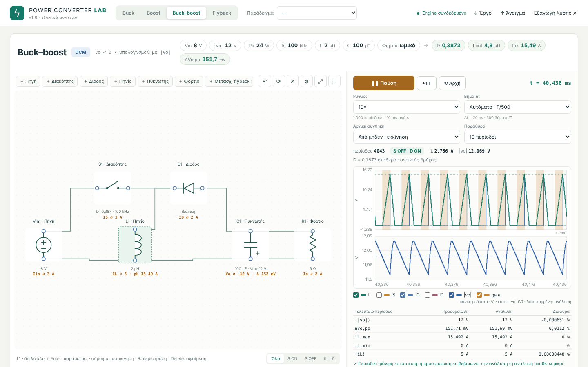
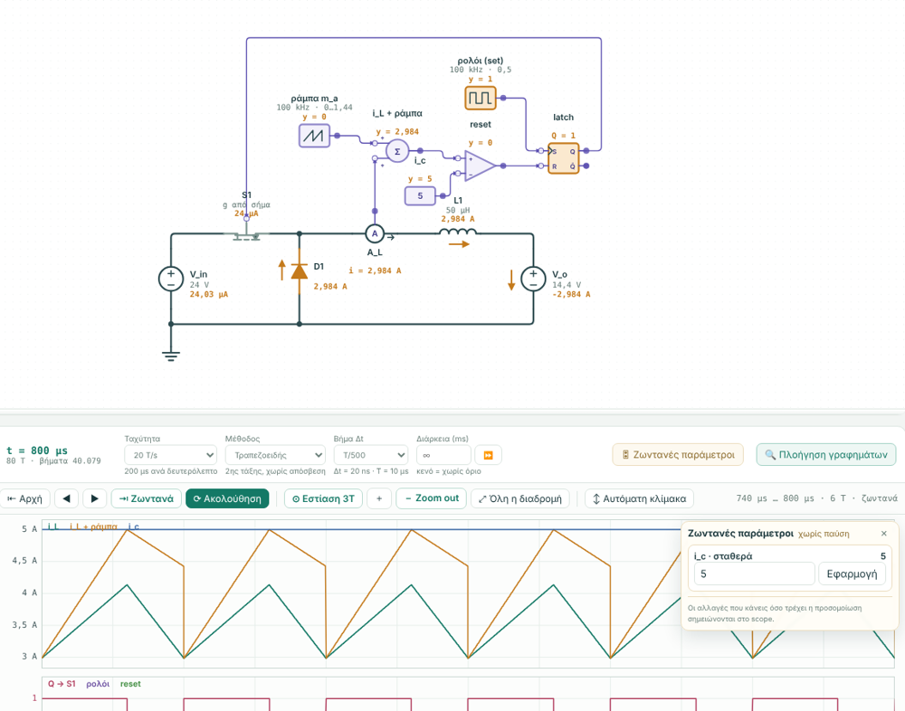

# Power Converter Lab 2

Εκπαιδευτικό εργαστήριο ηλεκτρονικών ισχύος. Σχεδιάζεις ή ανοίγεις ένα κύκλωμα, το προσομοιώνεις σε πραγματικό χρόνο και βλέπεις ρεύματα και τάσεις σε scopes ακριβώς κάτω από το κύκλωμα. Δίπλα έχεις τη θεωρία κάθε μετατροπέα, συγκριμένη με την προσομοίωση.

> **Έκδοση 3.0-alpha.2.** Σύρματα σημάτων και μπλοκ ελέγχου, και συνδέσεις χωρίς καλώδιο. Πρώτη σειρά με μπλοκ ελέγχου (μετρήσεις, πράξεις, συγκριτής, PI, z⁻¹, latch, ρολόι, φέρον). Άδεια: [PolyForm Noncommercial 1.0.0](LICENSE), δηλαδή ελεύθερη για μελέτη, διδασκαλία, έρευνα και προσωπική χρήση, όχι για εμπορική. Οι εκδόσεις 2.x μένουν με άδεια MIT.



## Γρήγορη αρχή για φοιτητές

1. Κατέβασε το zip της τελευταίας έκδοσης και στήσε το με Anaconda: δες την «Εκτέλεση με Anaconda» αμέσως παρακάτω. Είναι τέσσερις εντολές, μία φορά.
2. `python run.py` ανοίγει την εφαρμογή στον browser.
3. **Tutorials** πάνω αριστερά. Για την Άσκηση 2 της Ηλεκτρονικής Ισχύος ΙΙ:
   - **«Άσκηση 2 · Επίδραση δειγματοληψίας»** και **«Άσκηση 2 · Πολυφασική σχεδίαση»**,
   - στις επιλογές πάνω από το κύκλωμα αλλάζεις περίπτωση, τάση, έλεγχο,
   - με ▶ τρέχει η προσομοίωση, και ο πίνακας «Ζωντανές παράμετροι» (πλήκτρο P) αλλάζει τιμές χωρίς παύση.
4. Στους **«Υπολογισμούς & μαθηματικά»**, καρτέλα **«Ερωτήσεις»**:
   - απάντησε πριν δεις τη λύση,
   - σε λάθος απάντηση το εργαλείο δείχνει το πιθανό λάθος ή το βήμα όπου αποκλίνεις,
   - με «Δείξε μου τη λύση» βλέπεις τη λύση και τη σύγκριση με την προσομοίωση.
5. Η κάρτα **«Θεωρία & σύγκριση»** στο τέλος της σελίδας συγκρίνει τους τύπους με την προσομοίωση.

Τα αποτελέσματα είναι **πρόταση σχεδιασμού** για μελέτη και έλεγχο, όχι έτοιμη λύση εργασίας.

**Σχόλια και προβλήματα:** στο [GitHub Issues](https://github.com/ThanosZr/power-control-lab/issues/new/choose) (υπάρχουν έτοιμες φόρμες «Πρόβλημα» και «Σχόλιο ή πρόταση») ή στο Discord.

## Εκτέλεση με Anaconda

**1. Anaconda.** Αν δεν το έχεις, εγκατέστησε το [Anaconda](https://www.anaconda.com/download) ή το μικρότερο Miniconda.

**2. Άνοιξε τον φάκελο.** Αποσυμπίεσε το zip. Άνοιξε **Anaconda Prompt** (Windows) ή terminal (Linux/macOS) και πήγαινε στον φάκελο που έχει το `run.py`:

```bash
# Windows (Anaconda Prompt)
cd %USERPROFILE%\Downloads\Power_Converter_Lab_2_3_2
# Linux / macOS
cd ~/Downloads/Power_Converter_Lab_2_3_2
```

**3. Εγκατάσταση, μία φορά.** Φτιάχνεις περιβάλλον και περνάς τα requirements:

```bash
conda create -n pcl python=3.12 -y
conda activate pcl
pip install -r requirements.txt
```

**4. Εκτέλεση, κάθε φορά:**

```bash
conda activate pcl
python run.py
```

Ο browser ανοίγει μόνος του στο `http://127.0.0.1:8765`. Άφησε το παράθυρο του Anaconda Prompt ανοιχτό όσο δουλεύεις. Το Ctrl+C σταματά τον server.

Επιλογές:
- `python run.py --port 8800`, αν η θύρα 8765 είναι πιασμένη,
- `python run.py --no-browser`, για να μην ανοίξει αυτόματα ο browser.

Η προσομοίωση τρέχει μέσα στον browser. Η Python χρειάζεται για τη θεωρία (SymPy), για τον λύτη αναφοράς (SciPy) και για να σερβίρει τη σελίδα.

<details><summary>Χωρίς Anaconda (Python 3.10+ με venv)</summary>

```bash
# Linux / macOS
python3 -m venv .venv
source .venv/bin/activate
pip install -r requirements.txt
python run.py
```

```powershell
# Windows
py -3 -m venv .venv
.\.venv\Scripts\activate
pip install -r requirements.txt
python run.py
```

Στα Windows υπάρχουν και έτοιμα scripts: `INSTALL.ps1` μία φορά, μετά `START.ps1`.
</details>

## Τι περιέχει

| Περιοχή | Τι κάνει |
|---|---|
| **Κύκλωμα** | Βιβλιοθήκη στοιχείων: πηγές DC/AC/ρεύματος, τριφασική πηγή (Y), R, L, C, διακόπτης MOSFET ή IGBT με αντιπαράλληλη δίοδο, δίοδος, θυρίστορ, μετασχηματιστής με L_m, σκέδαση και αντιστάσεις τυλιγμάτων, φορτίο σταθερής ισχύος, PWM/έλεγχος, Sample & Hold. Ορθογώνια σύρματα με αυτόματη δρομολόγηση γύρω από τα σύμβολα. |
| **Προσομοίωση** | Τρέχει ζωντανά. Αλλάζεις τιμές ή το D την ώρα που τρέχει, από τον πίνακα **Ζωντανές παράμετροι** πάνω από το scope (κουμπί ή πλήκτρο P). Ορίζεις μέθοδο (τραπεζοειδής, Gear/BDF2, backward Euler), ταχύτητα, βήμα Δt και διάρκεια (εύρος προσομοίωσης), ή κάνεις άμεσο υπολογισμό έως το τέλος. Το μπλοκ PWM δίνει σταθερό D, πρόγραμμα D(t), PI/PID (K_d με φίλτρο), SPWM ή δύο εξόδους. |
| **Ζωντανές παράμετροι** | Πίνακας πάνω από το scope που εμφανίζεται και κρύβεται: D, αναφορά του PI, m του SPWM, γωνία α, μετατόπιση φέροντος, κανόνας δειγματοληψίας του S&H, με ζωντανές ενδείξεις. Κάθε αλλαγή κατά την προσομοίωση σημειώνεται στο scope με τον χρόνο της. Οι αλλαγές του D και της αναφοράς γίνονται με ένα κουμπί πρόγραμμα «t:τιμή», ώστε με ⟲ να ξαναπαίζεται η ίδια προσομοίωση. |
| **Δειγματοληψία** | Μπλοκ Sample & Hold: μετρά ρεύμα ή τάση οποιουδήποτε στοιχείου σε σημεία του φέροντος ενός PWM: στην αρχή της περιόδου (reset πριονωτού ή μέγιστο τριγώνου), στο μέσο της, ή και στα δύο. Τα δείγματα είναι συμβάντα του λύτη: παίρνονται ακριβώς στη στιγμή τους, πριν από την ενημέρωση του ελεγκτή και τις μεταγωγές της ίδιας στιγμής. Στο scope φαίνονται ως κουκκίδες, με την κρατημένη τιμή ως βαθμίδες. Το PWM δείχνει και το φέρον c(t). Ο βρόχος PI μπορεί να μετρά το δείγμα αντί για τη στιγμιαία τιμή. |
| **Μπλοκ σημάτων (3.0)** | Ομάδα «Σήματα» στη βιβλιοθήκη: βολτόμετρο, αμπερόμετρο σε σειρά, μέτρηση στοιχείου, σταθερά ή πρόγραμμα, κέρδος, άθροισμα, γινόμενο, διαίρεση, κορεσμός, συγκριτής με υστέρηση, λογικές πύλες, PI διακριτός, καθυστέρηση z⁻¹, SR latch, ρολόι, φέρον/ράμπα, ένδειξη, ετικέτες Goto/From. Ενώνονται με σύρματα σημάτων (μωβ, με βέλος). Το PWM παίρνει το D από ακροδέκτη, ο διακόπτης την πύλη από σήμα, το Sample & Hold μετρά και σήμα. Λεπτομέρειες στην ενότητα «Μπλοκ σημάτων». |
| **Παλμοί πύλης** | Κάθε διακόπτης και θυρίστορ δίνει στο scope τον παλμό που δέχεται (1 = ON, 0 = OFF), μετά τον νεκρό χρόνο. Στις «Ζωντανές παράμετρους» κάθε PWM έχει κουμπιά «⌁ D» και «⌁ παλμοί», και με πολλά PWM το «⌁ παλμοί όλων» φέρνει έναν παλμό ανά PWM. Όταν ένα παράθυρο του scope έχει μόνο παλμούς, ο καθένας σχεδιάζεται στη δική του λωρίδα. |
| **Διακόπτες** | MOSFET: R_on, άγει και ανάστροφα. IGBT: V_ce0 + R_on, μόνο ορθή φορά. Δίοδος σώματος με δικά της V_f, R_on. Νεκρός χρόνος στο PWM (κάθε έξοδος ανάβει t_d αργότερα). Απώλειες μεταγωγής E_on/E_off στις V_ref, I_ref, κλιμακωμένες με \|v\|·\|i\| τη στιγμή της μεταγωγής, ως σήμα p_sw (μέση ανά περίοδο). Θυρίστορ με γωνία α ως προς πηγή AC (μετατόπιση, διάρκεια παλμού) ή από PWM. Η α αλλάζει ζωντανά. |
| **Scopes** | Πολλά παράθυρα, κύλιση ή συγχρονισμός στην περίοδο, στιγμιαίες τιμές ή μέση ανά περίοδο με σκιά min–max, cursors A/B, μετρήσεις (μέση, RMS, min, max, p-p), εξαγωγή CSV. Γραμμή πλοήγησης (ανοίγει/κλείνει από τη γραμμή χειρισμού): αρχή, ◀ ▶, ζωντανά, **ακολούθηση** (η ροδέλα αλλάζει μόνο το πλάτος), εστίαση 3T, zoom, όλη η διαδρομή, αυτόματη κλίμακα. |
| **Δείκτες απόκρισης** | Στο πλάι του scope: για ένα σήμα και ένα βήμα (αναφοράς, φορτίου, τάσης, D) δίνει αρχική/τελική τιμή, υπερύψωση, χρόνο ανόδου 10–90 %, χρόνο κορυφής, αποκατάσταση στη ζώνη ±2 %, σφάλμα μόνιμης κατάστασης, IAE, ISE, ITAE. Για βήμα φορτίου δίνει μέγιστη απόκλιση και χρόνο επαναφοράς. Υπολογίζονται από τις μέσες τιμές ανά περίοδο. |
| **Λύτης αναφοράς (server)** | Το ίδιο κύκλωμα λύνεται με το `solve_ivp` του SciPy: Radau, BDF, LSODA (άκαμπτα) ή RK45, RK23, DOP853, με rtol/atol και μέγιστο βήμα. Οι μεταγωγές και τα δείγματα των S&H είναι συμβάντα. Το αποτέλεσμα σχεδιάζεται διακεκομμένο πάνω στα σήματα του scope, με πίνακα διαφορών (μέση τελευταίας περιόδου, RMS, 95 %) και σύγκριση των στιγμών και τιμών των δειγμάτων. |
| **Tutorials** | Buck, Boost, Buck–boost, Ćuk, SEPIC, Flyback (και με σκέδαση + RCD clamp), full-bridge DC-DC, μονοφασικός αντιστροφέας SPWM, ανορθωτής γέφυρας που φορτίζει μπαταρία, ελεγχόμενος ανορθωτής με θυρίστορ (R ή R–L), τριφασική γέφυρα 6 παλμών (δίοδοι ή θυρίστορ), buck με βρόχο τάσης (PI ή PID, βήμα αναφοράς και φορτίου), αμφίδρομος μετατροπέας μπαταρίας (PE2, και με πραγματικούς διακόπτες), Άσκηση 2: επίδραση δειγματοληψίας και πολυφασική σχεδίαση. Από την 3.0: βρόχος ρεύματος από μπλοκ και peak current-mode με υποαρμονική. |
| **Υπολογισμοί & μαθηματικά** | Κάτω από την προσομοίωση, με καρτέλες. Για Buck/Boost/Buck–boost/Flyback η τοπολογία **αναγνωρίζεται από τη συνδεσμολογία** και οι τιμές διαβάζονται από τα στοιχεία. Εμφανίζονται: μοντέλο κυκλώματος, περιοχή λειτουργίας (K, K_crit, L_crit), M(D) σε CCM, DCM και όριο BCM με αντικατάσταση και γράφημα, κυμάτωση τάσης και ρεύματος, ρεύματα/RMS, G_vd(s) με Bode, απόδειξη μοντέλου. Για την άσκηση της μπαταρίας: ερωτήματα 2–5, δοκιμές και ρυθμίσεις PLECS, έλεγχος, σύστημα. |
| **Σύγκριση** | Θεωρία και προσομοίωση δίπλα-δίπλα σε κάθε tutorial. Αν αλλάξεις στοιχεία ή συνδέσεις, η κάρτα θεωρίας το εντοπίζει και προειδοποιεί, με κουμπί επαναφοράς. |
| **Αναλυτικοί πάγκοι** | `/converter/`: ο πλήρης CCM/DCM σχεδιαστής του v1. Το «Άνοιγμα στο studio» μεταφέρει το κύκλωμα με τις τιμές του και με αρχικές συνθήκες μόνιμης κατάστασης. `/bidirectional/`: η άσκηση PE2 με τα ερωτήματα 2–5 και τον οδηγό PLECS. |

## Μπλοκ σημάτων (3.0)

Από την 3.0 ο έλεγχος σχεδιάζεται και με μπλοκ, όπως στο PLECS, εκτός από τις έτοιμες ρυθμίσεις του PWM.

- **Σύρματα σημάτων:**
  - οι ακροδέκτες σημάτων είναι μικροί μωβ κύκλοι: γεμάτος για έξοδο, άδειος για είσοδο,
  - τα σύρματα σημάτων είναι λεπτότερα, μωβ, με βέλος στην είσοδο που τροφοδοτούν,
  - ένα σύρμα σήματος **δεν ενώνεται ποτέ** με ηλεκτρικό κόμβο: το εργαλείο το απορρίπτει με εξήγηση. Για να φέρεις ένα μέγεθος του κυκλώματος σε σήμα, βάζεις βολτόμετρο, αμπερόμετρο σε σειρά ή «Μέτρηση στοιχείου».
- **Σύνδεση με το κύκλωμα:**
  - PWM με τρόπο «D από σήμα»: το D διαβάζεται από τον ακροδέκτη d στα σημεία ενημέρωσης (αρχή περιόδου, και στο ελάχιστο του τριγώνου με διπλή ενημέρωση),
  - διακόπτης με οδήγηση «Από σήμα»: εμφανίζεται ακροδέκτης πύλης g, ON όταν το σήμα είναι ≥ 0,5,
  - Sample & Hold με είσοδο «Σήμα»: δειγματοληπτεί ό,τι φτάνει στο u. Η κρατημένη τιμή βγαίνει πάντα στο y,
  - PI, z⁻¹ και Sample & Hold ενημερώνονται σε σημεία του φέροντος ενός PWM ή στις ακμές ενός μπλοκ «Ρολόι».
- **Σύνδεση χωρίς καλώδιο (3.0-alpha.2):**
  - **πεδίο «Πηγή»:** στις ρυθμίσεις κάθε μπλοκ διαλέγεις από ποια έξοδο παίρνει σήμα κάθε είσοδος, π.χ. «latch.q» για την πύλη του S1. Δίπλα στην είσοδο φαίνεται «← latch.q»,
  - **ετικέτες «προς» και «από» (Goto/From), όπως στο PLECS:** ό,τι μπαίνει στην ετικέτα «προς g_S1» βγαίνει από κάθε ετικέτα «από g_S1»,
  - και οι δύο τρόποι ισοδυναμούν με σύρμα: ίδια σειρά υπολογισμού, ίδιος έλεγχος βρόχων, ίδια συμπεριφορά στον λύτη SciPy,
  - προειδοποιήσεις για ετικέτα χωρίς ζευγάρι, για διπλό όνομα και για πηγή που δεν υπάρχει.
- **Πώς υπολογίζονται:**
  - σε κάθε στιγμή τα μπλοκ υπολογίζονται με σειρά εξάρτησης: κάθε μπλοκ μετά από όσα διαβάζει άμεσα. Η κάρτα θεωρίας δείχνει αυτή τη σειρά,
  - ένας κλειστός βρόχος χωρίς καθυστέρηση (αλγεβρικός βρόχος) αναφέρεται ως σφάλμα με τα μπλοκ του βρόχου, π.χ. «GN1 → SUM1 → GN1». Δεν λύνεται με κρυφή καθυστέρηση. Μια z⁻¹ μέσα στον βρόχο τον σπάει,
  - η στιγμή που αλλάζει ένας συγκριτής εντοπίζεται **μέσα στο βήμα** του λύτη, όπως οι μεταβάσεις των διόδων. Έτσι το peak current-mode φτιάχνεται από γενικά μπλοκ, χωρίς ειδικό κώδικα,
  - ρολόγια, ράμπες, προγράμματα και διακριτές ενημερώσεις είναι συμβάντα του λύτη,
  - ο λύτης SciPy του server υπολογίζει τα ίδια μπλοκ. Τους συγκριτές τους βρίσκει ως ρίζες του `solve_ivp`.
- **Scope και ζωντανές παράμετροι:**
  - κάθε έξοδος μπλοκ μπαίνει στο scope (δεξί κλικ → Scope),
  - οι λογικές έξοδοι (συγκριτής, latch, ρολόι, πύλες) σε ένα δικό τους παράθυρο σχεδιάζονται σε λωρίδες,
  - οι σταθερές αλλάζουν εν κινήσει από τις «Ζωντανές παραμέτρους», και οι αλλαγές γίνονται πρόγραμμα t:τιμή.

Δύο tutorials στην ομάδα **«Μπλοκ σημάτων (3.0)»**:

- **Βρόχος ρεύματος από μπλοκ.** Buck 48 V προς μπαταρία 24 V. Αναφορά → άθροισμα → PI → PWM, με το ρεύμα από αμπερόμετρο σε σειρά.
  - Επιλογές: PI από μπλοκ ή ο ενσωματωμένος, PWM με είσοδο d ή φέρον + συγκριτής, χωρίς ή με z⁻¹.
  - Ο PI από μπλοκ δίνει **ακριβώς** το D του ενσωματωμένου. Το φέρον με τον συγκριτή δίνει το ίδιο με το PWM.
  - Επειδή ο PI μετρά στο reset του πριονωτού, κρατά την κοιλάδα στην αναφορά και η μέση τιμή βγαίνει i_ref + Δi/2, όπως στην Άσκηση 2.
  - Η z⁻¹ αφαιρεί ω_c·T ≈ 18° περιθωρίου φάσης: η υπερύψωση της κοιλάδας μετά το βήμα πάει από 13 % σε 21 %.
- **Peak current-mode και υποαρμονική.** Buck 24 V προς μπαταρία, 100 kHz, χωρίς μπλοκ PWM: ρολόι → SET του latch, (i_L + ράμπα) ≥ i_c → RESET.
  - Επιλογές: D = 0,4 / 0,6 / 0,7 και ράμπα 0, m₂/2 ή m₂.
  - Η κάρτα θεωρίας δίνει m₁, m₂, m_a, τον συντελεστή λ = (m_a − m₂)/(m₁ + m_a), την ελάχιστη ράμπα, την κορυφή i_c − m_a·D·T, και το duty και την κορυφή των τελευταίων περιόδων με διάγνωση (σταθερό ή υποαρμονική).
  - Με D = 0,6 χωρίς ράμπα: λ = −1,5 και το duty αλλάζει από περίοδο σε περίοδο. Με m₂/2: σταθερό, Î = 4,136 A όπως η θεωρία. Το ίδιο βγαίνει με μικρότερο βήμα και στον λύτη SciPy.
  - Template `pcm_slope` με τέσσερις ερωτήσεις πρόβλεψης: λ, σταθερότητα, ελάχιστη ράμπα, κορυφή.



**Τι δεν έχει ακόμη η 3.0-alpha:** υποκυκλώματα, θύρες με μονάδες και διανύσματα, αρχείο συμβάντων, συνεχή ολοκληρωτή και φίλτρα, Clarke/Park/PLL, μπλοκ έκφρασης/Python.

## Ποντίκι και πληκτρολόγιο

| Ενέργεια | Αποτέλεσμα |
|---|---|
| Αριστερό σύρσιμο σε κενό | Ορθογώνιο επιλογής. Προς τα δεξιά επιλέγει όσα είναι πλήρως μέσα, προς τα αριστερά όσα ακουμπά. **Δεν** μετακινεί τον καμβά και δεν επιλέγει κείμενο. |
| Σύρσιμο στοιχείου | Μετακινεί όλη την επιλογή. Τα σύρματα ακολουθούν και μένουν ορθογώνια. |
| Σύρσιμο τμήματος σύρματος | Το μετακινεί κάθετα στον εαυτό του, και οι γωνίες προσαρμόζονται. |
| Σύρσιμο από ακροδέκτη | Νέο σύρμα. Αν το αφήσεις πάνω σε ακροδέκτη, ενώνει. Αν το αφήσεις πάνω σε σύρμα, δημιουργεί κόμβο Τ. Με κλικ σε ακροδέκτη, κλικ σε σημεία και κλικ στον στόχο, χαράζεις δική σου διαδρομή. |
| Μεσαίο κλικ ή Space + σύρσιμο | Μετακίνηση καμβά |
| Ροδέλα | Zoom |
| Διπλό κλικ | Ρυθμίσεις στοιχείου ή σύρματος (όνομα κόμβου, χρώμα, πάχος) |
| Δεξί κλικ | Μενού: **Scope ρεύματος / τάσης / ισχύος**, περιστροφή, διαγραφή κ.ά. |
| R / M / F | Περιστροφή / καθρέφτης / προσαρμογή προβολής |
| Ctrl+Z, Ctrl+Y, Ctrl+C, Ctrl+V, Ctrl+D, Ctrl+A, Del | Αναίρεση, επανάληψη, αντιγραφή, επικόλληση, διπλότυπο, όλα, διαγραφή |

Το τι κάνει κάθε κουμπί του ποντικιού αλλάζει από το ⚙ **Ρυθμίσεις**. Εκεί ορίζεις επίσης πλέγμα, πάχος και γωνίες συρμάτων, αυτόματη δρομολόγηση και ζωντανές ενδείξεις.

Για να δεις κάτι στο scope:
- δεξί κλικ στο στοιχείο → Scope, ή
- επιλέγεις στοιχεία και πατάς «I/V επιλεγμένων», ή
- διαλέγεις από τη λίστα «Σήμα στο scope».

Δεξί κλικ σε σύρμα δίνει την τάση του κόμβου ως προς τη γείωση.

## Το παράδειγμα της μπαταρίας (PE2)

Tutorials → **Αμφίδρομος μετατροπέας μπαταρίας**. Οι επιλογές πάνω από το κύκλωμα ξαναχτίζουν το ίδιο κύκλωμα:

- **θέση αποθήκευσης:** πάνω από 50 V (60–100 V) ή κάτω (25–40 V) και τιμή V_st,
- **φορά ισχύος:** εκφόρτιση ή φόρτιση,
- **ζυγός:**
  - ιδανική πηγή 50 V, όπως στο ερώτημα 5,
  - ή πλήρες σύστημα με μονόδρομη πηγή 50 V/1 mΩ, C_bus και φορτίο σταθερής ισχύος 60 → 30 kW στα 5 ms,
- **έλεγχος:**
  - σταθερό D = D₀ με χειροκίνητο D ζωντανά,
  - D₀ με i_L(0) = 0,
  - παλμός ΔD (φόρτιση ↔ εκφόρτιση),
  - PI ρεύματος με feedforward και αναστροφή.
- **διακόπτες:** ιδανικοί, ή MOSFET 1 mΩ με δίοδο σώματος 0,8 V, νεκρό χρόνο 200 ns και E_on/E_off. Σε σταθερό D το ρεύμα τότε ολισθαίνει, και μόνο ο βρόχος PI το κρατά στην αναφορά.

Το D είναι το duty του κάτω διακόπτη S2, και i_L > 0 σημαίνει ρεύμα από τη χαμηλή πλευρά προς την ημιγέφυρα.

## Άσκηση 2: επίδραση δειγματοληψίας

Tutorials → **Άσκηση 2 · Επίδραση δειγματοληψίας**. Η διάταξη της Άσκησης 1 με ένα Sample & Hold στο ρεύμα του πηνίου, δεμένο στο φέρον του PWM. Επιλογές:

- **δειγματοληψία:**
  - πριονωτό trailing-edge, ένα δείγμα στο reset,
  - συμμετρικό τρίγωνο, ένα δείγμα στο μέγιστο,
  - συμμετρικό τρίγωνο, δύο δείγματα στα ακρότατα,
- **αρχική κατάσταση:** i_L(0) = I_avg στο μέσο του OFF ή του ON του S2 (η μετατόπιση του φέροντος υπολογίζεται ως t_c = (−τ) mod T), ή χωρίς μετατόπιση,
- **V_st, φορά ισχύος, διακόπτες** όπως στην Άσκηση 1,
- **έλεγχος:** ανοιχτός βρόχος με D = D₀, ή PI ρεύματος που μετρά το δείγμα, με D_ff = 1 − V_bus/V_st από τις μετρούμενες τάσεις, βήμα αναφοράς στα 2 ms και βήμα V_st στα 5 ms,
- **ενημέρωση του D:** μία φορά ανά περίοδο, ή δύο (και στο ελάχιστο του τριγώνου). Με δύο, η ακμή ανάμματος χρησιμοποιεί το D της αρχής της περιόδου, η ακμή σβησίματος το D του μέσου, και ο PI τρέχει με T_s = T/2.

Η κάρτα θεωρίας δίνει:
- πού πέφτει κάθε δείγμα στην κυματομορφή και ποια τιμή περιμένουμε,
- το πρώτο δείγμα και το πλήθος των δειγμάτων,
- πίνακα με τα τελευταία δείγματα και τη μέση τιμή της περιόδου τους,
- το χρονοδιάγραμμα t_sample, t_update και t_gate της τρέχουσας περιόδου.

Το scope δείχνει, εκτός από το D, και τους ίδιους τους παλμούς των S2 και S1 σε δικές τους λωρίδες. Με πραγματικούς διακόπτες φαίνεται και ο νεκρός χρόνος ανάμεσά τους.

Στους «Υπολογισμούς & μαθηματικά» το template `pe2_sampling` δίνει την ίδια ανάλυση με βήματα και αντικατάσταση. Είναι πρόταση σχεδιασμού, όχι λύση.

Τι δείχνει:
- Στο πριονωτό, το δείγμα στο reset είναι η κοιλάδα, Δi/2 κάτω από τη μέση τιμή.
- Στα ακρότατα του τριγώνου το δείγμα είναι η μέση τιμή.
- Ένας PI που κρατά το δείγμα στην αναφορά αφήνει τη μέση τιμή Δi/2 μακριά από την αναφορά με πριονωτό, ενώ με τρίγωνο όχι.

## Άσκηση 2: πολυφασική σχεδίαση

Tutorials → **Άσκηση 2 · Πολυφασική σχεδίαση**. N όμοιοι κλάδοι ημιγέφυρας (2–6), ο καθένας με δικό του πηνίο και PWM, με κοινό ρολόι, ίδιο duty και ίδια συχνότητα. Επιλογές:
- **οδήγηση:** συμφασική, ή μετατοπισμένη, όπου ο κλάδος k καθυστερεί k·T/N,
- **V_st:** 60, 80 ή 100 V, ή σημείο ακύρωσης (N·D ακέραιος),
- **συχνότητα:** 20 ή 40 kHz,
- **L:** L_min για το κριτήριο Δi_k ≤ 30 % |I_k| σε όλο το παράθυρο, ή το L των 20 kHz,
- **φορά ισχύος:** φόρτιση ή εκφόρτιση,
- **έλεγχος:** ανοιχτός βρόχος με κοινό D, ή PI ρεύματος ανά φάση με αναφορά P/N,
- **κλάδοι:** όμοιοι και ιδανικοί, ή με αντίσταση πηνίων 5 mΩ όπου ο κλάδος 2 έχει 7,5 mΩ ή L + 20 %.

Κάθε κλάδος ξεκινά από την περιοδική του κυματομορφή στη δική του φάση, με κοινό μέσο ρεύμα. Το scope δείχνει τα ρεύματα των κλάδων και το άθροισμά τους (ρεύμα ζυγού).

Η κάρτα θεωρίας δίνει:
- τον καταμερισμό ανά κλάδο,
- τη Δi_k,
- τη Δi_Σ: N·Δi_k συμφασικά, (V_st/L)·(T/N)·r(1 − r) μετατοπισμένα, με r = N·D − ⌊N·D⌋,
- τα σημεία ακύρωσης και τη μέγιστη κυμάτωση σε όλο το παράθυρο,
- το κριτήριο 30 %.

Το template `pe2_polyphase` δίνει:
- L_min,
- κορυφή κλάδου,
- βήμα φάσης,
- πίνακες για το παράθυρο τάσεων και για N = 2–6,
- τη δεύτερη συχνότητα.

Για N = 4 στα 40 kW: L_min = 20,83 μH, κορυφή 230 A, φάσεις 0 / 12,5 / 25 / 37,5 μs, ακύρωση στα 66,7 V και στα 100 V.

Το τρίτο παράθυρο του scope δείχνει τον παλμό του κάτω διακόπτη κάθε κλάδου σε δική του λωρίδα: μετατοπισμένα, οι παλμοί απέχουν T/N.

Στον πίνακα ζωντανών παραμέτρων, το κοινό D και τα κουμπιά «Συμφασικά» / «Μετατοπισμένα» αλλάζουν όλα τα PWM μαζί, ενώ τρέχει η προσομοίωση.
- **Ανοιχτός βρόχος, ιδανικοί κλάδοι:** μια αλλαγή φάσης αφήνει μόνιμη ανισοκατανομή ρεύματος, γιατί τίποτα δεν τη διορθώνει.
- **Ανοιχτός βρόχος με αντιστάσεις:** τα ρεύματα μοιράζονται αντίστροφα με τις αντιστάσεις. Ο κλάδος με 7,5 mΩ παίρνει −133 A αντί για −200 A.
- **PI ανά φάση:** κάθε κλάδος κρατά P/N, και η ανισοκατανομή μετά από αλλαγή φάσης διορθώνεται σε λίγα ms.

## Σύγκριση με PLECS ή μετρήσεις (CSV)

Στο πλάι του scope, «Σύγκριση με CSV»:
1. Ανοίγεις ένα CSV με τον χρόνο στην πρώτη στήλη και ένα σήμα ανά στήλη. Το διαχωριστικό μπορεί να είναι , ; ή tab. Οι επικεφαλίδες είναι προαιρετικές.
2. Αντιστοιχίζεις κάθε στήλη σε σήμα του scope. Γίνεται αυτόματα όταν τα ονόματα ταιριάζουν.
3. Η αναφορά σχεδιάζεται διακεκομμένη, μαζί με πίνακα διαφορών: μέση τιμή τελευταίας περιόδου, RMS, 95 %.

Μπορείς να μετατοπίσεις τον χρόνο και να δηλώσεις αν είναι σε s, ms ή μs.

Από το PLECS εξάγεις τα δεδομένα του Scope σε CSV. Για σωστή σύγκριση χρειάζονται ίδιες παράμετροι, αρχικές συνθήκες και φορές ρευμάτων. Το ίδιο κουμπί δέχεται και μετρήσεις από πάγκο, ή ένα παλιό run που εξήχθη με «CSV ↓».

## Ερωτήσεις με πρόβλεψη

Στα templates δεδομένων υπάρχει τύπος block «questions». Κάθε ερώτηση είναι αριθμός ή επιλογή.

**Αριθμός:**
- η σωστή τιμή δίνεται ως έκφραση των βημάτων, με ανοχή,
- το template δηλώνει συνηθισμένα λάθη, π.χ. «υπολόγισες στη V_st του σημείου λειτουργίας αντί για τη μέγιστη»,
- αν δεν ταιριάζει κάποιο λάθος, η απάντηση συγκρίνεται με τα ενδιάμεσα βήματα. Ελέγχονται και ×2, ÷2, αντίθετο πρόσημο και ένα πρόθεμα SI.

**Επιλογή:** κάθε απάντηση έχει εξήγηση για το γιατί είναι σωστή ή λάθος.

Σε κάθε ερώτηση υπάρχουν υπόδειξη και λύση με βήματα. Όπου ορίζεται, η απάντηση συγκρίνεται και με την προσομοίωση: μέση τιμή ή p-p σήματος, πλήθος ή τιμή δειγμάτων. Η πρόοδος («Σωστές 3 από 6») μένει στον browser, χωρίς λογαριασμούς.

Υπάρχουν ερωτήσεις για τα δύο μέρη της Άσκησης 2, στα `pe2_sampling` και `pe2_polyphase`.

## Templates λύσης

Μια άσκηση δεν λύνεται μόνο από το σχέδιο. Τα ζητούμενα (παράθυρα, ισχύεις, PLECS) έρχονται από τα δεδομένα της. Γι' αυτό η λύση περιγράφεται σε template, με δύο μορφές που εμφανίζονται στο ίδιο σημείο («Υπολογισμοί & μαθηματικά», επιλογή πάνω δεξιά):

- **Template κώδικα**, π.χ. `web/studio/exercises/pe2_battery.js`. Καλεί έναν engine του server (`bidir`) και ορίζει ενότητες, προτάσεις PLECS και φόρτωση δοκιμών στο studio (▶).
- **Template δεδομένων** (JSON, `"schema": "pcl-template-1"`), π.χ. `pe2_battery.template.json` και `buck_design.template.json`. Δεν έχει κώδικα:
  - `inputs`: ονομαστικά μεγέθη με προεπιλογή και μονάδα. Δένονται με το κύκλωμα (`"from": "comp.L1.L"`) ή με το tutorial (`"from": "meta.vst"`) και αλλάζουν και με το χέρι από τη φόρμα.
  - `steps`: σχέσεις `σύμβολο = έκφραση` με τίτλο και εξήγηση. Το `"when"` διαλέγει τη σχέση της περιοχής λειτουργίας (π.χ. αποθήκευση πάνω ή κάτω από τον ζυγό, CCM ή DCM). Ο server τις λύνει με SymPy και δείχνει συμβολικά, αντικατάσταση, αποτέλεσμα.
  - `tables`: τα ίδια βήματα για πολλά σενάρια (π.χ. οι δοκιμές του ερωτήματος 5).
  - `checks`: συνθήκες αποδοχής με κείμενο επιτυχίας/αποτυχίας.
  - `sections`: τι φαίνεται και με ποια σειρά. Τύποι: `text`, `steps`, `kv`, `table`, `checks`, `settings` (π.χ. PLECS), `script` (αντιγράψιμο, με τελεία για δεκαδικά).
  - Στα κείμενα, `{έκφραση}`, `{έκφραση|μονάδα}` ή `{έκφραση:.4g}` αντικαθίστανται με τιμές.

Νέο template: «Template…» στο panel για άνοιγμα αρχείου, ή προσθήκη στο `web/studio/exercises/index.json`. Το «↓ Λήψη template» δίνει το JSON του τρέχοντος ως αφετηρία. Οι εκφράσεις δέχονται μόνο ονόματα εισόδων/βημάτων, αριθμούς, πράξεις, συγκρίσεις και τις συναρτήσεις sqrt, sin, cos, tan, asin, acos, atan, exp, log, abs, min, max, floor, ceiling, sign, pi. Μια άλλη πηγή (π.χ. Java) μπορεί αργότερα να παράγει το ίδιο JSON χωρίς αλλαγές στο UI.

## Πώς λύνει

- **Μέθοδος:** Modified Nodal Analysis. Τραπεζοειδής (default), Gear/BDF2 μεταβλητού βήματος ή backward Euler, πάντα με δύο βήματα backward Euler μετά από κάθε μεταγωγή.
- **Βήμα:** σταθερό, αλλά δεν περνά ποτέ πάνω από ακμή PWM, στιγμή δειγματοληψίας ή αλλαγή προγράμματος.
- **Δίοδοι:** αλλάζουν κατάσταση στη στιγμή που το ρεύμα μηδενίζεται μέσα στο βήμα, οπότε η DCM είναι ακριβής.
- **Ακμές:** στη στιγμή κάθε μεταγωγής καταγράφεται και η λύση αμέσως μετά (ρεύματα πηνίων και τάσεις πυκνωτών ίδια, νέα τοπολογία). Οι ακμές στα scopes είναι κατακόρυφες και οι μέσες τιμές ακριβείς, π.χ. στους ελεγχόμενους ανορθωτές.
- **Μοντέλα στοιχείων:**
  - MOSFET ως R_on/R_off. IGBT και θυρίστορ ως δίοδοι με πύλη: το IGBT άγει μόνο με πύλη, το θυρίστορ ανάβει με παλμό και μένει αναμμένο ως τον μηδενισμό του ρεύματος,
  - νεκρός χρόνος από το PWM, απώλειες μεταγωγής από E_on/E_off (χωρίς ανάκτηση διόδων),
  - μετασχηματιστής: ιδανικός με L_m, σκέδαση πρωτεύοντος/δευτερεύοντος και αντιστάσεις τυλιγμάτων,
  - τριφασική πηγή Y με R_s, L_s ανά φάση.
- **Λύτης αναφοράς (server, `engine/batch.py`):** παίρνει το netlist που έφτιαξε ο browser. Σε κάθε τοπολογία λύνει ακριβώς το ωμικό δίκτυο για δεδομένα ρεύματα πηνίων και τάσεις πυκνωτών και ολοκληρώνει τις καταστάσεις με το `solve_ivp`. Οι ακμές PWM, η δειγματοληψία των ελεγκτών, τα προγράμματα και οι παλμοί θυρίστορ είναι γνωστά συμβάντα. Το σβήσιμο και το άναμμα των διόδων εντοπίζονται ως ρίζες. Οι ρητές μέθοδοι (RK) κόβονται στα άκαμπτα κυκλώματα (R_off, DCM) και το μήνυμα προτείνει Radau/BDF.
- **Επαλήθευση:**
  - buck CCM/DCM, boost DCM, flyback, ανορθωτής με μπαταρία, αμφίδρομος, νεκρός χρόνος (V_o = V_in(D − t_d·f_s)), IGBT, απώλειες μεταγωγής, σκέδαση, ελεγχόμενος ανορθωτής (R και R–L) και τριφασική γέφυρα (δίοδοι, θυρίστορ) συμφωνούν με τις κλειστές λύσεις, συνήθως καλύτερα από 0,1 %,
  - ο λύτης αναφοράς συμφωνεί με τον browser στο 0,01 % στις μέσες τιμές. Εξαίρεση το RCD clamp: εκεί ο browser με σταθερό βήμα αποκλίνει περίπου 1 % στην τάση του clamp, και φαίνεται στον πίνακα σύγκρισης,
  - στα tutorials η θεωρία και η προσομοίωση διαφέρουν περίπου 0,1% (αντιστροφέας: 1%, λόγω αρμονικών).

## Γραμμή εντολών

Οι αναλυτικοί engines τρέχουν και χωρίς browser:

```bash
python solve.py analyze examples/buck_boost_project.json
python solve.py bidir examples/buck_boost_project.json --output bidir.json
```

Τα παραδείγματα αιτημάτων βρίσκονται στο `examples/`. Η τεκμηρίωση του αναλυτικού engine (αρχιτεκτονική, οδηγός, επαλήθευση) είναι στο `docs/v1/`.

## Για όσους αλλάζουν τον κώδικα

- [`docs/ARCHITECTURE.md`](docs/ARCHITECTURE.md): τα κομμάτια, η ροή δεδομένων από τη διεπαφή ως τον λύτη, και πίνακας «πού αλλάζεις τι» για κάθε είδος αλλαγής (νέο στοιχείο, μπλοκ, tutorial, template, κανάλι, ζωντανή παράμετρος).
- [`docs/CODEMAP.md`](docs/CODEMAP.md): ευρετήριο με αριθμούς γραμμών για συναρτήσεις, στοιχεία, tutorials και API. Παράγεται με `python tools/codemap.py`.
- CI (`.github/workflows/ci.yml`): σε κάθε push στα `main`/`lab-*` και σε κάθε pull request τρέχει τα tests, τα σενάρια του browser και τον έλεγχο του χάρτη, και φτιάχνει το zip της έκδοσης.

## Tests

```bash
python -m unittest discover -s tests -v
```

Τα tests καλύπτουν:
- τους αναλυτικούς engines και τα templates δεδομένων,
- τον λύτη του browser και τα tutorials μέσω Node (παραλείπονται αν δεν υπάρχει Node),
- τον λύτη αναφοράς του server σε netlists του browser,
- τον server.

Στο `tests/ui/` υπάρχουν έλεγχοι του περιβάλλοντος με Playwright: επιλογή, σύρσιμο, σύρματα, scopes, ρυθμίσεις, αποθήκευση (`studio_flow.js`, `editor_interactions.js`), δείκτες απόκρισης, σύγκριση με τον server, templates δεδομένων και άνοιγμα από το `/converter/` (`features_flow.js`), και τα μπλοκ σημάτων της 3.0: σύρματα με το ποντίκι, κανόνας σήματος/ηλεκτρικού, αλγεβρικός βρόχος, τα δύο tutorials (`blocks_flow.js`).

## Εκδόσεις

Κάθε έκδοση έχει δικό της branch και δικό της zip (`Power_Converter_Lab_<έκδοση>.zip`), ώστε να μην αντικαθιστά την προηγούμενη.

| Έκδοση | Branch | Τι έφερε |
|---|---|---|
| 2.0 | `lab-2.0` | Studio με προσομοίωση σε πραγματικό χρόνο, scopes, tutorials, υπολογισμοί & μαθηματικά από το κύκλωμα, template PE2 με PLECS, PID, μέθοδοι ολοκλήρωσης. |
| 2.3 | `lab-2.3` | Νεκρός χρόνος, IGBT, απώλειες μεταγωγής, σκέδαση, θυρίστορ, τριφασική πηγή, νέα tutorials (βρόχος τάσης, ανορθωτές με θυρίστορ, γέφυρα 6 παλμών, RCD clamp), δείκτες απόκρισης, λύτης αναφοράς SciPy στον server, templates λύσης ως δεδομένα, άνοιγμα από το `/converter/` στο studio. |
| 2.3.1 | `lab-2.3.1` | Οδηγίες εκτέλεσης με Anaconda (περιβάλλον, requirements, run) και επόμενα βήματα στο `docs/ROADMAP.md`. |
| 2.7 | `lab-2.7` | Ερωτήσεις με πρόβλεψη και ανατροφοδότηση στα templates, για τα δύο μέρη της Άσκησης 2. Άδεια MIT, φόρμες «Πρόβλημα» και «Σχόλιο» στο GitHub, γρήγορη αρχή για φοιτητές, σύνδεσμος για σχόλια στην εφαρμογή. |
| 2.7.1 | `lab-2.7.1` | Παλμός πύλης κάθε διακόπτη στο scope (μετά τον νεκρό χρόνο), κουμπιά «⌁ D» και «⌁ παλμοί» στις ζωντανές παραμέτρους, λωρίδες για τους παλμούς. Εξ ορισμού στα scopes της Άσκησης 2. |
| 3.0-alpha | `lab-3.0-alpha` | Σύρματα σημάτων και 17 μπλοκ (μετρήσεις, πράξεις, συγκριτής, λογική, PI, z⁻¹, latch, ρολόι, φέρον, ένδειξη). PWM με D από σήμα, πύλη διακόπτη από σήμα, S&H σε σήμα. Σειρά υπολογισμού και διάγνωση αλγεβρικών βρόχων, ρίζες συγκριτών μέσα στο βήμα, ίδια μπλοκ στον λύτη SciPy. Tutorials «Βρόχος ρεύματος από μπλοκ» και «Peak current-mode και υποαρμονική», template με ερωτήσεις. Άδεια PolyForm Noncommercial 1.0.0. |
| 3.0-alpha.2 | `lab-3.0-alpha.2` | CI στο GitHub (tests, σενάρια browser, zip), χάρτης υλοποίησης (`docs/ARCHITECTURE.md`, `docs/CODEMAP.md`). Συνδέσεις σημάτων χωρίς καλώδιο: πεδίο «Πηγή» σε κάθε είσοδο και ετικέτες Goto/From (χρησιμοποιούνται στα δύο tutorials της 3.0). Ανανεωμένος οδικός χάρτης: λίστα «τι απομένει», συμβολική λύση οποιουδήποτε κυκλώματος, εκπαιδευτική έκδοση, υποσύγχρονα φαινόμενα, γραμμές και καλώδια τύπου PSCAD/EMTP-RV, πολλές εκδόσεις λογισμικού με άδειες ή κλειδιά. |
| 2.6 | `lab-2.6` | Κλείσιμο της Άσκησης 2: PI ρεύματος ανά φάση και κλάδοι με διαφορετικά R ή L στο πολυφασικό, διπλή ενημέρωση του D ανά περίοδο (browser και SciPy), εισαγωγή CSV ως αναφοράς στο scope για σύγκριση με PLECS ή μετρήσεις. |
| 2.5 | `lab-2.5` | Άσκηση 2, πολυφασική σχεδίαση: tutorial με N = 2–6 κλάδους σε κοινό ρολόι (συμφασικά ή μετατοπισμένα κατά k·T/N), κάρτα θεωρίας για την κυμάτωση κλάδου και αθροίσματος, σημεία ακύρωσης και σάρωση του παραθύρου, template `pe2_polyphase` (L_min με κριτήριο 30 %, πίνακας N, δεύτερη συχνότητα). Κοινό D και συμφασικά/μετατοπισμένα στον πίνακα ζωντανών παραμέτρων. |
| 2.4 | `lab-2.4` | Άσκηση 2 (επίδραση δειγματοληψίας): μπλοκ Sample & Hold στο φέρον του PWM, φέρον c(t) ως σήμα, tutorial με τις τρεις περιπτώσεις και PI με το δείγμα, κάρτα θεωρίας με πίνακα δειγμάτων και χρονοδιάγραμμα, template `pe2_sampling`, ίδια δείγματα στον λύτη αναφοράς του server. Πίνακας ζωντανών παραμέτρων πάνω από το scope, με σημάδια των αλλαγών και μετατροπή τους σε πρόγραμμα t:τιμή. |
| 2.3.2 | `lab-2.3.2` | Σωστή αρχική μόνιμη κατάσταση σε DCM (buck, boost). Προειδοποίηση στην κάρτα θεωρίας όταν το κύκλωμα δεν είναι πια αυτό του tutorial, με επαναφορά. Νέες προτεραιότητες στο `docs/ROADMAP.md`. |
| 2.3.3 | `lab-2.3.3` | Νέα επόμενα βήματα στο `docs/ROADMAP.md`: σήματα ελέγχου, PWM από μπλοκ, πολυφασική σχεδίαση, ζωντανές παράμετροι σε πίνακα πάνω από την προσομοίωση, μπλοκ κώδικα (έκφραση, Python), έλεγχος με AI. Ο κώδικας είναι ίδιος με της 2.3.2. |

Τα επόμενα βήματα είναι στο [`docs/ROADMAP.md`](docs/ROADMAP.md), σε δύο παράλληλα σκέλη:
- **πυρήνας:** σήματα ελέγχου και μετρήσεις, ζωντανές παράμετροι, PWM από μπλοκ και δειγματοληψία, peak current-mode, υποκυκλώματα, πολυφασική σχεδίαση, μπλοκ κώδικα,
- **εκπαιδευτικό:** ερωτήσεις με πρόβλεψη, εργαστήρια, επαλήθευση με PLECS, Educational Mode.

Μετά ακολουθούν μηχανές και τριφασικά, και μακροπρόθεσμα έλεγχος με AI.

## Σημείωση

Εργαλείο μελέτης για να καταλαβαίνεις και να ελέγχεις λύσεις. Δεν αντικαθιστά το PLECS ή το SPICE, ούτε αποτελεί έτοιμη λύση εργασίας.

## Άδεια χρήσης

Από την έκδοση 3.0: [PolyForm Noncommercial 1.0.0](LICENSE) · © 2026 Thanos Zr.
- Επιτρέπεται ελεύθερα η χρήση, η αλλαγή και η διανομή για μη εμπορικούς σκοπούς: μελέτη, διδασκαλία, έρευνα, προσωπική χρήση, πανεπιστήμια και μη κερδοσκοπικοί οργανισμοί. Μαζί με το λογισμικό πρέπει να δίνεται η άδεια (ή ο σύνδεσμός της) και η γραμμή «Required Notice».
- Για εμπορική χρήση χρειάζεται χωριστή άδεια από τον δημιουργό.
- Οι εκδόσεις 2.x (ως και τη 2.7.1) δόθηκαν με άδεια MIT και μένουν με αυτήν.
