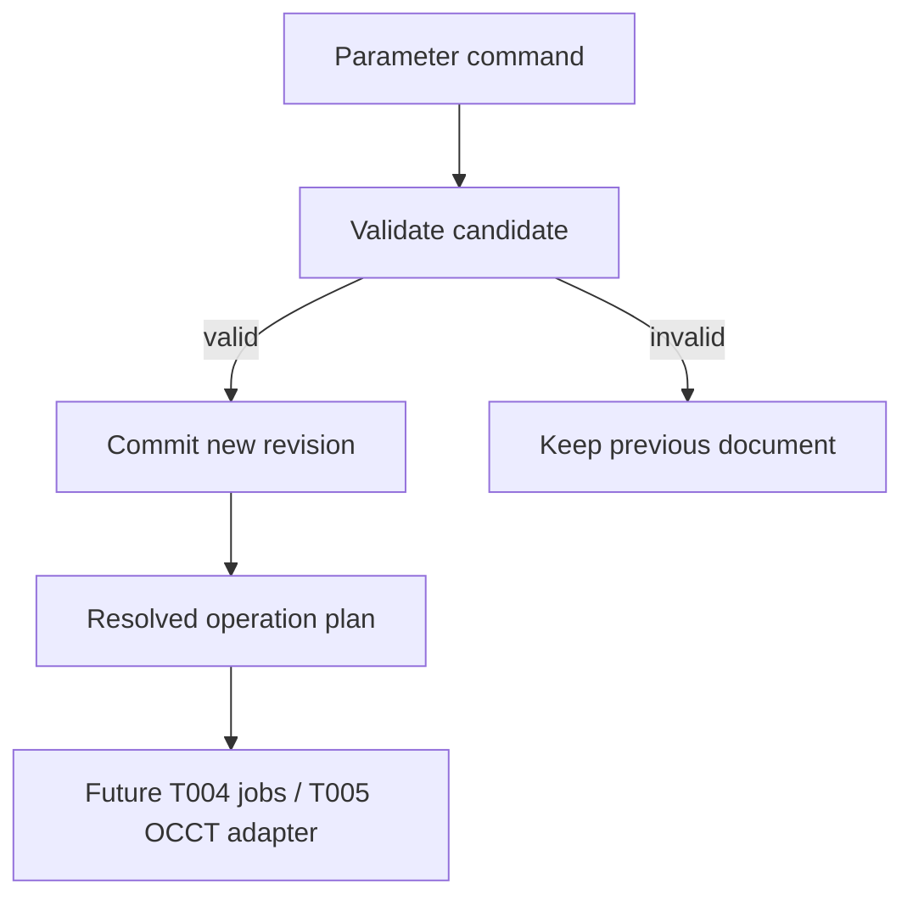

# CAD-T003 · neutral document engine v1

23/11/2026 · SOL · `lab-cad-0.3.0-document` · isolated synthetic reference implementation. Engine 5.0.7 unchanged. Parent T002 `43f7fe301122c2942d61a4badc5fb4a4ccf461af`, CI 45135806207, 4/4 jobs passed.

## Architecture and ownership

The document describes intent; an operation plan resolves the intent but does **not** build geometry. The reference implementation uses Python's standard library only; no dependency on PCL, build123d or OCCT. The neutral data contract is suitable for a later GUI/Python/Java transport, not an implemented cross-language API. Kernel handles, exact solids, display meshes, simulated state and job/cache ownership remain outside persistence.



## Schema v1 and semantics

The normative executable validator is [document.py](../experiments/cad_t003/document.py). The root is a closed JSON object; unknown fields, unknown schema versions and duplicate JSON properties are rejected, not silently dropped. IDs are stable strings matching `[A-Za-z][A-Za-z0-9_.-]{0,63}`, unique within their category. Scope is one component and one output feature, not assemblies. IDs identify document features/ports, not individual OCCT faces/edges.

| Field | Meaning |
| --- | --- |
| `schema`, `version` | `pcl.cad.document`, `1`; explicit migration required for other versions (no migration yet). |
| `id`, `revision` | Caller-assigned document ID, nonnegative JSON-safe integer revision; edits/undo/redo increment it. |
| `component` | Component ID, template ID and independent template version, material `{id,density_kg_m3}`. Density is a declared property, not a computed mass. |
| `parameters` | Typed records `{id,type,unit,value,min,max}`; v1 positive lengths in mm with inclusive bounds; finite real numbers only. |
| `features` | Ordered DAG: `{id,op,inputs,args}`. Dependencies must precede users; duplicate/dangling/forward references rejected. |
| `output` | ID of the feature whose result represents the component. |
| `ports` | Stable rotational port ID, kind, origin in mm and global +Z axis. Port sign/effort-flow physics not defined here. |

Each length expression is a finite literal or `{parameter: "id", scale: number}` (dimensionless scale). No arbitrary expressions, executable strings, or wrapper objects. `cylinder` uses positive radius, height and origin, aligned along +Z. `union` accepts at least two distinct prior feature IDs; its geometric validity is a future adapter result, not guaranteed by schema validation.

## Shaft template and API demo

Default synthetic shaft: diameter 20 mm, length 100 mm, nominal generic steel density 7850 kg/m³. Bounds are template policy for this example, not engineering safety limits. Ports remain on both ends and use one common +Z axis convention; no physical coupling or mass calculation. Changing diameter to 32 mm and length to 180 mm resolves to radius 16 mm, height 180 mm, and end-b at z=180 mm. The IDs `shaft-body`, `end-a`, `end-b` are unchanged.

```python
from experiments.cad_t003.document import shaft, Document, dumps, loads

doc = shaft("sample-shaft")
doc.set_parameters({"diameter": 32, "length": 180}, expected_revision=0)
plan = doc.plan()                  # revision 1, resolved neutral operations
restored = Document(loads(dumps(doc.snapshot())))
assert restored.plan() == plan
doc.undo(expected_revision=1)      # revision 2, original parameters
doc.redo(expected_revision=2)      # revision 3, edited parameters
```

`Document` is single-owner (not thread-safe). `set_parameters` validates the entire candidate before commit, refuses stale revisions and leaves the document/history unchanged on failure. No-op edits leave the revision unchanged. Undo/redo are in-memory snapshots, up to 64 entries per history stack; new edit discards redo. Save/open preserves current snapshot/revision, not command history. Snapshots and plans are detached copies. An invalid native build later must keep the last valid *geometry* separately; successful document validation alone does not guarantee a geometry result.

`content_key` is SHA-256 of sorted-key compact JSON excluding revision. It identifies the exact document representation in this Python reference (array ordering and numeric representation can affect it); it is not cross-language canonicalization, geometry equivalence, or a complete cache key. T004 must add job/session identity, adapter/kernel and tolerance versions, dependency keys, memory budget and stale-result checks. Opening a document or concurrent editors needs explicit session ownership; revision alone is not globally unique.

## Verify in an ordinary checkout

```sh
python -m unittest experiments.cad_t003.test_document -v
python -m experiments.cad_t003.demo
python tools/codemap.py --check
python tools/api_surface.py --check
```

The isolated suite covers template resolution, parameter/port edits, mixed valid/invalid atomic edits, stale edits, no-op, undo/redo and bounded history, detached snapshots, JSON round-trip, schema rejection, dependency ordering, duplicate keys and revision overflow. The unchanged PCL workflow does **not** discover or run this isolated suite; it verifies the pinned existing PCL independently. No dedicated workflow or PCL integration was added. Do not claim native BRep, mesh, STEP, GPU, physical mass/inertia or performance measurements here.

## Next stage / Fable review

| Priority | Review item | Evidence expected |
| --- | --- | --- |
| P0 | Version migration, stable entity identity and topology changes | Non-silent migration fixtures; no arbitrary face indices; parameter changes and rollback. |
| P0 | T004 job contract and cache | Document/session/revision vs content key separation; stale rejection, cancellation and adapter/tolerance-specific keys. |
| P1 | Scale document validation and snapshot/history cost | Large DAG benchmarks, dependency invalidation, structural sharing vs deep copy, memory bounds; no unsupported speed claims. |
| P1 | Cross-language wire format and persistence | Canonical numeric/JSON rules, fixtures across languages, bounded input sizes, atomic file persistence; avoid wrapper coupling. |
| P1 | T005 native adapter | Cylinder and later Boolean operations mapped to OCCT, actual validity and analytic comparison, exact-vs-display separation. |

The two outstanding private gates in CAD_STATUS apply before any integration in PCL. T003 is isolated and synthetic, and does not close either gate. T004 is a separately authorized milestone; no automatic delegation or main/base changes.
