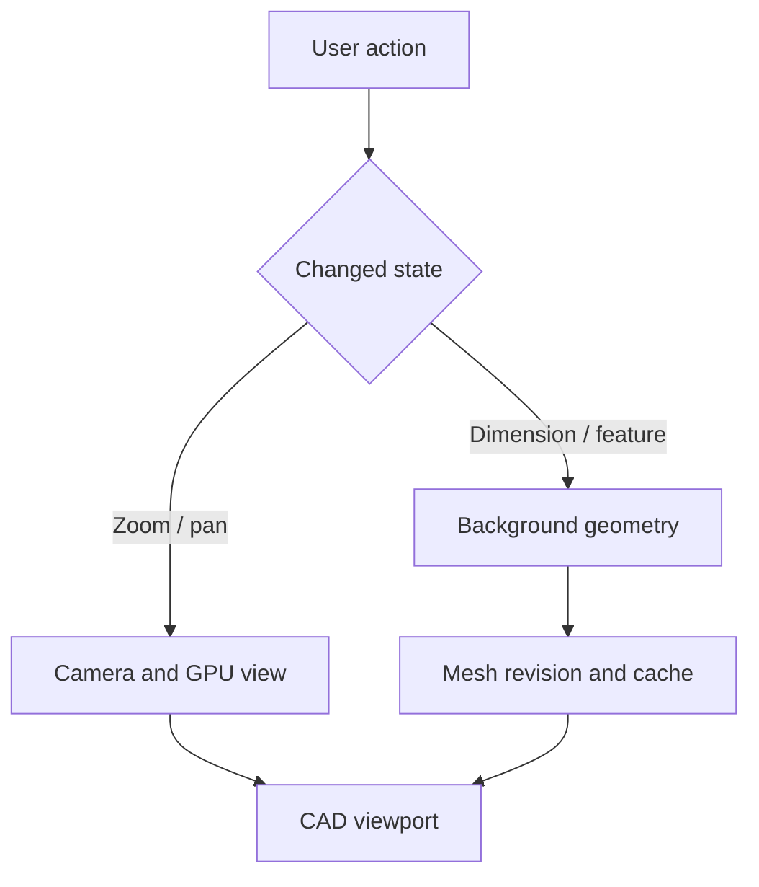

# CAD-T001: integration map for engine 5.0.7

Source: `dab82e5ff2e6da4bde09e4a38aab32edfffe6d51`. Reviewed again on 2026-11-23, including the original CAD-S007 documents recovered from earlier generated files. This is a map of existing code and proposed extension points. It does not implement or select a CAD kernel, rendering backend, vector library or worker architecture.

## Shared surfaces

| Surface | Existing implementation at the approved source | Proposed CAD use and boundary |
| --- | --- | --- |
| Panel registry and window menu | `web/studio/panels.js`: `register`, `toggle`, `check`, `openMenu`; `web/studio/app.js`: `initPanels` | Register one CAD panel through a small adapter; preserve the existing menu and single panel instance. |
| Docking and central documents | `web/studio/dock.js`: `init`, `firstAs`, `reveal`, `place`, `side`, `onChange`; `app.js`: `netViewOpen` | Follow the network diagram's central-document integration; reuse the existing card and layout state. |
| Window sizing | `web/studio/winframe.js`: `frame`, `max`; existing dock splitters | Reuse title drag and resize conventions. Follow the baseline's deferred splitter resize; no second window manager. |
| Circuit drawing gestures | `web/studio/editor.js`: `requestView`, `viewFrame`, `applyView`, `gridBg`, `render` | Use as the interaction/performance reference. Do not use the circuit document as the CAD feature graph. |
| Inspector and application state | `web/studio/app.js`: `openInspector`, `renderProps`, `project`, `applyProject`, `saveLocal` | Later adapter for selected CAD entities and explicit document persistence. No silent geometry-to-electrical parameter mapping. |
| Native HTTP service | `run.py`: request routing; `engine/` | A future CAD service needs an explicit native job boundary, revision/error/cancellation semantics and resource limits. No native CAD endpoint exists in this checkpoint. |
| Add-ons and Python execution | `docs/ADDONS.md`, `web/studio/addons.js`, `addon_client.js`, `pyrt.js`, `scenario_worker.js`, `engine/addons.py` | Existing add-on Python runs in Pyodide. Native geometry is not assumed to run through `PCL.python`. Preserve permission and message boundaries. |
| Existing browser workers | `live.js`, `live_worker.js`, `split.js`, `split_worker.js`, `scenario_worker.js`, `study_worker.js` | Reuse experience and interface conventions after worker design. These are not already a shared CAD scheduler. |
| Sweep worker pool | `web/studio/pool.js`: `SimPool.map`, `stop`, `SIZE`; `sim_worker.js` | Existing dispatch and stop behavior are references for later CAD jobs. The pool has its own worker limit, not a global CPU/RAM budget. |
| External Python control | `pcl/link.py`: `App`, `connect`; `pcl/workbench.py`: `CircuitPlant`, `LivePlant`, `serve` | Extend an agreed API later; retain existing circuit behavior and calls. |
| MATLAB / Octave | `matlab/PclApp.m`, `pcl_link.m`, `PclPlant.m`, `pcl_run.m`, `pcl_sweep.m` | Prefer adapters to the existing interfaces after CAD contracts exist. Current wrappers do not provide CAD commands. |
| Command console | `docs/ROADMAP.md` §98 | Persistent Python workspace and dual kernels are planned at this source, not an implemented CAD console. Avoid adding a competing command window. |
| Recording and time ranges | `web/studio/recview.js`: `open`, `load`; `engine/recording.py`: `read_range`; `study.js`, `engine/studyfolder.py`, `web/viewer/` | Reuse timestamped results and range reading when playback is designed. Plot envelopes are display data, not complete mechanical states. |
| Numerical protection | `web/studio/mna.js`, `netlib.js`, `parts.js`, `sparse.js`, `engine/batch.py` | No change in CAD-T001. If later modified, require the actual nethash/reference inputs and ERR procedure as well as ordinary tests. |
| Test and delivery workflow | `.github/workflows/ci.yml`, `tools/codemap.py`, `api_surface.py`, `verify.py`, `nn_weights.py`, `tests/ui/` | Existing CI includes `lab-*` branches. Keep local evidence and CI tied to their exact SHA; no workflow change is needed for this documentation checkpoint. |

## Preserve the fast interaction path

The existing circuit editor coalesces view updates with `requestAnimationFrame`. During normal zoom/pan, `viewFrame` transforms the existing `.schem-xf` layer with CSS. `applyView` follows 140 ms after the last gesture, or earlier when the relative scale leaves its supported range. The grid uses a CSS background. `render` rebuilds component SVG and is a separate path.

This is a source-code finding, not a new speed measurement or proof that a particular machine uses GPU compositing. New 3D drawing must preserve the separation between camera movement and geometry regeneration.

The following is a **design sketch, not implemented CAD behavior**:

Requirements for later implementation:

- Zoom, pan and camera rotation reuse retained display geometry; they do not request a BRep rebuild or retessellation.
- Geometry edits and tessellation run outside the UI thread. Only the result for the current document revision may become visible.
- Rendering, selection, menus, resize and concurrent simulation are measured separately. No unmeasured response-time promise is made here.
- GPU and vector-library choices remain proposals until their own technical evaluation. Reuse meshes and buffers, release resources, and avoid unlimited nested CPU pools.

## Existing lifecycle and resource boundaries

The following findings were checked against the pinned code. They refine extension points; they are not a new CAD API or scheduler design.

| Existing path | Actual behavior | Consequence for later CAD work |
| --- | --- | --- |
| `app.js:initPanels`, `netViewOpen`; `dock.js:init`, `firstAs`, `reveal` | The app supplies the panel and card definitions. The network document opens next to the circuit and subsequently follows its saved placement. Dock moves the existing DOM node. | Register a single future CAD card in the existing definitions. Preserve one viewport instance through tab, float, reveal and resize; use `Panels.check()` for duplicate IDs. There is no separate `Dock.register` API at this source. |
| `dock.js:splitStart`, `vsplitStart`; `winframe.js:frame` | Region and column splitters move a preview line with animation-frame updates, then commit the layout at release. Floating window frames have their own resize path. | Preserve the deferred splitter behavior. Do not treat every pointer event as a geometry rebuild or assume all resize paths are identical. |
| `live.js`: `supported`, `start`, `apply`, `stop`, `drop` | Live simulation uses a worker when shared memory and cross-origin isolation are available. Replies carry an `epoch`; numbered change batches are acknowledged. Stop restores the worker state; drop abandons it. Unsupported/failed startup can fall back to the page. | Reuse the stale-result and state-ownership lessons. An epoch is not a CAD document revision, and the live stop protocol is not native CAD cancellation. Include the page fallback in later responsiveness checks. |
| `live_worker.js:loop`; `app.js:loop` | Worker execution runs in bounded slices. The page fallback changes its solver budget during input and throttles some UI updates. | CAD jobs must respect both live-worker and fallback execution. Preserve the existing drawing and input budget; measure concurrent activity before claiming a performance gain. |
| `pool.js:SimPool` | Default size is limited by hardware concurrency and capped at eight. Each worker handles one request at a time; `stop()` rejects pending work and terminates workers. Separate consumers can create separate pools. | No shared reservation across live simulation, sweeps, split workers and native geometry exists here. Avoid adding another unrestricted pool. Native cancellation and kernel thread safety still need their own evaluation. |
| `scenario_worker.js`; `app.js:scenStop` | Pyodide runs scripts in a worker. File bytes can be transferred. Stopping terminates the scenario worker and its pool, so Python reloads on the next run. | Preserve the distinction between script termination and cooperative cancellation of a native geometry operation. Do not describe Pyodide execution as an installed native CAD kernel. |
| `study_worker.js` | A separate run streams timestamped data and events to a study folder. A stop request is checked between run slices; the page retains its own simulation. | Recording jobs are another resource consumer. A study run is not automatically synchronized with the live simulation or a future CAD animation. |
| `kernels.js:Solver.put`, `solve` | The existing WebAssembly sparse solver reuses factor data until its identity or value version changes. | This is an existing numerical optimization, not a rendering backend or geometry cache. Keep it intact; use its explicit invalidation principle when later evaluating CAD caches. |

## Recovered document and persistence findings

On 2026-11-23 the owner requested a review of files generated in earlier conversations. The original `CAD_INTEGRATION_MAP.md`, `CAD_BASELINE(1).md` and `CAD_VERSIONS_01(1).md` dated 2026-11-22 were read; the versions document contains CAD-S007. The five CAD planning documents at revision 0.3 were also found and read. These are actual earlier documents, separate from the reconstruction published in `5660e9b`. Their old unpublished-HEAD and CI statements remain historical.

The following important boundaries from the recovered map were checked again in the pinned source:

- `editor.js:load` rebuilds the circuit document from supported fields. `app.js:fullDoc` exports that circuit state. Adding an arbitrary root `cad` field does not establish a lossless save/load path. Later CAD persistence needs an explicit owner, serialization and migration rules, including old circuit files.
- `pcl/core.py:Project.hash` hashes selected circuit fields, while `engine/studyfolder.py:project_hash` hashes the project JSON. Neither is a ready-made CAD geometry/revision cache key or the project's separate original nethash checker.
- Existing `templates.js`, `engine/templates.py`, `library.js`, `units.js` and the inspector provide conventions to reuse. A CAD template still needs explicit length, angle, material, mass and inertia semantics; existing electrical pins must not acquire physical behavior merely from a mesh.
- Network SVG/DXF export in `pcl/netview.py` exports a diagram. It does not provide solid STEP export or parametric feature history. Exact physical properties and display tessellation require separate verification.

## Owner directions recorded for later stages

These directions were confirmed on 2026-11-23. They are future requirements, not implementation in CAD-T001 or approval to start another task.

| Direction | Recorded requirement | Still to evaluate |
| --- | --- | --- |
| Specialized renderer | Build an efficient renderer tailored to this application, without Three.js. Retain display geometry during camera movement and reuse the existing UI infrastructure. | Rendering backend, supported devices, vector/selection facilities, resource lifecycle and measured performance. No backend is selected here. |
| General motion and robotics | Later support general kinematics and dynamics, including a robot defined through CAD and simulated under different scenarios. | Mechanical model, joints, constraints, contact, control coupling and independent validation. CAD shape alone does not supply those models. |
| AI-assisted acceleration | Evaluate assistance for expensive simulation; physics-informed neural networks (PINNs) are a candidate. | Appropriate problem, training data, validity range, error and conservation checks, reference-solver comparison and fallback. Existing NN control code does not establish a general CAD/robotics accelerator. See the existing acceleration discussion in `docs/ROADMAP.md` §41. |
| Time-scaled playback | Keep simulation time and presentation time independent; support temporal zoom, pause, step, replay and synchronized results. | Timestamp/state storage, interpolation around events, replay fidelity, buffer limits and resource cost. Define these contracts in their own later task. |

The earlier Three.js proposal in the historical planning files is superseded by the owner's no-Three.js direction. This does not select or replace a geometry kernel.

### Time behavior already present, and the future boundary

At the approved source, `app.js:loop` and `live_worker.js:loop` compute requested simulation progress from elapsed wall time, the speed setting and the simulation period `T`. The speed setting is periods per wall-clock second, not the integration timestep. `app.js:stepT` advances a requested number of periods; `pause` stops live execution. Recorded parameter programs can replay a circuit run, and `recview.js` can zoom through timestamped results.

Those features are useful foundations. They do not yet implement a generic CAD motion timeline. In particular, `engine/recording.py:read_range` may return per-bin first/minimum/maximum/mean/last values for plots. Such envelopes cannot be treated as complete states for reconstructing a robot's pose or contact events.

For the future playback requirement, physical simulation time remains in seconds and advances under the solver's own timestep and event rules. Presentation time chooses which computed state to show. For example, showing 1 ms of simulation over 1 s of presentation is a playback scale of 0.001 simulation seconds per presentation second; it does not change the physical timestep. Geometry, motion, scopes and events must refer to the same simulation timestamp and document/result revision. Pause, step and replay must specify whether they operate on stored results or advance a solver. No new clock, playback code or storage format is introduced here.

## Parallel engine coordination

Read-only Git inspection on 2026-11-23 found `main` and `lab-5.0.9` at `b1b42b0c4ff1bd546713983ecd27c474bca89451`. The intervening 5.0.8 history includes the persistent Python console (§98), and 5.0.9 adds multiport FDNE work. This is coordination evidence, not a new approved baseline or confirmation of the owner's active engine branch. The CAD checkout remains on engine 5.0.7. Public code, roadmap and commit messages do not replace the still-missing current engine next-steps/decisions/version handoff.

### CAD-S010: coordination with the 5.0.10 workspace changes

A subsequent read-only fetch found `lab-5.0.10` at `2160a13d7180745e80f7f3fefa07788d30b37d1f` (engine version confirmed in `engine/__init__.py`), while `main` remained at the 5.0.9 SHA above. Its own [CI 45102252449](https://github.com/ThanosZr/power-control-lab/actions/runs/45102252449) is completed/success at that exact 5.0.10 SHA. This is an observed engine branch, not an approved CAD target. The pinned-to-5.0.10 comparison changes 54 files, including app, dock, panels, style, console, native routing, numerical code, API surface and workflow. Do not copy or merge those changes into the pinned CAD branch as part of T001.

| Public 5.0.10 source finding | Future integration consideration; not a new CAD contract |
| --- | --- |
| `dock.js` adds layout presets, named layouts, `from` provenance, `screen` positions, `pcl-dock` / `pcl-layouts` storage; `app.js` proposes a study/tutorial's layout without replacing a user-owned layout. | Preserve card IDs and compatible layout persistence; a CAD panel must survive layout changes without discarding its document, selection or active jobs. Older layout data must be tested. |
| `dock.js:openWin`, `adopt`, `lost`, `keepScreen`, `forward`; `screen.html` / `screen.js` handshake move the same card DOM node into a same-origin browser window, handle resize/return/reload and blocked popups. The circuit card is excluded. `Dock.q`/`qa` find detached elements and `screenWin` finds a visible detached window for frame scheduling. | If a future CAD viewport is allowed to detach, verify graphics-context/size/input ownership, resource cleanup, frame scheduling when the main page is hidden and return/reload behavior across documents; do not assume moving a DOM node preserves every GPU backend or permits a second copy. No CAD detach support is implemented. |
| `app.js` displays an experimental GPU* indicator based on `/api/accel_info`; its described use is the AC N−1 batch backend, not graphics rendering. | Keep compute-backend availability, rendering-backend availability and measured frame latency distinct; do not claim a CAD GPU path from this badge. |
| `tests/js/dock_cases.js`, `tests/js/screen_cases.js` and `tests/ui/dock_flow.js` cover layout/preset and second-window behavior in the newer code. See ROADMAP §94 and GUIDE §48. | Reuse these scenarios as target-specific regression references if the owner later authorizes integration with that engine. Existing pinned tests cannot certify the newer detached-window behavior. |

The persistent Python console introduced in 5.0.8 and these workspace changes make the console/card registration and DOM lifecycle particularly important shared surfaces. The 5.0.9 numerical changes also make a whole-tree merge unsuitable as a documentation-only update: a future solver/netlib/parts change requires the separately prescribed nethash/ERR comparison. No target version, adapter API or renderer has been selected here.

## Existing checks useful for later adapters

| Area | Existing checks |
| --- | --- |
| Docking and windows | `tests/js/dock_cases.js`, `tests/ui/dock_flow.js`, `tests/ui/window_flow.js` |
| Drawing and menus | `tests/ui/editor_interactions.js`, `ux_flow.js`, `wiring_flow.js` |
| Responsiveness | `tests/ui/perf_flow.js`, `speed_flow.js` |
| API and native bridge | `tests/test_api.py`, `test_addons.py`, `test_workbench.py`, `test_matlab.py` |
| Numerical equivalence | Existing engine tests plus the separately supplied original nethash/ERR procedure when applicable |
| Recorded results and circuit programs | `tests/test_recording.py`, `tests/test_live_program.py`, `tests/test_stream.py`; these verify existing circuit/recording behavior, not CAD motion playback |

Keep a future CAD adapter in its own module and limit shared-file edits to the registration and lifecycle hooks it needs. Document/feature contracts, kernel comparison and worker design remain later tasks.

## Canonical public plan and integration entry point

The owner subsequently requested that the full CAD plan be maintained in Git and be readable by the parallel engine project for future integration. The five recovered planning files are now canonical docs/CAD_PROJECT_INSTRUCTIONS.md, CAD_NEXT_STEPS.md, CAD_DECISIONS_01.md, CAD_VERSIONS_01.md and CAD_SOURCES.md at documentation revision 0.4.

Start at [CAD_INDEX](CAD_INDEX.md) for the complete reading order and [CAD_PLAN_DETAILS](CAD_PLAN_DETAILS.md) for stage acceptance, dependencies and integration checks. The CAD branch [root README](../README.md) now presents this tool's goal and current planning stage, while linking to the original engine README at its pinned source.

This is an owner-authorized documentation change, not a base upgrade or integration of newer console/FDNE code. Anyone preparing a future merge must record source/base/target SHAs, read the actual active engine handoff, inspect shared-file/API/persistence conflicts and obtain the specific main/base authorization before making that integration.
