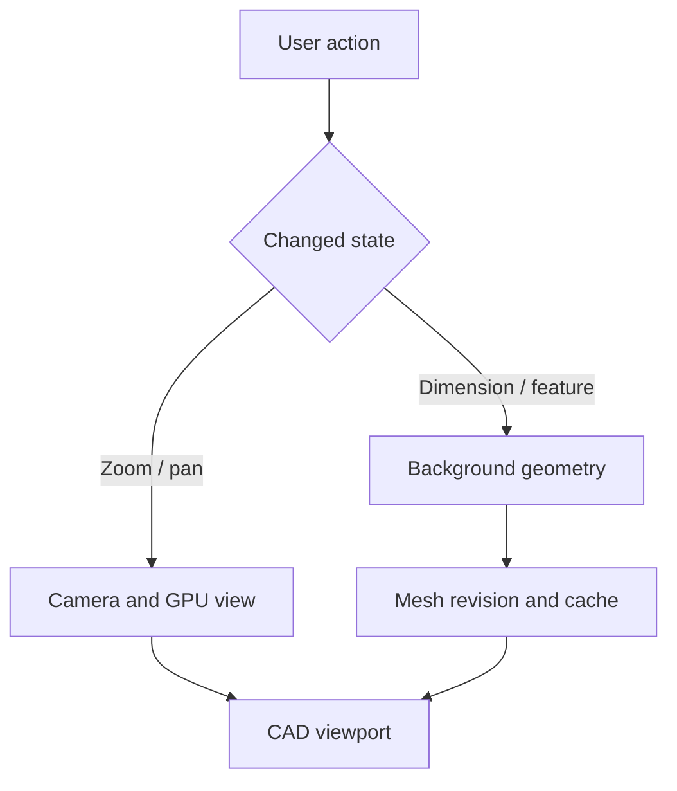

# CAD-T001: integration map for engine 5.0.7

Source: `dab82e5ff2e6da4bde09e4a38aab32edfffe6d51`. This is a map of existing code and proposed extension points. It does not implement or select a CAD kernel, vector library or worker architecture.

## Shared surfaces

| Surface | Existing implementation at the approved source | Proposed CAD use and boundary |
| --- | --- | --- |
| Panel registry and window menu | `web/studio/panels.js`: `register`, `toggle`, `check`, `openMenu`; `web/studio/app.js`: `initPanels` | Register one CAD panel through a small adapter; preserve the existing menu and single panel instance. |
| Docking and central documents | `web/studio/dock.js`: `init`, `firstAs`, `reveal`, `place`, `side`, `onChange`; `app.js`: `netViewOpen` | Follow the network diagram's central-document integration; reuse the existing card and layout state. |
| Window sizing | `web/studio/winframe.js`: `frame`, `max`; existing dock splitters | Reuse title drag and resize conventions. Follow the baseline's deferred splitter resize; no second window manager. |
| Circuit drawing gestures | `web/studio/editor.js`: `requestView`, `viewFrame`, `applyView`, `gridBg`, `render` | Use as the interaction/performance reference. Do not use the circuit document as the CAD feature graph. |
| Inspector and application state | `web/studio/app.js`: `openInspector`, `renderProps`, `project`, `applyProject`, `saveLocal` | Later adapter for selected CAD entities and explicit document persistence. No silent geometry-to-electrical parameter mapping. |
| Native HTTP service | `run.py`: request routing; `engine/` | A future CAD service needs an explicit native job boundary, revision/error/cancellation semantics and resource limits. No native CAD endpoint exists in this checkpoint. |
| Add-ons and Python execution | `docs/ADDONS.md`, `web/studio/addons.js`, `addon_client.js`, `pyrt.js`, `scenario_worker.js`, `engine/addons.py` | Existing add-on Python runs in Pyodide. Native geometry is not assumed to run through `PCL.python`. Preserve permission and message boundaries. |
| Existing browser workers | `live.js`, `live_worker.js`, `split.js`, `split_worker.js`, `scenario_worker.js`, `study_worker.js` | Reuse experience and interface conventions after worker design. These are not already a shared CAD scheduler. |
| External Python control | `pcl/link.py`: `App`, `connect`; `pcl/workbench.py`: `CircuitPlant`, `LivePlant`, `serve` | Extend an agreed API later; retain existing circuit behavior and calls. |
| MATLAB / Octave | `matlab/PclApp.m`, `pcl_link.m`, `PclPlant.m`, `pcl_run.m`, `pcl_sweep.m` | Prefer adapters to the existing interfaces after CAD contracts exist. Current wrappers do not provide CAD commands. |
| Command console | `docs/ROADMAP.md` §98 | Persistent Python workspace and dual kernels are planned at this source, not an implemented CAD console. Avoid adding a competing command window. |
| Numerical protection | `web/studio/mna.js`, `netlib.js`, `parts.js`, `sparse.js`, `engine/batch.py` | No change in CAD-T001. If later modified, require the actual nethash/reference inputs and ERR procedure as well as ordinary tests. |
| Test and delivery workflow | `.github/workflows/ci.yml`, `tools/codemap.py`, `api_surface.py`, `verify.py`, `nn_weights.py`, `tests/ui/` | Existing CI includes `lab-*` branches. Keep local evidence and CI tied to their exact SHA; no workflow change is needed for this documentation checkpoint. |

## Preserve the fast interaction path

The existing circuit editor coalesces view updates with `requestAnimationFrame`. During normal zoom/pan, `viewFrame` transforms the existing `.schem-xf` layer with CSS. `applyView` follows 140 ms after the last gesture, or earlier when the relative scale leaves its supported range. The grid uses a CSS background. `render` rebuilds component SVG and is a separate path.

This is a source-code finding, not a new speed measurement or proof that a particular machine uses GPU compositing. New 3D drawing must preserve the separation between camera movement and geometry regeneration.

The following is a **design sketch, not implemented CAD behavior**:

Requirements for later implementation:

- Zoom, pan and camera rotation reuse retained display geometry; they do not request a BRep rebuild or retessellation.
- Geometry edits and tessellation run outside the UI thread. Only the result for the current document revision may become visible.
- Rendering, selection, menus, resize and concurrent simulation are measured separately. No unmeasured response-time promise is made here.
- GPU and vector-library choices remain proposals until their own technical evaluation. Reuse meshes and buffers, release resources, and avoid unlimited nested CPU pools.

## Existing checks useful for later adapters

| Area | Existing checks |
| --- | --- |
| Docking and windows | `tests/js/dock_cases.js`, `tests/ui/dock_flow.js`, `tests/ui/window_flow.js` |
| Drawing and menus | `tests/ui/editor_interactions.js`, `ux_flow.js`, `wiring_flow.js` |
| Responsiveness | `tests/ui/perf_flow.js`, `speed_flow.js` |
| API and native bridge | `tests/test_api.py`, `test_addons.py`, `test_workbench.py`, `test_matlab.py` |
| Numerical equivalence | Existing engine tests plus the separately supplied original nethash/ERR procedure when applicable |

Keep a future CAD adapter in its own module and limit shared-file edits to the registration and lifecycle hooks it needs. Document/feature contracts, kernel comparison and worker design remain later tasks.
