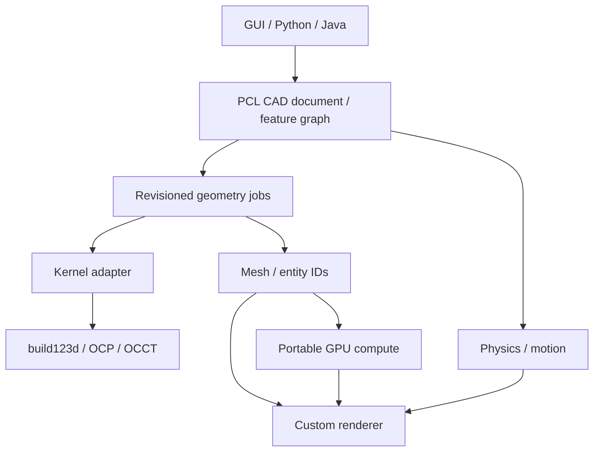

# CAD-T002 · επιλογή πυρήνα και τεχνικό spike

23/11/2026 · SOL · branch lab-cad-0.2.0-kernel. Βάση engine 5.0.7 αμετάβλητη.
Το T002 είναι απομονωμένη τεχνική διερεύνηση, όχι CAD runtime μέσα στο PCL.

## Απόφαση και όρια

Ο ιδιοκτήτης ενέκρινε υβριδική αρχιτεκτονική: **δικός μας CAD engine, Open CASCADE Technology (OCCT) για ακριβή BRep και δικό μας GPU acceleration/rendering layer**. Επιλέγουμε OCCT ως αρχικό γεωμετρικό kernel και build123d ως αρχικό υψηλού επιπέδου Python adapter, όχι ως document engine. Το CadQuery παραμένει μετρημένη εναλλακτική· OCP και μελλοντικά native C++/OCCT είναι διαδρομές για hotspots. Δεν φορτώνουμε δύο wrappers μόνιμα στο runtime. Η επιλογή wrapper είναι αναστρέψιμη, όχι δωρεάν: adapters, topology mapping, semantics και regression tests θα χρειαστούν αν αλλάξει.

| Κριτήριο | CadQuery | build123d | Συμπέρασμα |
| --- | --- | --- | --- |
| Ακριβής γεωμετρία | OCCT μέσω OCP | OCCT μέσω OCP | Ίδιος υποκείμενος kernel για τις δοκιμασμένες εκδόσεις |
| Σύνθεση | Workplane/fluent API, direct shapes | Algebra και builder, direct shapes | Προτιμάται explicit shape composition ως βάση του δικού μας graph |
| Native πρόσβαση | Shape.wrapped | Shape.wrapped | Επιλεκτικό OCP χωρίς μεταφορά τύπων στο δημόσιο API |
| Assemblies | Constraints/solve API | Ρητά joints/placements | Δεν υποκαθιστούν μελλοντικό γενικό sketch/mate ή multibody solver |
| STEP, ιδιότητες, tessellation | PASS στο δοκίμιο | PASS στο δοκίμιο | Καμία υπόσχεση καθολικού topology naming ή ίδιου feature history |
| Διανομή | Apache-2.0 wrapper | Apache-2.0 wrapper | Επιβεβαιώθηκε από installed metadata· απαιτείται πλήρης dependency/license audit πριν πακετάρισμα, συμπεριλαμβανομένου OCCT |

## Δικό μας architecture, όχι εγκλωβισμός



- Neutral versioned document: parameters, units, feature IDs, operation dependencies, materials, frames και command/undo history ανήκουν στο PCL. Δεν γράφουμε wrapper objects ή Python expression AST ως υποχρεωτικό format και δεν κάνουμε persistent references με αυθαίρετους face indices. Kernel-specific BRep cache μπορεί να αναδημιουργηθεί. Import STEP δεν ανακτά ιστορικό.
- Native geometry service με σαφή ownership: exact solid, validation, mass/inertia, STEP και Boolean/fillet operations. Όπου υπάρχει τεκμηριωμένο hotspot, το adapter παρακάμπτει το wrapper και χρησιμοποιεί OCP. Native integration ή άλλο kernel εξετάζονται μόνο βάσει regression/μετρήσεων, όχι προκαταβολικό rewrite του OCCT.
- Ακριβής BRep/φυσικές ιδιότητες παραμένουν στον native CPU kernel. Το GPU compute αφορά κατάλληλα παράλληλα workload (mesh processing, BVH/culling, preview, broad-phase και μελλοντικά συγκεκριμένοι validated physics/AI dispatches). Δεν υποσχόμαστε GPU acceleration των exact Booleans ή ακριβείς ιδιότητες από display triangles.
- Backend GPU abstraction: υποψήφιο wgpu (Vulkan/D3D12/Metal ανά συσκευή/OS). Όχι hard dependency CUDA. Capability detection, memory budget, CPU fallback και καταγραφή πραγματικού adapter/driver/precision. Optional vendor fast path μόνο αν υποστηρίζεται από benchmark και contract. Αυτή είναι επιλογή κατεύθυνσης προς validation, όχι επιλεγμένη έκδοση ή υλοποίηση.
- Frontend: δικός μας retained renderer, WebGPU ως πρώτος υποψήφιος και WebGL2 fallback προς εξέταση. Όχι Three.js. GPU buffers ανά geometry revision, camera uniforms, picking, instancing, LOD, incremental updates, resize και resource disposal. Camera zoom/pan/rotation δεν καλούν geometry rebuild. Renderer δεν ορίζει exact BRep, ούτε document schema.
- Transfer native service → browser ως versioned binary buffers με entity mapping, offsets, index width και bounds· μετράμε IPC/serialization/upload και latency. Δεν υποσχόμαστε zero-copy μεταξύ processes/browser/GPU. Κοινός scheduler με CPU και VRAM/RAM budget, cancellation, stale-revision rejection και protection του live simulation.
- Future motion: physics/joints/solver και timestamped states χωριστά από CAD shapes. GPU acceleration και PINNs μόνο με validated reference, tolerance και fallback. Time-scaled playback δεν αλλάζει solver Δt.

## Αναπαραγώγιμο δοκίμιο

Κώδικας: [benchmark.py](../experiments/cad_t002/benchmark.py). Ουδέτερη πλάκα 80 × 60 mm, πάχος 10 mm, κεντρική οπή ακτίνας 12 mm, τέσσερις οπές ακτίνας 3 mm στα (±30, ±20) mm. Παραλλαγές (πάχος, κεντρική ακτίνα): (12, 10) και (8, 14) mm. Ανεξάρτητα αναλυτικά volume/inertia, unit density, κέντρο στο origin. Ακριβές BRep ελέγχεται με OCCT, όχι με το mesh.

- Ένα solid, BRep validity, volume/inertia relative 1e-8, absolute volume 1e-6 mm³, inertia 1e-5 για density 1, center tolerance 1e-6 mm. STEP export/import σε κάθε variant και επανάληψη exact checks.
- Tessellation linear tolerance 0.05 mm, angular tolerance 0.1 rad, valid triangle indices/finite vertices, απόκλιση signed mesh volume <0.5%. Δεν αποτελεί πλήρη Hausdorff/watertightness έλεγχο.
- 2 warmups και 15 timed builds / fresh tessellations ανά wrapper σε διαφορετικό process, εναλλαγή των τριών variants. Timing excludes exact tests, export/import, process startup· separate import timing. p95 nearest rank (με 15 δείγματα είναι μέγιστο), RSS είναι process peak και περιλαμβάνει import, STEP και mesh. Δεν είναι production SLA.
- Runtime: Linux x86_64 6.18.57, Python 3.12.14, AMD EPYC 9V45 reported, 9 logical CPUs visible, κοινό OCP 7.8.1.1.post1, CadQuery 2.7.0 και build123d 0.10.0. Imports/operations επιτυχείς και pip check PASS· packages ήταν ήδη εγκατεστημένα, δεν πραγματοποιήθηκε fresh wheel installation σε ξένο OS. Δεν υπάρχουν GPU measurements.

```sh
python -m venv .venv-cad-spike
# Activate the isolated environment (Linux example):
source .venv-cad-spike/bin/activate
python -m pip install "cadquery==2.7.0" "build123d==0.10.0" "cadquery-ocp==7.8.1.1.post1"
python -m pip check
python experiments/cad_t002/benchmark.py cadquery --runs 15
python experiments/cad_t002/benchmark.py build123d --runs 15
```

Η εντολή installation είναι recipe αναπαραγωγής, όχι ολοκληρωμένος cross-platform installation test ή πλήρες transitive lock.

Το υπάρχον GitHub CI παραμένει αμετάβλητο και ελέγχει τον PCL 5.0.7· δεν εγκαθιστά ούτε εκτελεί το πείραμα. Τα exact/tessellation/STEP checks εκτελέστηκαν τοπικά. Μια dedicated CAD CI matrix προϋποθέτει χωριστή έγκριση και πραγματική επαλήθευση dependency packaging.

| Μετρηθέν | CadQuery 2.7.0 | build123d 0.10.0 |
| --- | ---: | ---: |
| Build median / p95 (ms) | 8.03 / 24.12 | 13.07 / 14.21 |
| Tessellation median / p95 (ms) | 34.50 / 43.10 | 24.22 / 32.94 |
| Import (ms, μία εκτέλεση) | 1323.52 | 1286.19 |
| Peak RSS (KiB) | 366192 | 375784 |
| Triangles ανά variant | 2552 | 2552 |
| Exact validity, volume, inertia, STEP | PASS, 3/3 variants | PASS, 3/3 variants |
| Μέγιστη mesh volume relative deviation | 0.00742% | 0.00742% |

Δεν συμπεραίνουμε γενικό νικητή ταχύτητας από 15 επαναλήψεις σε ένα μικρό shape. Η επιλογή build123d συσχετίζεται με τον καθαρό διαχωρισμό shape objects/operations και ευέλικτη σύνθεση, με OCCT ως πραγματικό kernel. Οι μετρήσεις δικαιολογούν profiling και adapter boundary, όχι μόνιμο lock-in.

## Fable: συγκεκριμένο review / optimization backlog

Οι παρακάτω ενέργειες είναι για ξεχωριστή εργασία αφού εγκριθούν τα σχετικά gates. Καμία αλλαγή runtime ή main σε αυτό το spike.

| Προτεραιότητα | Τι να εξεταστεί | Αποδοχή / evidence |
| --- | --- | --- |
| P0 | Native profile wrapper έναντι OCP/C++: Boolean, fillet, tessellation, repeated features, assemblies | Warm/cold p50/p95, controlled repetitions, memory, ίδιο OCCT, ίδιο αποτέλεσμα, όχι benchmark μόνο ενός part |
| P0 | Topology naming/history: split/merge/generated faces, ambiguous selections, regeneration και stable entity mapping | Deterministic tests με topology-changing parameter edit, undo και failure recovery |
| P0 | Packaging/ABI path Windows/Linux/macOS: Python wheels, OCCT versions, license/notice closure | Fresh install matrix σε δηλωμένες αρχιτεκτονικές, pin/lock και διαχωρισμός adapter |
| P1 | Cross-vendor GPU prototype: wgpu vs εναλλακτικές, WebGPU vs WebGL2 fallback, capability negotiation | AMD/NVIDIA/Intel και Apple όπου υπάρχει hardware· driver/device names, feature/limits, precision and fallback tests. Όχι software renderer ως hardware proof |
| P1 | Retained renderer: mesh layout, GPU buffer residency, camera uniforms, picking/BVH, culling/LOD, instancing | p50/p95 frame/input latency, number of rebuilds = 0 στο zoom/pan, VRAM, upload bytes, large assembly & device-loss tests |
| P1 | Native jobs/IPC/scheduler: thread/process safety, parallel OCCT, incremental cache, cancellation, bounded queues | Concurrent PCL solver + geometry, stale result rejection, memory ceiling, responsiveness, no oversubscription |
| P2 | Precision strategy: CPU double exact properties, accelerated approximations with error bounds, workload suitability | Compare against analytic/reference solver, tolerances, conservation, end-to-end speed including transfer |
| P2 | Future motion/physics and PINN fallback | Separate validated model/solver and timestamped playback, end-to-end latency/error and fallback, no general accelerator claim |

Στο T003 ορίζεται versioned CAD document/component contract με neutral operations και opaque backend handles. Δεν αρχίζει αυτόματα το T003 ούτε επιλέγεται GPU implementation. Η ιδιωτική πύλη ενεργού engine handoff και πραγματικού privacy checker διατηρείται πριν από εφαρμογή στο PCL.

## Πηγές

- [CadQuery introduction](https://cadquery.readthedocs.io/en/stable/intro.html), [assembly constraints](https://cadquery.readthedocs.io/en/stable/assy.html).
- [build123d concepts](https://build123d.readthedocs.io/en/stable/key_concepts_algebra.html), [direct shape API](https://build123d.readthedocs.io/en/stable/direct_api_reference.html), [joints](https://build123d.readthedocs.io/en/stable/joints.html). Stable online docs may differ from the installed spike version.
- [OCCT BRepGProp](https://dev.opencascade.org/doc/refman/html/class_b_rep_g_prop.html).
- [wgpu backend support](https://wgpu.rs/doc/wgpu/struct.Backends.html), [WebGPU adapter and limits](https://developer.mozilla.org/en-US/docs/Web/API/GPUAdapter).
