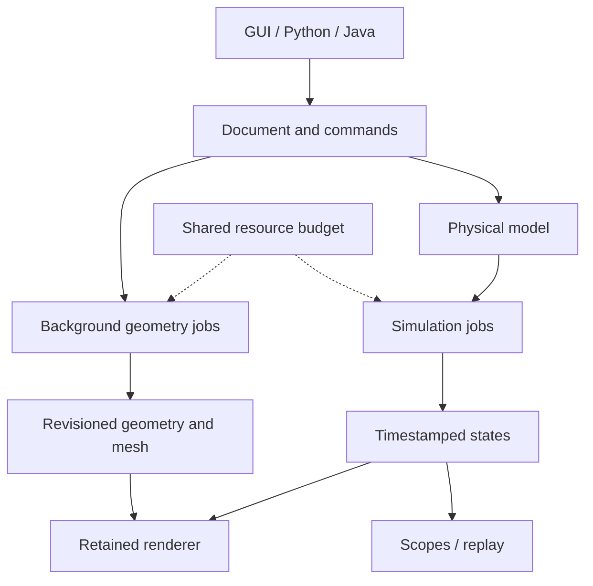

# CAD · αναλυτικό πλάνο προϊόντος και κριτήρια

Αναθεώρηση εγγράφων 0.5 · 23/11/2026. Συμπληρώνει το [CAD_NEXT_STEPS](CAD_NEXT_STEPS.md), τους [κανόνες](CAD_PROJECT_INSTRUCTIONS.md) και τον [χάρτη ενσωμάτωσης](CAD_INTEGRATION_MAP.md).

Απαιτήσεις, προτάσεις και υλοποίηση διατηρούνται χωριστά. T001 documentation-only, T002 isolated spike: επιλεγμένη υβριδική αρχιτεκτονική OCCT/build123d adapter, δικό μας document/compute/rendering layer, αναλυτικά στο [CAD_KERNEL_EVALUATION](CAD_KERNEL_EVALUATION.md). Κανένα runtime API, scheduler ή renderer δεν έχει υλοποιηθεί.

## 1. Προϊόν και βασική εμπειρία

Στόχος είναι ενιαίο παραμετρικό CAD/custom-component tool μέσα στο Power & Control Lab. Ο χρήστης σχεδιάζει με GUI ή κώδικα, παραμετροποιεί το ίδιο έγγραφο, ορίζει υλικά και φυσική συμπεριφορά, συναρμολογεί και συνδέει εξαρτήματα με μοντέλα προσομοίωσης. Τα templates αποτελούν βασική διαδρομή δημιουργίας.

Ενδεικτική τελική διαδρομή χρήσης, όχι σημερινή λειτουργία:

1. Δημιουργία εξαρτήματος από ουδέτερο template, π.χ. άξονα ή βάσης εδράνου.
2. Ορισμός διαστάσεων, υλικού και τοπικών frames με ρητές μονάδες.
3. Αλλαγή από GUI ή Python στο ίδιο document· inspector, feature history, undo και αποθήκευση ακολουθούν.
4. Δημιουργία instance σε assembly, ορισμός συμβατών mates/θυρών και επιλογή φυσικού μοντέλου.
5. Εκτέλεση του υποστηριζόμενου σεναρίου, με συγχρονισμένες τιμές/καταστάσεις και σαφή αναφορά παραμέτρων.
6. Έλεγχος μετρήσεων, replay αποτελεσμάτων και εξαγωγή στα υποστηριζόμενα formats.

FEA/CFD/CAM και κλειστές μορφές ανταλλαγής απαιτούν ξεχωριστό scope και επαλήθευση.

## 2. Τι είναι απαίτηση και τι είναι ακόμη ανοικτό

| Θέμα | Απαίτηση/κατεύθυνση | Ανοικτή τεχνική επιλογή |
| --- | --- | --- |
| Renderer | Εξειδικευμένος και αποδοτικός, χωρίς Three.js· camera movement με διατηρημένη display geometry | Backend, vector/selection libraries, συσκευές, fallback και κατανομή εργασίας |
| Γεωμετρικός πυρήνας | Ακριβείς γεωμετρικές πράξεις και ελεγχόμενα exports, χωριστά από το display mesh | T002: OCCT με build123d adapter, OCP/native hotspots, neutral document. Cross-platform και topology validation εκκρεμούν |
| Έγγραφο | Versioned παραμετρικό document, κοινό για GUI/κώδικα, με έλεγχο μεταβολών | Τελικό schema, feature IDs/naming, migrations και document ownership στο T003 |
| Jobs | Background βαριές πράξεις, revisions, cache, σαφής ακύρωση και συνολικό όριο πόρων | Native process/thread model, fairness, shared reservations και cancellation semantics στο T004 |
| Ενσωμάτωση | Υπάρχον UI, μικροί adapters, διατήρηση παλιών αρχείων και API | Ακριβή hooks μετά τα contracts· καμία αυτόματη αλλαγή approved base |
| Φυσική | Δηλωμένο μοντέλο με ιδιότητες, θύρες και μονάδες | Πρώτοι φυσικοί τομείς, coupling/DAE και supported model subset |
| Κίνηση | Μελλοντική γενική κινηματική/δυναμική και robotics | Constraints, multibody/contact, numerical method και benchmarks |
| AI | Μελλοντική αξιολόγηση υποβοήθησης/επιτάχυνσης· PINNs υποψήφια προσέγγιση | Πεδίο χρήσης, δεδομένα, training/runtime, error control και fallback |
| Playback | Χωριστός χρόνος προσομοίωσης/προβολής, zoom/pause/step/replay, συγχρονισμένα αποτελέσματα | State storage, interpolation/event policy και ακριβές timeline contract |
| MCU | Μελλοντικό code generation για ρητά υποστηριζόμενο υποσύνολο | IR, συγκεκριμένος target/SDK/toolchain και μετρήσεις |

Οι ενότητες αυτές δεν αποτελούν άδεια να ξεκινήσουν τα επόμενα tasks. T001 documentation-only ολοκληρωμένο, T002 isolated synthetic spike (D026). Νέα υλοποίηση CAD στο PCL απαιτεί ρητή εντολή και τις πραγματικές ιδιωτικές πύλες.

### Ενδεικτική αρχιτεκτονική για συνεργασία και ενίσχυση

**Ενδεικτική πρόταση συζήτησης, όχι επιλεγμένα συμβόλαια ή υλοποίηση.** D025: θα εξελίξουμε μαζί με τον ιδιοκτήτη τον engine πάνω στο αποθετήριο της εγκεκριμένης 5.0.7. Το Fable μπορεί να εξετάσει και να ενισχύσει τις λύσεις όταν επιλέξουμε να του αναθέσουμε συγκεκριμένη εργασία. Οι ακόλουθες μονάδες δείχνουν διαχωρισμούς ευθυνών και ερωτήματα προς εξέταση, όχι υποχρεωτικές νέες κλάσεις, υπηρεσίες ή εξαρτήσεις.

Η παραμετρική περιγραφή είναι η αυθεντική πηγή εντολών, όχι το mesh. Μια αλλαγή διαστάσεων μπορεί να παράγει νέα ακριβή γεωμετρία και display mesh στο background· η κάμερα κινείται πάνω σε ήδη διατηρημένα δεδομένα χωρίς να ξανατρέχει τον kernel. Η φυσική μοντελοποίηση και η διαχείριση χρόνου δεν εξαρτώνται αυθαίρετα από το frame rate. Ο κοινός προϋπολογισμός πόρων πρέπει να καλύπτει παράλληλα geometry jobs και simulation, διατηρώντας την απόκριση του υπάρχοντος editor.

| Θέμα προς εξέταση από εμάς / Fable | Ενδεικτική σχεδιαστική επιλογή προς δοκιμή | Αποδεικτικό πριν από υιοθέτηση |
| --- | --- | --- |
| Renderer χωρίς Three.js | Retained GPU buffers, χωριστά camera/scene revisions, incremental uploads και picking. Σύγκριση κατάλληλων backends, όχι προεπιλογή. | p50/p95 frame time, input latency, geometry rebuild count στο zoom/pan, VRAM/RAM, responsiveness με concurrent solver, resize/reveal και resource disposal. |
| Ακριβής γεωμετρία και topology | Ανεξάρτητος kernel adapter, σταθερές feature references, cache με ρητή ταυτότητα/ανοχή. | Ίδιο δοκίμιο, STEP round-trip, volume/mass/inertia, feature regeneration, αποτυχίες boolean και undo χωρίς απώλεια τελευταίου valid state. |
| Worker scheduling | Jobs με revision/token, κοινός προϋπολογισμός CPU/RAM, backpressure και ακύρωση· προστασία live simulation. | Stale results απορρίπτονται· δοκιμή oversubscription, cancellation/recovery, memory ceiling και μετρημένο IPC overhead. |
| GUI / API / αποθήκευση | Ένα document contract, μικροί adapters σε PCL 5.0.7, κοινή command/undo διαδρομή. | Save/open παλιών circuit files, migration/round-trip δικού μας εγγράφου, συμβατή επιλογή/inspector, ένα panel instance. Μελλοντικό detached window ελέγχεται μόνο σε εγκεκριμένο target. |
| Physics και motion | Ρητές μάζες/αδράνειες, joints, frames, θύρες/μονάδες, σαφής διαχωρισμός κινηματικής και δυναμικής. | Αναλυτικά reference cases, conservation/energy balance, event handling, ανοχές και σύγκριση solver· όχι μόνο animation. |
| Χρόνος προβολής | Ανεξάρτητα simulation/presentation clocks, χρονικά σφραγισμένες καταστάσεις και κοινό playhead για 3D/scopes/events. | Replay με pause/step/slow motion, συγχρονισμός timestamps/revisions, πολιτική συμβάντων/interpolation, έλεγχος αποθήκευσης. |
| AI-assisted acceleration | PINNs ως μία υποψήφια μέθοδος μόνο σε ορισμένο πρόβλημα, με επαληθευμένο reference solver και fallback. | Σφάλμα, φυσικοί περιορισμοί, out-of-domain συμπεριφορά, reproducibility, χρόνος end-to-end και overhead. |
| Engine regression και integration | Απομόνωση νέων modules και μικρά hooks στον pinned engine. Ακριβή refs πριν από οποιαδήποτε μελλοντική ενσωμάτωση. | Τοπικοί έλεγχοι και CI στο ίδιο SHA, πραγματικός privacy checker, και πραγματικός nethash/ERR αν αλλάζουν solver/netlib/parts. |

**Ενδεικτικό σενάριο πρώτου δοκιμίου:** προτείνεται ουδέτερος παραμετρικός άξονας με δύο διαμέτρους, υλικό και τοπικά frames. Ένα zoom/pan δεν επιτρέπει rebuild του σώματος· μια αλλαγή διαμέτρου ζητά νέα revision. Γεωμετρικές ιδιότητες και επιλογή οντότητας ελέγχονται ανεξάρτητα από τη tessellation. Αργότερα, και μόνο σε εγκεκριμένο motion task, μπορεί να δοκιμαστεί μικρό σενάριο περιστροφής με γνωστή αδράνεια και χρονικά σφραγισμένα αποτελέσματα. Το δοκίμιο, ο kernel και τα αριθμητικά όρια δεν εγκρίνονται εδώ. Τα ευρήματα κάθε επόμενου πειράματος θα γράφονται στο Git, ώστε η ενίσχυση να πατά σε πραγματικές μετρήσεις και όχι σε context παλιών chats.

## 3. Ιδιοκτησία δεδομένων και ακριβή/προσεγγιστικά αποτελέσματα

Το πλάνο διακρίνει πληροφορίες με διαφορετικό σκοπό:

| Πληροφορία | Προβλεπόμενος ρόλος | Απαραίτητος έλεγχος |
| --- | --- | --- |
| Παραμετρικό document / feature graph | Ορισμοί, εξαρτήσεις, παράμετροι, ιστορικό εντολών | Version/migration, αναπαραγωγή, undo/redo, ελεγχόμενες αποτυχίες |
| Ακριβής γεωμετρία | BRep/τοπολογία και πράξεις του επιλεγμένου kernel | Εγκυρότητα, γεωμετρικές ανοχές, export/import και ιδιότητες |
| Display geometry | Mesh, ακμές, picking και επίπεδα λεπτομέρειας | Σύνδεση με entity/revision, ορατή ακρίβεια, GPU lifecycle και κόστος μεταφοράς |
| Φυσικό μοντέλο component | Καταστάσεις, νόμοι, θύρες, effort/flow και γεγονότα | Μονάδες, πρόσημα, ενέργεια/ισχύς, reference cases και solver compatibility |
| Αποτελέσματα / timestamps | Τι υπολογίστηκε σε συγκεκριμένο μοντέλο/σενάριο | Provenance, σύνολο παραμέτρων, χρόνος προσομοίωσης, συμβάντα και replay fidelity |
| UI layout / camera | Προτίμηση προβολής και θέση καρτών | Resize/dock/reveal, persistence χωρίς αλλοίωση φυσικού/γεωμετρικού μοντέλου |

Οι ακριβείς δομές και ονόματα πεδίων θα οριστούν στο σχετικό contract. Το υπάρχον circuit JSON δεν έχει ακόμη εγγυημένη διαδρομή αποθήκευσης αυθαίρετων CAD πεδίων: το Editor.load ανακατασκευάζει γνωστά πεδία. Τα υπάρχοντα Project.hash/project_hash έχουν διαφορετικές εμβέλειες και δεν αποτελούν έτοιμο CAD cache key.

Μονάδες/άξονες/frames ορίζονται ρητά για GUI/Python/Java/MATLAB. Συντεταγμένες ηλεκτρικού σχεδίου δεν γίνονται αδήλωτα φυσικές διαστάσεις ή SI παράμετροι.

## 4. Στάδια με συγκεκριμένα κριτήρια

### C0 — δεσμευμένη βάση, τεχνική επιλογή και συμβόλαια

Περιλαμβάνει τα χωριστά πρώτα tasks του NEXT_STEPS, όχι μία συνομιλία υλοποίησης για όλα.

- T001: ακριβής βάση και CI, αναπαραγώγιμο baseline, shared-file map, πραγματική κατάσταση των inputs και πλήρες δημόσιο handoff.
- T002: ίδιο ουδέτερο δοκίμιο σε υποψήφιους kernels, εγκατάσταση, exact/export/mesh/ιδιότητες, κόστος build/tessellation και περιορισμοί. Η απόφαση χρειάζεται πραγματικά αποτελέσματα.
- T003: document/component contract με μικρό template, lifecycle, ταυτότητες και migration boundaries.
- T004: απομονωμένο worker-job proof με revisions, cache, ακύρωση και συνολικό CPU/RAM budget.

Το C0 απαιτεί όλα τα αντίστοιχα παραδοτέα.

### C1 — πρώτο λειτουργικό κατακόρυφο CAD βήμα

- Μία πραγματική δημιουργία σώματος από το API και ένα panel στο υπάρχον UI.
- Επιλογή, μετακίνηση και αλλαγή παραμέτρου με ορατή σωστή document revision.
- GUI και κώδικας παράγουν το ίδιο αποτέλεσμα μέσω του συμφωνημένου API.
- Undo/redo, save/open και STEP export του υποστηριζόμενου δοκιμίου.
- Βαριά πράξη στο background, διατήρηση του UI και τελευταίου έγκυρου αποτελέσματος σε αποτυχία.
- Camera zoom/pan/rotation χρησιμοποιούν υπάρχον mesh/buffers, χωρίς BRep rebuild ή retessellation.

### C2 — sketches και constraints

- Γραμμές/καμπύλες και υποστηριζόμενοι γεωμετρικοί/διαστατικοί περιορισμοί.
- Καταγραφή βαθμών ελευθερίας και σαφής εξήγηση υπό/υπερκαθορισμένων ή ασύμβατων sketches.
- Χρήστης και κώδικας μεταβάλλουν το ίδιο sketch με αναπαραγώγιμη επίλυση.
- Αποτυχημένη επίλυση δεν μετακινεί σιωπηρά γεωμετρία ούτε καταστρέφει έγκυρη κατάσταση.
- Reference cases, ανοχές και όρια solver τεκμηριωμένα. Solver και API δεν επιλέγονται στο T001.

### C3 — feature history και regeneration

- Σταδιακή υποστήριξη extrude/revolve/sweep/loft, booleans, fillet/chamfer, patterns/mirror/shell.
- Εξαρτήσεις και επανυπολογισμός μόνο των αναγκαίων features όπου αυτό είναι ασφαλές.
- Σταθερή ή εξηγήσιμη αντιστοίχιση entity IDs μετά από μεταβολή τοπολογίας.
- Εντοπισμός του feature που απέτυχε, ορατό σφάλμα και ανάκτηση χωρίς απώλεια του τελευταίου έγκυρου μοντέλου.
- Tests αλλαγής upstream παραμέτρου, ακύρωσης/παλιού αποτελέσματος, undo και round-trip.

### C4 — assemblies

- Διακριτά definitions/instances με τοπικά frames και υποστηριζόμενα mates.
- Βαθμοί ελευθερίας, συνέπεια περιορισμών και επεξεργασία χωρίς ανεξέλεγκτη μετατόπιση άλλων instances.
- Αποθήκευση/επαναφόρτωση assembly, κοινή γεωμετρία όπου είναι ασφαλής και σαφές κόστος μεγάλων συνόλων.
- Βασική κινηματική ελέγχεται χωριστά από δυναμική με μάζες, δυνάμεις και επαφές.
- Η γενική robotics κατεύθυνση εξειδικεύεται αργότερα με συγκεκριμένο model/benchmark.

### C5 — μετρήσεις, ιδιότητες, τεχνικές όψεις και ανταλλαγή

- Μήκος/εμβαδό/όγκος και, όπου το υλικό το ορίζει, μάζα, κέντρο μάζας και τανυστής αδράνειας.
- Ιδιότητες από το κατάλληλο ακριβές μοντέλο, με καταγεγραμμένες μονάδες και ανοχές.
- Τεχνικές όψεις, τομές και διαστάσεις ανά υποστηριζόμενο παραδοτέο.
- STEP/DXF/STL import/export με ελέγχους αναγνωσιμότητας, μονάδων, placements και αποκλίσεων.
- Το import δεν υπόσχεται ανάκτηση του αρχικού feature history ή των μηχανικών constraints.
- Το υφιστάμενο network DXF παραμένει διακριτή εξαγωγή διαγράμματος.

### C6 — custom component builder και templates

- Ορισμός γεωμετρίας, υλικών, ορισμάτων με τύπους/μονάδες/όρια, θυρών και φυσικού μοντέλου.
- GUI και κώδικας δουλεύουν στο ίδιο versioned component definition.
- Μικρή βιβλιοθήκη ουδέτερων templates μετά το πρώτο συμφωνημένο παράδειγμα.
- Αποθήκευση, reuse, validation και upgrade template χωρίς κρυφές μεταβολές σε παλιά projects.
- Ρητός διαχωρισμός γεωμετρικού ορίσματος, παραγόμενης ιδιότητας και παραμέτρου φυσικού μοντέλου.
- Μια γεωμετρική μεταβολή που επηρεάζει φυσικά αποτελέσματα δημιουργεί αναγνωρίσιμη νέα κατάσταση μοντέλου.

### C7 — runtimes και φυσική συμπεριφορά

- Σταδιακό υποσύνολο causal blocks/physical models με σαφή init/state/step/event semantics.
- Python και Java μέσω καθορισμένων runtimes/bridges· το υπάρχον Pyodide δεν βαφτίζεται native CAD υπηρεσία.
- Διάγνωση σφαλμάτων με θέση/μήνυμα, ελεγχόμενα resources και πραγματικό κόστος IPC.
- Units, effort/flow και συνέπεια αρχικοποίησης ελέγχονται πριν σύζευξη.
- Ακύρωση χρήστη ή αποτυχία runtime αφήνει ορατή και επαναλήψιμη κατάσταση.
- Δεν επιλέγεται Java execution model ή νέο γενικό solver στην τεκμηρίωση T001.

### C8 — σύνδεση με PCL και φυσικούς τομείς

- Μικροί adapters προς υπάρχοντα μοντέλα κινητήρα/άξονα/φορτίου και σταθερές ταυτότητες στοιχείων.
- Ρητή αντιστοίχιση ονομάτων/θυρών/μονάδων, πρόσημων, event ordering και αρχικών συνθηκών.
- Tests ισχύος/ενέργειας και reference scenarios με συμφωνημένα φυσικά μεγέθη.
- Αποθήκευση provenance: ποια γεωμετρία, υλικό, μοντέλο και παράμετροι παρήγαγαν κάθε run.
- Γενικό multibody, constraints/DAE και νέοι φυσικοί τομείς σπάνε σε ξεχωριστά δύσκολα βήματα.
- Υφιστάμενος λύτης, netlist και κατάλογος στοιχείων δεν αλλάζουν έμμεσα από display meshes.

### C9 — MATLAB και κοινή κονσόλα

- Υποστηριζόμενες πράξεις CAD/component από Python και MATLAB στο ίδιο API.
- Reuse των pcl.link/workbench και υπαρχόντων MATLAB wrappers όπου ταιριάζουν.
- Παραδείγματα που τρέχουν με δηλωμένο backend και ίδια document/result revision.
- Συντονισμός με την Python κονσόλα του engine· όχι δεύτερη ανεξάρτητη κονσόλα λόγω CAD.
- Η μόνιμη κονσόλα είναι σχέδιο στη pinned 5.0.7 και νεότερη υλοποίηση στο παράλληλο engine. Reuse εκείνης της υλοποίησης απαιτεί ξεχωριστή εγκεκριμένη ενσωμάτωση.

### C10 — υποστηριζόμενο code generation

- Ρητή κοινή αναπαράσταση και υποσύνολο blocks/μοντέλων που μπορεί να εξαχθεί.
- Συγκεκριμένος MCU target, toolchain και runtime requirements.
- Σύγκριση παραγόμενου C με simulation για ίδιες εισόδους, αρχικοποίηση και sampling.
- Μετρημένοι χρόνος, μνήμη και numerical deviations στο δηλωμένο target.
- Αυθαίρετο Python/Java πρόγραμμα δεν θεωρείται αυτόματα μετατρέψιμο σε MCU κώδικα.

## 5. Απόδοση ως οριζόντια απαίτηση

Ο engine παρέχει retained drawing, animation-frame coalescing, workers, UI budgets και caches· βλ. CAD_INTEGRATION_MAP. Η επέκταση αξιοποιεί και μετρά αυτές τις υποδομές.

| Περιοχή | Τι πρέπει να διαχωρίζεται | Τι μετριέται όταν υλοποιηθεί |
| --- | --- | --- |
| Camera και geometry | View/camera transform έναντι feature regeneration/tessellation | Frame times, input latency, περιττές γεωμετρικές πράξεις |
| UI και βαριά εργασία | Menus/selection/docking έναντι native geometry jobs | p50/p95 απόκρισης, long tasks, cancellation latency |
| CPU/RAM | Live simulation, sweeps, split/study workers, CAD processes | Peak memory, active jobs, oversubscription και προτεραιότητες |
| Cache/revisions | Έγκυρη γεωμετρία/mesh έναντι παλιού αποτελέσματος | Cache-hit/rebuild κόστος, invalidations και stale-result rejection |
| IPC/GPU resources | Παραγωγή, μεταφορά και επαναχρησιμοποίηση buffers | Χρόνος/bytes μεταφοράς, memory lifecycle και μεγάλες συνεδρίες |
| Συγχρονισμένη προσομοίωση | Renderer και solver με χωριστές ανάγκες χρόνου | UI απόκριση με ενεργή προσομοίωση και σωστά αποτελέσματα |

Τα όρια αποδοχής καθορίζονται μετά το πρώτο λειτουργικό baseline στο δηλωμένο μηχάνημα. Code inspection ή headless εικόνα δεν αποδεικνύει hardware GPU acceleration. Οι μετρήσεις πρέπει να περιέχουν έκδοση, σύστημα, δοκίμιο, ρυθμίσεις και τρόπο αναπαραγωγής.

## 6. Μελλοντική κίνηση, AI και χρόνος προβολής

### Κινηματική/δυναμική και robotics

Ο στόχος καλύπτει robots/μηχανισμούς που ορίζονται μέσω CAD και δοκιμάζονται σε διαφορετικά σενάρια. Απαιτούνται συγκεκριμένα joints, γεωμετρικά και κινηματικά frames, μάζες/αδράνειες, δυνάμεις, φορτία, επαφές όπου υποστηρίζονται και σύνδεση με έλεγχο. Η αναπαράσταση ενός κινούμενου mesh δεν αποτελεί επαλήθευση δυναμικής. Η αριθμητική μέθοδος και το πρώτο benchmark θα επιλεγούν στη σχετική εργασία.

### AI-assisted acceleration και PINNs

Η απαίτηση αφορά μελλοντική αξιολόγηση. Πρέπει να δηλωθούν το υποβοηθούμενο πρόβλημα, το πεδίο εγκυρότητας, η προέλευση δεδομένων και ο τρόπος σύγκρισης με αναφορά. Χρειάζονται έλεγχοι numerical error/φυσικών περιορισμών, συμπεριφορά εκτός πεδίου εκπαίδευσης και fallback. Κέρδος χρόνου μετριέται μαζί με το κόστος training/IPC και την ακρίβεια. Τα υπάρχοντα NN control blocks δεν είναι αυτομάτως accelerator CAD ή robotics.

### Time-scaled playback

Ο χρόνος φυσικής προσομοίωσης, ο χρόνος προβολής του αποτελέσματος και ο χρόνος εκτέλεσης/απόδοσης του υπολογιστή έχουν διαφορετικό ρόλο.

- Ο λύτης προχωρά με το φυσικό του βήμα και τους κανόνες συμβάντων.
- Ο player επιλέγει υπολογισμένες καταστάσεις για τη χρονική θέση προβολής.
- Παράδειγμα κλίμακας, όχι benchmark: 1 ms προσομοίωσης που εμφανίζεται σε 1 s προβολής σημαίνει 0,001 simulation s ανά presentation s.
- Η αλλαγή playback speed ή χρονικού zoom δεν αλλάζει το h ούτε τα φυσικά αποτελέσματα.
- Geometry/motion, scopes, events και τιμές πρέπει να αναφέρονται στο ίδιο simulation timestamp και κατάλληλη model/result revision.
- Pause/step/replay χρειάζονται σαφή διάκριση ανάμεσα σε αναπαραγωγή αποθηκευμένων αποτελεσμάτων και νέα πρόοδο λύτη.
- Interpolation και decimation ορίζονται ανά είδος δεδομένων. Δεν επιτρέπεται να χαθούν ή να παραποιηθούν discontinuities επειδή ο player σχεδιάζει λιγότερα frames.
- Τα υπάρχοντα min/max/mean plot envelopes δεν περιέχουν απαραίτητα πλήρη μηχανική κατάσταση για reconstructing pose/contact.

Δεν υλοποιείται νέο timeline στο T001.

## 7. Επαλήθευση, αποτυχίες και παράδοση

| Είδος αλλαγής | Απαιτούμενο τεκμήριο |
| --- | --- |
| Δημόσια τεκμηρίωση πλάνου | Εξουσιοδοτημένα paths, source-grounded claims, links/συνοχή/diff, κατάλληλοι υπάρχοντες έλεγχοι και CI στο τελικό SHA |
| CAD γεωμετρία / export | Ακριβές δοκίμιο, kernel/runtime, ανοχές ανά ποσότητα, round-trip/invalid geometry και μετρήσεις |
| Document / API / migration | Same-document GUI/code, undo/redo, παλιά/νέα αρχεία, διατήρηση API και version transitions |
| Worker / ακύρωση / cache | Τρέχουσα revision μόνο, πραγματικό stop/cancel αποτέλεσμα, bounded resources, exceptions και τελευταία έγκυρη κατάσταση |
| UI adapter | Υπάρχον Dock/Panel lifecycle, μία instance, focus/shortcuts, resize/reveal, menus και concurrent-simulation responsiveness |
| Solver/netlib/parts | Πραγματικός nethash με baselines και ERR επιπλέον των κατάλληλων tests/CI |
| Νέο φυσικό μοντέλο | Πρωτογενής πηγή, μονάδες/πρόσημα, reference scenarios, conservation/limits και ανεξάρτητη αναφορά όπου απαιτείται |
| Ενσωμάτωση σε άλλο engine SHA | Πλήρες σύνολο ελέγχων στο πραγματικό integration commit, όχι μόνο στο παλιό CAD/source commit |

Οι αποτυχίες αναπαράγονται και εξηγούνται στον χρήστη. Προηγούμενο έγκυρο mesh δεν σημαίνει επιτυχία νέας πράξης.

Τοπικοί περιορισμοί/CI και διαφορετικές εκτελέσεις καταγράφονται χωριστά.

## 8. Πρωτόκολλο μελλοντικής ενσωμάτωσης

Ακολουθείται ο αναλυτικός πίνακας στο [CAD_INDEX](CAD_INDEX.md#για-ενσωμάτωση-με-τον-engine): source/base/target SHAs, ενεργά handoffs, shared-file/API/persistence έλεγχος, μικροί adapters, συγκεκριμένη άδεια main/base και επαλήθευση στο πραγματικό τελικό integration SHA. Η σημερινή εργασία τεκμηριώνει τη διαδικασία· δεν εκτελεί ούτε προεγκρίνει ενσωμάτωση.
