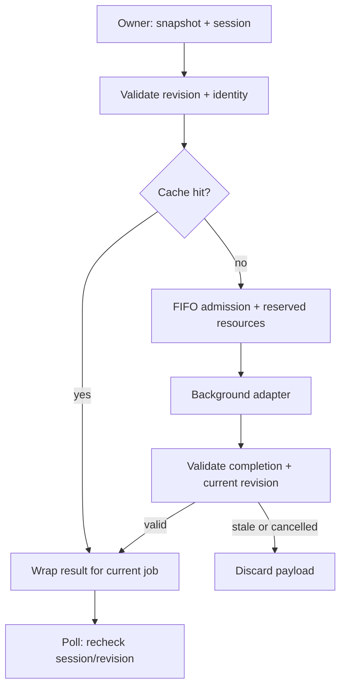

# CAD-T004 · revisioned worker/job coordinator v1

25/11/2026 · SOL · `lab-cad-0.4.0-workers` · isolated synthetic reference (D029). Parent T003 `c9fe513eb984653741519b93ff177796150a66cd`, CI [45149843737](https://github.com/ThanosZr/power-control-lab/actions/runs/45149843737), 4/4 jobs passed. Approved PCL 5.0.7 unchanged.

## Responsibility boundary

[worker.py](../experiments/cad_t004/worker.py) is a single-owner coordinator over a bounded standard-library thread pool. It consumes the T003 detached document snapshot and resolves a neutral plan. Workers receive immutable bytes and a cooperative cancellation token; they never mutate the document or coordinator. The example adapter returns synthetic feature metadata; it does not compute BRep, meshes, physical properties or GPU operations. Thread workers demonstrate admission, lifecycle and cooperative cancellation, **not** native OCCT thread-safety, process isolation or hard cancellation. A native worker process and transport must satisfy the same external contract in T005 or subsequent integration.



## Identity, cache and delivery

| Layer | Contract |
| --- | --- |
| Session | Fresh UUID per open, never reused on close/reopen; each independent editor has its own session. |
| Current document | `(document_id, revision, content_key)` in that session; advancing rejects another document, older revision or different content at the same revision. |
| Job | UUID, session, document, revision, content key, immutable plan bytes, estimated work bytes and cache key. |
| Cache | SHA-256 over exact T003 content key (excludes revision but includes document ID), contract version, adapter identity/version, kernel identity/version, normalized positive tolerance in mm, purpose and recursive resolved feature/dependency hashes. |
| Result | Job/session/document/revision/cache key, terminal status, optional bounded immutable bytes; `cached` distinguishes reuse. |

Cache equality is conservative, document-granular, not geometric equivalence or cross-language canonicalization. Feature keys establish ordered dependency identity but there is **no incremental feature cache** yet. Outputs are not tagged with an old revision: a cache hit creates a fresh completion for the caller's current job. Only current, successful, size-valid output is inserted; not failures, stale results or cancelled jobs. LRU eviction is bounded by both bytes and entry count. Cache does not include native handles or persisted state. A worker adapter is a trusted callable fixed at coordinator construction; its identity/version and tolerance must identify its behavior.

## Lifecycle and cancellation

| State/change | Semantics |
| --- | --- |
| Submit | Owner validates current snapshot and input limits; returns unique job ID. Admission can fail immediately with `Backpressure`. |
| Queued | Strict FIFO for noncached work; no reservation consumed until admitted. A later smaller job does not bypass a blocked earlier job. |
| Running | Reserve one CAD slot and estimated work bytes until future actually exits; worker checks cancellation token at defined checkpoints. |
| Cancel | Queued jobs finish without executing. Running cancellation signals the token, does not claim termination; even ignored token cannot cause payload delivery. |
| Edit/undo/close | Advance or close invalidates queued, running **and unread** old jobs; stale wins over a previous cancellation reason. Old worker reservation stays until exit. |
| Poll | Harvest completed jobs, recheck current identity before delivering, return terminal results once and remove them from coordinator. Caller also rechecks identity on eventual application if delivery is asynchronous. |
| Close | Signal workers and join the pool; no forced stop or bounded shutdown for a non-cooperative callable. |

Successful payloads previously delivered belong to the owner; it preserves the last valid geometry separately. The reference coordinator does not overwrite it on failed or stale work. Poll/tick is owner-driven; no callbacks mutate shared state. Same snapshot re-submission is allowed; simultaneous identical misses are not coalesced. No persistence or network service is introduced.

## Resource contract

Default *illustrative configuration*, not recommended hardware settings: total four CPU slots and 64 MiB logical RAM; reserve two slots and 32 MiB for live simulation; 2 MiB cache/128 entries, 16 outstanding jobs, eight sessions, 64 KiB input + 64 KiB result per outstanding slot. Thus two CAD slots and 28 MiB declared work budget remain. Queue plus running plus unread completions count against the same outstanding cap. A job too large for the available work budget is rejected; otherwise resource pressure queues it. Test proves FIFO, two-slot cap, RAM reservation arithmetic, cancellation retention and backpressure.

This is deterministic admission accounting, **not an OS RSS ceiling or deadline guarantee**: transient serialization, Python/allocator overhead, caller-held payloads, native allocation and actual CPU use are not measured/enforced. Live reservation is static and logical, not coordination with the running PCL solver. Native process/IPC, dynamic resource broker, cancellation escalation and measured concurrent simulation remain future work.

## Reproduce

```sh
python -m unittest experiments.cad_t003.test_document experiments.cad_t004.test_worker -v
python -m experiments.cad_t004.demo
python tools/codemap.py --check
python tools/api_surface.py --check
```

Python 3.12.14: 12 T003 and 11 T004 tests passed; demo outputs revision 0 radius 10 mm miss, revision 1 radius 16 mm miss, revision 2 radius 10 mm hit after undo, 2 CAD slots, 29,360,128 work bytes and 304 cached bytes. Test-controlled events distinguish real worker exit from cancellation signalling. Separate existing dock/live-program/recording tests (24) and API (947)/CODEMAP passed. Existing CI verifies the pinned PCL, not these isolated experiments. No wall-time speedup, independent process IPC, physical simulation, GPU timing or hard memory ceiling is claimed.

## Fable optimization review / next stage

| Priority | Review item | Evidence expected |
| --- | --- | --- |
| P0 | Native process execution / recovery | Spawn/fork portability, OCCT affinity, bounded IPC, explicit cancellation acknowledgement and terminate/restart policy for hung native jobs. |
| P0 | Shared solver/CAD arbitration | Dynamic CPU/RAM budgets, cgroups/job-object or measured RSS enforcement, deadlines, process overhead and live-control jitter under load. |
| P0 | Revision/model race audit | Reopen, rapid edits, concurrent delivery, queue saturation, cancellation/exception races; ownership and last-valid BRep rules. |
| P1 | Cache optimization | Immutable snapshot reuse, reduce repeated validation/hashing/serialization, per-feature keys and incremental regeneration, coalesce identical in-flight jobs, byte-weighted eviction including native resource lifetimes. |
| P1 | Scheduler and IPC throughput | FIFO head-of-line blocking vs fair bounded policies, p50/p95 queue/start/finish/cancel latency, process-transfer costs; compare after a real T005 build. |

Next separately authorized milestone: isolated T005 native cylinder adapter with exact BRep validity, analytic volume check and background execution, subject to explicit approval of isolated scope. No PCL runtime integration until the two private gates in CAD_STATUS are satisfied. No automatic T005, Fable delegation or base change.
